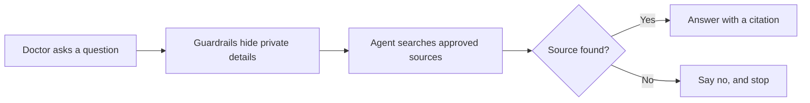

# Agentic AI Live Labs

Learn to build AI agents that stay safe. Each lab shows one idea in plain TypeScript.

The labs tell two stories. In the first, a doctor asks a drug question. The agent must cite a source or say no. In the second, AI teammates run a design studio. Each lab is a different bot with a different job.



You run it with Bun. You need no AI library and no API key.

All drugs, doctors and documents are invented.

## Start

```bash
bun install
bun test
```

Expect: `0 fail`

Then run your first lab. Use its concept name.

```bash
bun run lab agent-loop --demo
```

Expect: a list of cases. Each one has a "Why" and a command to repeat it.

## How a lab works

Every lab has two files.

- The lesson file holds the idea. It is a short story, then steps in code.
- The show file holds the examples and the screen output. You do not need to read it.

The steps in the code have numbers. The run prints the same numbers. You can match what you read with what you see.

For example, the crash and resume lab stops the program in the middle of a job. Step 1 in the code checks the ledger. The log prints "Step 1: dr-lee is in the ledger, so it is skipped."

## Three ways to run a lab

```bash
bun run lab agent-loop --demo
bun run lab agent-loop --question "Is Zorbex safe for children?"
bun run lab agent-loop
```

Expect: the first line runs every case. The second runs one question. The third shows a menu.

Every lab opens with the problem. Case 1 is the naive way, and it fails on purpose. Add `--naive` to run a whole lab that way.

## The short way

Use the concept name. Add `demo`, `naive` or `live` as plain words.

```bash
bun run lab
bun run lab agent-loop demo
bun run lab guardrails naive
bun run lab agent-loop live --question "Is Zorbex safe for children?"
```

Expect: the first line lists every lab by track. The others run one lab.

Every run starts with a "You are here" line. It names the lab, its track, and the labs before and after it.

## Use a real model

The labs run offline on a pretend model. To use a real one, add `--live` to any command.

```bash
bun run lab agent-loop --question "What is the dose of Cardioza for Dr. Lee?" --live
```

Expect: the same lab, with a real model behind it.

It uses OpenRouter and your own key in `OPENROUTER_API_KEY`. The key is never printed. The lab code does not change.

## When something looks wrong

| What you see | What it means | Fix |
| --- | --- | --- |
| The terminal says it cannot find bun | Bun is not installed | Install Bun, then open a new terminal |
| The run asks for a key | You added `--live` | Set `OPENROUTER_API_KEY`, or remove `--live` |
| A case says SURPRISE | The result is not the one the lab expected | Read its "Why". With `--live`, a real model can differ |
| `bun run check` fails on a long line | A lab breaks the plain style | Split the line. Keep each line under 101 letters |
| "No lab called ..." | The name does not match a lab | Run `bun run lab` to see every name |

Common wrong turn: you open the show file first. It only prints things. The lesson is in the lesson file.

## The labs

The labs are grouped into tracks. Pick a learning path in [paths/README.md](paths/README.md), or go in order.

Each lab has a guide in `docs/labs/`. The guide has the problem, the examples and the test.

<!-- AUTO_LAB_INDEX_START -->
### Foundations

*The four ideas every agent uses.*

| Lab | Run it | Guide |
| --- | --- | --- |
| The agent loop | `bun run lab agent-loop --demo` | [Read](docs/labs/01-agent-loop.md) |
| Guardrails and PHI redaction | `bun run lab guardrails --demo` | [Read](docs/labs/02-guardrails.md) |
| Human in the loop gates | `bun run lab gates --demo` | [Read](docs/labs/03-gates.md) |
| Workflow, one agent, multi-agent | `bun run lab shapes --demo` | [Read](docs/labs/04-shapes.md) |

### Tools and protocols

*How an agent reaches tools: functions, the shell and MCP.*

| Lab | Run it | Guide |
| --- | --- | --- |
| Tool schemas and structured output | `bun run lab tool-schemas --demo` | [Read](docs/labs/05-tool-schemas.md) |
| A shell tool, safely | `bun run lab shell-tool --demo` | [Read](docs/labs/06-shell-tool.md) |
| MCP basics | `bun run lab mcp-basics --demo` | [Read](docs/labs/07-mcp-basics.md) |
| Trusting an MCP server | `bun run lab mcp-trust --demo` | [Read](docs/labs/08-mcp-trust.md) |
| Function, CLI or MCP | `bun run lab three-doors --demo` | [Read](docs/labs/09-three-doors.md) |

### Context engineering

*What the model reads, and how to choose it.*

| Lab | Run it | Guide |
| --- | --- | --- |
| The context budget | `bun run lab context-budget --demo` | [Read](docs/labs/10-context-budget.md) |
| Trimming long history | `bun run lab history-trimming --demo` | [Read](docs/labs/11-history-trimming.md) |
| Retrieval | `bun run lab retrieval --demo` | [Read](docs/labs/12-retrieval.md) |
| Picking the right context | `bun run lab pick-context --demo` | [Read](docs/labs/13-pick-context.md) |
| Instructions versus data | `bun run lab instructions-vs-data --demo` | [Read](docs/labs/14-instructions-vs-data.md) |

### Loop engineering

*How a loop ends well, and how it recovers.*

| Lab | Run it | Guide |
| --- | --- | --- |
| Stop conditions | `bun run lab stop-conditions --demo` | [Read](docs/labs/15-stop-conditions.md) |
| Error feedback and retries | `bun run lab error-feedback --demo` | [Read](docs/labs/16-error-feedback.md) |
| Plan, then act | `bun run lab plan-then-act --demo` | [Read](docs/labs/17-plan-then-act.md) |
| Reflect and fix | `bun run lab reflect-and-fix --demo` | [Read](docs/labs/18-reflect-and-fix.md) |

### Agent runtime

*The machine that runs the loop: state, failures, cost.*

| Lab | Run it | Guide |
| --- | --- | --- |
| Run state | `bun run lab run-state --demo` | [Read](docs/labs/19-run-state.md) |
| When tools fail | `bun run lab tool-failures --demo` | [Read](docs/labs/20-tool-failures.md) |
| Crash and resume | `bun run lab crash-and-resume --demo` | [Read](docs/labs/21-crash-and-resume.md) |
| Budgets | `bun run lab budgets --demo` | [Read](docs/labs/22-budgets.md) |
| Model routing and caching | `bun run lab model-routing --demo` | [Read](docs/labs/23-model-routing.md) |

### Harness engineering

*The rules, checks and records around the model.*

| Lab | Run it | Guide |
| --- | --- | --- |
| Identity and scopes | `bun run lab identity-and-scopes --demo` | [Read](docs/labs/24-identity-and-scopes.md) |
| Acting for a user | `bun run lab act-for-user --demo` | [Read](docs/labs/25-act-for-user.md) |
| Hooks | `bun run lab hooks --demo` | [Read](docs/labs/26-hooks.md) |
| Traces and the audit ledger | `bun run lab traces-and-audit --demo` | [Read](docs/labs/27-traces-and-audit.md) |
| Evals and the release gate | `bun run lab evals-and-release --demo` | [Read](docs/labs/28-evals-and-release.md) |

### Teammate patterns

*How several agents work as one team.*

| Lab | Run it | Guide |
| --- | --- | --- |
| Routing | `bun run lab routing --demo` | [Read](docs/labs/29-routing.md) |
| Chains and delegation | `bun run lab chain-and-delegate --demo` | [Read](docs/labs/30-chain-and-delegate.md) |
| Parallel workers | `bun run lab parallel-workers --demo` | [Read](docs/labs/31-parallel-workers.md) |
| Subagents with their own context | `bun run lab subagent-isolation --demo` | [Read](docs/labs/32-subagent-isolation.md) |
| Handoffs between agents | `bun run lab handoffs --demo` | [Read](docs/labs/33-handoffs.md) |
| Memory the bots share | `bun run lab shared-memory --demo` | [Read](docs/labs/34-shared-memory.md) |
| Wakeups and the mission board | `bun run lab wakeups-and-board --demo` | [Read](docs/labs/35-wakeups-and-board.md) |

### HCP case study

*The ideas used together on one real job.*

| Lab | Run it | Guide |
| --- | --- | --- |
| One profile per doctor | `bun run lab hcp-360 --demo` | [Read](docs/labs/36-hcp-360.md) |
| The PHI vault | `bun run lab phi-vault --demo` | [Read](docs/labs/37-phi-vault.md) |
| The claim checker | `bun run lab fact-checker --demo` | [Read](docs/labs/38-fact-checker.md) |
| Country rules and revocation | `bun run lab revocation --demo` | [Read](docs/labs/39-revocation.md) |
| Put it all together | `bun run lab end-to-end --demo` | [Read](docs/labs/40-end-to-end.md) |
<!-- AUTO_LAB_INDEX_END -->

## Add a lab

1. Copy `scripts/lab-template.ts` into `labs/`. Name it with the next number and your concept name.
2. Add one line for it to `LABS` in `src/roadmap.ts`.
3. Write the lesson as plain steps. Write the examples in `show/`.
4. Add its picture to `src/pictures.ts`.
5. Write one test in `tests/promises/` that proves the promise.
6. Run `bun run sync`, then `bun run check`.

For example, if you remove the audit line in the audit lab, its test must fail. If it does not, the check names the rule that was missed.

## Four rules for this repo

1. **Plain English.** Keep sentences short. Use everyday words.
2. **Names, not numbers.** Docs and screens use concept names, such as `agent-loop`. The number only sets the file order.
3. **No counts.** Never write how many labs there are. The lab index is generated.
4. **One picture per lab.** Every lab page starts with a picture of its story.

## What this does not do

- Hiding private data uses patterns and a language library. A rare format or an odd name can still slip through.
- The auditor compares each cited sentence word for word. A real system may use a second model.
- The pretend model follows rules. It is a stand-in, so use `--live` to see a real model.
