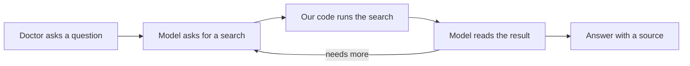

# The agent loop

The model asks for a tool. Our code runs it. The model reads the result. This repeats until the model answers. The only source of facts is the approved document search. The country decides which documents the doctor may see.

## The story in one picture



## Run it

Copy any line into your terminal. Each one is a real example from this lab.

```bash
bun run lab agent-loop --question "What is the dose of Cardioza?"
bun run lab agent-loop --question "What is the dose of Cardioza?" --country DE
bun run lab agent-loop --question "Can you tell me the CARDIOZA dose please?"
bun run lab agent-loop --question "What is the dose of Cardioza and Neurovex?"
bun run lab agent-loop --question "Is Zorbex safe for children?"
bun run lab agent-loop --question "What is the dose of Dermalin?" --country DE
bun run lab agent-loop --question "What is the dose of Cardiozza?"
bun run lab agent-loop --question "Hi there, how are you doing today?"
bun run lab agent-loop --question "What is the dose of Cardioza?" --steps 1
bun run lab agent-loop --demo
```

Run `bun run lab agent-loop` with nothing else to pick an example from a menu.

## The cases

| # | Case | Why it matters | Result | Run it alone |
| --- | --- | --- | --- | --- |
| 1 | A normal question | The happy path. One search, then an answer that cites its source. | answered | `bun run lab agent-loop --question "What is the dose of Cardioza?"` |
| 2 | Same question, different country | Approved text differs by country. Germany gets 5mg and the US gets 10mg. The tool filters by country, so the model cannot override it. | answered | `bun run lab agent-loop --question "What is the dose of Cardioza?" --country DE` |
| 3 | Capital letters | Search ignores case, so shouting the drug name still works. | answered | `bun run lab agent-loop --question "Can you tell me the CARDIOZA dose please?"` |
| 4 | Two drugs in one question | One search can return two documents. The answer must cite both. | answered | `bun run lab agent-loop --question "What is the dose of Cardioza and Neurovex?"` |
| 5 | A drug we have no document for | The search finds nothing, so the model must refuse. It must not guess from memory. | no-source | `bun run lab agent-loop --question "Is Zorbex safe for children?"` |
| 6 | Approved in another country only | Dermalin is approved in the US only. A German doctor gets no answer. That is the right behaviour. | no-source | `bun run lab agent-loop --question "What is the dose of Dermalin?" --country DE` |
| 7 | A spelling mistake | Search needs the exact drug name. A typo finds nothing. A real system would match close spellings or ask the doctor to confirm. | no-source | `bun run lab agent-loop --question "What is the dose of Cardiozza?"` |
| 8 | Not a drug question at all | Small talk has no approved source. The loop still ends safely. | no-source | `bun run lab agent-loop --question "Hi there, how are you doing today?"` |
| 9 | The loop hits its step limit | We allow only 1 step. The model gets one tool call and no turn left to answer. A step limit stops a model that never finishes. | stopped | `bun run lab agent-loop --question "What is the dose of Cardioza?" --steps 1` |

## Read the code

Open `labs/01-agent-loop.ts`. Read the code from the top. It holds only the lesson.
The screen output is in `show/`. You do not need it to learn.
