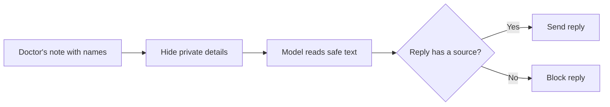

# Guardrails and private details

Each example is a note from a doctor. The input guardrail hides the private details before the model reads the note. The output guardrail blocks any reply with no approved source. For example, a social security number becomes a token such as [SSN].

## The story in one picture



## The problem

A note can hold PHI, such as a patient name or a record number. Once the model reads it, we cannot take it back. The model can also write a fact with no source.

## New words

Each word has one meaning in every lab.

- **PHI**: Protected health information. Facts that can point to a patient, such as a name or record number.
- **token**: A short label, such as [SSN] or [SSN-1], that stands in for a private value.
- **guardrail**: A check in plain code, before or after the model, that can stop or change text.

## Run it

Copy any line into your terminal. Each one is a real example from this lab.

```bash
bun run lab guardrails --demo
bun run lab guardrails --demo
bun run lab guardrails --demo
bun run lab guardrails --question "What is the dose of Cardioza?"
bun run lab guardrails --demo
bun run lab guardrails --question "Jane Doe takes Cardioza, what is the dose?"
bun run lab guardrails --question "What is the dose of Cardioza?" --model nocite
bun run lab guardrails --question "What is the dose of Zorbex?"
bun run lab guardrails --question "What is the dose of Cardioza?" --model invent
bun run lab guardrails --demo
```

Run `bun run lab guardrails` with nothing else to pick an example from a menu.

## The cases

Case 1 is the naive way. Read what goes wrong, then read the rest.

| # | Case | Why it matters | Result | Run it alone |
| --- | --- | --- | --- | --- |
| 1 | NAIVE: no guardrails | The model reads the patient's name and social security number. Its reply goes out with no check. Once a model has read private details, you cannot take them back. | leaked 3 | `bun run lab guardrails --demo` |
| 2 | Name, social security number and phone | The classic case. All three are hidden, and the model only ever sees the tokens. | 3 masked, passed | `bun run lab guardrails --demo` |
| 3 | Email, record number and birth date | Other formats the input guardrail knows about. | 3 masked, passed | `bun run lab guardrails --demo` |
| 4 | Nothing private | A clean question passes through unchanged. No false alarms. | 0 masked, passed | `bun run lab guardrails --question "What is the dose of Cardioza?"` |
| 5 | An SSN with no dashes | The SSN has no dashes, and a second rule still finds it after the word SSN. | 1 masked, passed | `bun run lab guardrails --demo` |
| 6 | A name with no label | No 'Patient:' comes before the name. The language library still finds it and hides it. | 1 masked, passed | `bun run lab guardrails --question "Jane Doe takes Cardioza, what is the dose?"` |
| 7 | Reply with no citation | This model gives the right fact but forgets the source tag. The output guardrail blocks it anyway. An uncited claim never goes out. | 0 masked, blocked | `bun run lab guardrails --question "What is the dose of Cardioza?" --model nocite` |
| 8 | No approved source, so no citation | The model refuses, and a refusal has no citation either. The guardrail blocks it. In the gates lab that sends it to a person. | 0 masked, blocked | `bun run lab guardrails --question "What is the dose of Zorbex?"` |
| 9 | EDGE: wrong dose, valid citation | The model says 20mg and cites the real document. A citation check cannot see that the claim is wrong. Only a check of the claim itself can. That is the shapes lab. | 0 masked, passed | `bun run lab guardrails --question "What is the dose of Cardioza?" --model invent` |

## The promise, and its test

The model only ever reads the hidden version of a note. A reply with no approved source is blocked.

```bash
bun test tests/promises/02.test.ts
```

To see the test do its job, break the rule in PART 1 on purpose. The test must fail. Then undo it.

## In production

Rules catch only the formats we wrote. A name finder can miss a rare name, so a person should review what slips through. Never log the raw note.

## Read the code

Open `labs/02-guardrails.ts`. Read the code from the top. It holds only the lesson.
The screen output is in `show/`. You do not need it to learn.
