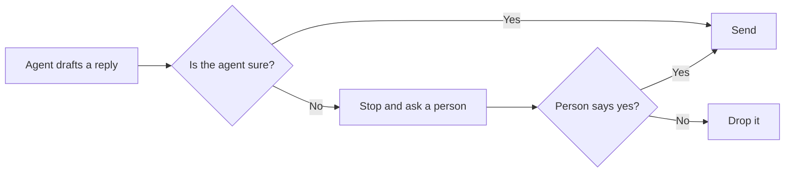

# Human in the loop gates

A gate stops the run and hands the full story to a person. Gate 1 fires before the model runs, when no approved document exists. Gate 2 fires after the model, when the reply fails the output check. Add --approve y or --approve n to answer the gate. With no answer, the gate says no.

## The story in one picture



## The problem

A model always writes something. A human in the loop is the safety net. With no gate, a reply with no source goes straight to a doctor.

## New words

Each word has one meaning in every lab.

- **gate**: A stop in the run where a person must say yes before it goes on.
- **human in the loop**: A design where a person checks the risky steps before they happen.
- **escalate**: Send the case to a person, because the system is not sure.

## Run it

Copy any line into your terminal. Each one is a real example from this lab.

```bash
bun run lab gates --demo
bun run lab gates --question "What is the dose of Cardioza?"
bun run lab gates --question "What is the dose of Zorbex?" --approve y
bun run lab gates --question "What is the dose of Zorbex?" --approve n
bun run lab gates --question "What is the dose of Cardioza?" --model nocite --approve y
bun run lab gates --question "What is the dose of Cardioza?" --model nocite --approve n
bun run lab gates --demo
bun run lab gates --question "What is the dose of Dermalin?" --country DE --approve n
bun run lab gates --question "Hello there, can you help me today?" --approve n
bun run lab gates --demo
```

Run `bun run lab gates` with nothing else to pick an example from a menu.

## The cases

Case 1 is the naive way. Read what goes wrong, then read the rest.

| # | Case | Why it matters | Result | Run it alone |
| --- | --- | --- | --- | --- |
| 1 | NAIVE: no gate | The model forgets the citation. With no gate, the uncited reply goes straight to the doctor. | SENT_UNCHECKED | `bun run lab gates --demo` |
| 2 | No gate needed | Approved document found, reply cited. Nothing to stop, so it is sent. | SENT | `bun run lab gates --question "What is the dose of Cardioza?"` |
| 3 | Gate 1, reviewer approves | No approved document, so the model is never called. A person sees the fallback message and approves it. | SENT_AFTER_HUMAN_APPROVAL | `bun run lab gates --question "What is the dose of Zorbex?" --approve y` |
| 4 | Gate 1, reviewer rejects | Same stop, but the person says no. Nothing is sent. | BLOCKED_BY_REVIEWER | `bun run lab gates --question "What is the dose of Zorbex?" --approve n` |
| 5 | Gate 2, reviewer approves | The model forgot the citation. The output check stops it and a person reads the draft before it can go. | SENT_AFTER_HUMAN_APPROVAL | `bun run lab gates --question "What is the dose of Cardioza?" --model nocite --approve y` |
| 6 | Gate 2, reviewer rejects | Same stop, and the person rejects it. | BLOCKED_BY_REVIEWER | `bun run lab gates --question "What is the dose of Cardioza?" --model nocite --approve n` |
| 7 | Patient details in the question | The note is masked before the search. The reply and the reviewer never see the SSN or the name. | SENT | `bun run lab gates --demo` |
| 8 | Approved in another country only | Dermalin is approved in the US only. A German doctor hits gate 1. | BLOCKED_BY_REVIEWER | `bun run lab gates --question "What is the dose of Dermalin?" --country DE --approve n` |
| 9 | Small talk | No drug, no document. The safe default is to stop and ask a person. | BLOCKED_BY_REVIEWER | `bun run lab gates --question "Hello there, can you help me today?" --approve n` |

## Stuck points

**Correct run:** Stop the run at the gate. A person says yes or no, and the demo prints the outcome.

**Common wrong turn:** Treating a missing answer as yes. With no answer the gate says no, so the reply is blocked.

**Hint to give:** What should happen if nobody answers? Which way should the default go?

| What you see | What it means | Fix |
| --- | --- | --- |
| The demo prints outcome: SENT_UNCHECKED on the NAIVE case | No gate ran, so the uncited reply was sent | Add a gate before every send that may be wrong |
| The gate prints a box with Reason and Draft | The person sees what the model wrote | Read the reason first, then approve or reject |
| A reply is sent with --approve y and no one read it | The answer was typed in advance, not read | Use a real person's answer for the gate |

## The promise, and its test

We escalate to a person when there is no approved document or no source. Nothing goes out until a person says yes. No answer means no.

```bash
bun test tests/promises/03.test.ts
```

To see the test do its job, break the rule in PART 1 on purpose. The test must fail. Then undo it.

## In production

A real gate saves the run, tells the reviewer by chat card or queue, and then stops. The decision is an event. It wakes the run from its save. Check again at send time, and expire a draft after a day. Log who approved what, and keep the default as no.

## Read the code

Open `labs/03-gates.ts`. Read the code from the top. It holds only the lesson.
The screen output is in `show/`. You do not need it to learn.
