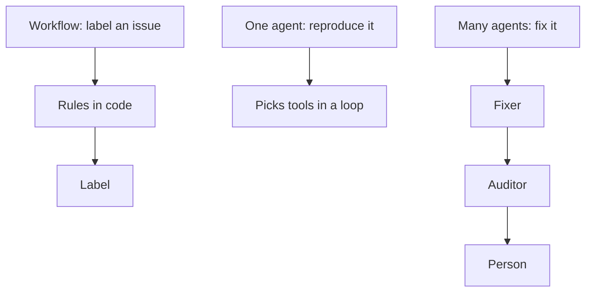

# Three ways to build one job

Plain code labels a new issue. One agent reproduces it. Many agents fix and check it. Pick the shape with --shape workflow, agent or multi, and the issue with --issue issue-101, issue-102 or issue-103. For an agent, pick the job with --task label or reproduce.

## The story in one picture



## The problem

An agent used for plain labels costs far more than code. It can give a label that is not on the list. Use an agent only where the path must change.

## New words

Each word has one meaning in every lab.

- **workflow**: A fixed set of steps written in code. The model writes text but does not pick the steps.
- **agent**: A model that picks its own next step and tool, inside a loop.
- **many agents**: Several models, each with one job, that pass work between them.
- **auditor**: A model that checks the work of another model.

## Run it

Copy any line into your terminal. Each one is a real example from this lab.

```bash
bun run lab shapes --question "A new issue came in. Please label it." --shape agent --task label --issue issue-102 --naive
bun run lab shapes --demo
bun run lab shapes --demo
bun run lab shapes --question "Label issue 999 for me." --shape workflow --issue issue-999
bun run lab shapes --question "Triage the blurry logo report." --shape agent --task label --issue issue-101 --model wanders
bun run lab shapes --question "Can you reproduce the checkout error?" --shape agent --task reproduce --issue issue-103
bun run lab shapes --question "Can you reproduce the blurry logo?" --shape agent --task reproduce --issue issue-101
bun run lab shapes --question "Please fix the checkout error." --shape multi --issue issue-103
bun run lab shapes --question "Fix the checkout error for me." --shape multi --issue issue-103 --model invent --approve n
bun run lab shapes --question "Please fix the coupon problem." --shape multi --issue issue-103 --model invent --approve y
bun run lab shapes --question "Please fix the blurry logo." --shape multi --issue issue-101 --approve n
bun run lab shapes --demo
```

Run `bun run lab shapes` with nothing else to pick an example from a menu.

## The cases

Case 1 is the naive way. Read what goes wrong, then read the rest.

| # | Case | Why it matters | Result | Run it alone |
| --- | --- | --- | --- | --- |
| 1 | NAIVE: an agent for a plain label | The agent reads the issue, the label list and a CI log it did not need. It pays for every round, to do what three lines of code do. | agent-labelled | `bun run lab shapes --question "A new issue came in. Please label it." --shape agent --task label --issue issue-102 --naive` |
| 2 | Workflow: label a bug | The rules find the word fails in the issue. The label is bug, every time, with no model call. | labelled | `bun run lab shapes --demo` |
| 3 | Workflow: label a request | No bug word in the text, so the label is feature. The same input always gives the same label. | labelled | `bun run lab shapes --demo` |
| 4 | Workflow: an issue we do not have | Plain code handles missing data the same way each time. No issue means no label. | unknown | `bun run lab shapes --question "Label issue 999 for me." --shape workflow --issue issue-999` |
| 5 | One agent: a label off the list | This model wanders and invents a label. Our board has only bug and feature, so the label is wrong. Code cannot do this. | off-list | `bun run lab shapes --question "Triage the blurry logo report." --shape agent --task label --issue issue-101 --model wanders` |
| 6 | One agent: reproduce a bug | The path changes. The agent reads the issue, then the CI log, then reports the failing test. | reproduced | `bun run lab shapes --question "Can you reproduce the checkout error?" --shape agent --task reproduce --issue issue-103` |
| 7 | One agent: a bug that will not reproduce | The CI log for the logo issue is green. The agent says so, and does not make up a failure. | not-reproduced | `bun run lab shapes --question "Can you reproduce the blurry logo?" --shape agent --task reproduce --issue issue-101` |
| 8 | Many agents: a fix the auditor passes | The fix names tests/coupon.test.ts. The auditor finds that test failing in the CI log, so the fix goes on. | passed | `bun run lab shapes --question "Please fix the checkout error." --shape multi --issue issue-103` |
| 9 | Many agents: the auditor catches a wrong test | The fixer names a test that never failed. A single agent would ship it. The auditor checks the log, and a person says no. | rejected | `bun run lab shapes --question "Fix the checkout error for me." --shape multi --issue issue-103 --model invent --approve n` |
| 10 | Many agents: a person overrides | Same wrong fix, but the person says yes. The gate is only as good as the person behind it. | approved by person | `bun run lab shapes --question "Please fix the coupon problem." --shape multi --issue issue-103 --model invent --approve y` |
| 11 | Many agents: nothing to fix | The CI log is green, so there is no failing test to aim at. The auditor fails the empty fix and a person decides. | rejected | `bun run lab shapes --question "Please fix the blurry logo." --shape multi --issue issue-101 --approve n` |

## Stuck points

**Correct run:** Label with a workflow, reproduce with one agent, and check a fix with an auditor. Pick the simplest shape that works.

**Common wrong turn:** Using an agent to label issues. It reads tools it does not need, and it may pick a label off the board.

**Hint to give:** Do the label rules ever change? If not, what does an agent add?

| What you see | What it means | Fix |
| --- | --- | --- |
| The demo prints outcome: agent-labelled on the NAIVE case | An agent did a job that code does for free | Use the workflow for the label |
| The label is off the list | The model made up a label | Let code pick labels, or check the label against the list |
| A fix is rejected, and the log shows FAIL | The fix named a test that did not fail | This is correct. Fix the note, not the auditor |

## The promise, and its test

Labels come from code and never vary. An agent pays for every round. An auditor stops a fix that names the wrong test, and a person decides on any doubt.

```bash
bun test tests/promises/04.test.ts
```

To see the test do its job, break the rule in PART 1 on purpose. The test must fail. Then undo it.

## In production

Label with a workflow, because the rules never change. Use one agent where the path changes, such as reproducing a bug. Add an auditor and a person where a bad fix would reach the main branch.

## Read the code

Open `labs/04-shapes.ts`. Read the code from the top. It holds only the lesson.
The screen output is in `show/`. You do not need it to learn.
