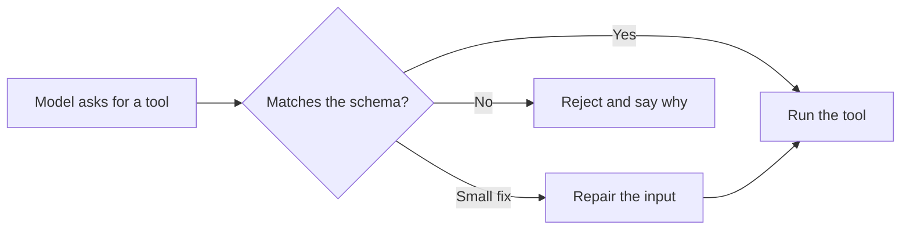

# Tool schemas and structured output

Each example sends a receipt to the expense bot. A schema checks each tool call first. Good calls run, fixable calls are repaired and bad calls are rejected. To test a bad call, pass the text with --call. The country always comes from the sign-in, which is the US here.

## The story in one picture



## The problem

A model writes tool calls as JSON text. Words for numbers can reach the books and break them. So can a euro sign or a date like 03/04. No error shows.

## New words

Each word has one meaning in every lab.

- **schema**: The rules for a valid input: its fields, their types and which ones are required.
- **JSON**: A text format for data made of named fields and their values.
- **reject**: Refuse a tool call, so the tool never runs.

## Run it

Copy any line into your terminal. Each one is a real example from this lab.

```bash
bun run lab tool-schemas --question "Font licence, twelve fifty, paid 03/04" --naive
bun run lab tool-schemas --question "Cloud hosting 31.00 USD, 2026-04-30"
bun run lab tool-schemas --question "Client lunch with Acme, €48.90 on 2026-04-09"
bun run lab tool-schemas --question "Font licence, twelve fifty, paid 03/04"
bun run lab tool-schemas --question "Book the font licence for me." --call '{"amount": 12.5, "currency": "USD", "date": "2026-04-03", "category": "software", "country": "US"}'
bun run lab tool-schemas --question "Please book the font receipt from 03/04." --call '{"amount":12.5,"currency":"USD","date":"03/04","category":"software","country":"US"}'
bun run lab tool-schemas --question "Add the gift basket for Acme." --call '{"amount":12.5,"currency":"USD","date":"2026-04-03","category":"gift basket","country":"US"}'
bun run lab tool-schemas --question "I am in Germany today. Book this font licence." --call '{"amount":12.5,"currency":"USD","date":"2026-04-03","category":"software","country":"DE"}'
bun run lab tool-schemas --question "Book twelve dollars fifty for fonts." --call '{"amount": 12.5, "currency": "USD", "category": "software"}'
bun run lab tool-schemas --question "Please book the hosting bill." --call '{"amount":100000,"currency":"USD","date":"2026-04-03","category":"software","country":"US"}'
bun run lab tool-schemas --question "Please book the team lunch receipt." --call 'Please book the lunch with Acme'
bun run lab tool-schemas --demo
```

Run `bun run lab tool-schemas` with nothing else to pick an example from a menu.

## The cases

Case 1 is the naive way. Read what goes wrong, then read the rest.

| # | Case | Why it matters | Result | Run it alone |
| --- | --- | --- | --- | --- |
| 1 | NAIVE: trust the text | The model copies the receipt as written: the words twelve fifty, a dollar sign and 03/04. With no check, the books take all three. A date like 03/04 could be two different days. | bad-books | `bun run lab tool-schemas --question "Font licence, twelve fifty, paid 03/04" --naive` |
| 2 | A receipt that is almost right | The model writes the amount as the text 31.00. We turn it into a number and note it. The books are right. | repaired | `bun run lab tool-schemas --question "Cloud hosting 31.00 USD, 2026-04-30"` |
| 3 | A euro sign and a studio word | The model writes the euro sign and the words client lunch. The euro sign has one safe meaning. The word list says client lunch means meals. Both fixes are noted. | repaired | `bun run lab tool-schemas --question "Client lunch with Acme, €48.90 on 2026-04-09"` |
| 4 | Twelve fifty is not a number | We do not guess what words mean. The amount is rejected, and the books stay as they were. | rejected | `bun run lab tool-schemas --question "Font licence, twelve fifty, paid 03/04"` |
| 5 | A good call | Every field is right. The books take it, and it matches a bank line. | ok | `bun run lab tool-schemas --question "Book the font licence for me." --call '{"amount": 12.5, "currency": "USD", "date": "2026-04-03", "category": "software", "country": "US"}'` |
| 6 | A date that could mean two days | The first number could be the day or the month. A guess could book the cost in the wrong month. We reject it and ask for a full date. | rejected | `bun run lab tool-schemas --question "Please book the font receipt from 03/04." --call '{"amount":12.5,"currency":"USD","date":"03/04","category":"software","country":"US"}'` |
| 7 | A studio word nobody explained | Gift basket is not in the books and not in the word list. We reject it. Once someone adds the word, it works. | rejected | `bun run lab tool-schemas --question "Add the gift basket for Acme." --call '{"amount":12.5,"currency":"USD","date":"2026-04-03","category":"gift basket","country":"US"}'` |
| 8 | The country comes from the sign-in | The chat says Germany, but Maya signed in from the US. The schema ignores the chat and uses the sign-in. A note says so. | repaired | `bun run lab tool-schemas --question "I am in Germany today. Book this font licence." --call '{"amount":12.5,"currency":"USD","date":"2026-04-03","category":"software","country":"DE"}'` |
| 9 | A missing field | No date, so the cost has no month. We reject. We do not guess. | rejected | `bun run lab tool-schemas --question "Book twelve dollars fifty for fonts." --call '{"amount": 12.5, "currency": "USD", "category": "software"}'` |
| 10 | An amount that is too big | A hundred thousand dollars is above the top of the range. A slipped decimal point should not reach the books. | rejected | `bun run lab tool-schemas --question "Please book the hosting bill." --call '{"amount":100000,"currency":"USD","date":"2026-04-03","category":"software","country":"US"}'` |
| 11 | Not JSON at all | The model wrote a sentence. There is no call to run. | rejected | `bun run lab tool-schemas --question "Please book the team lunch receipt." --call 'Please book the lunch with Acme'` |

## Stuck points

**Correct run:** The schema checks each receipt call first, and a bad call is rejected. A fixable call is repaired and noted.

**Common wrong turn:** Trusting the model's text. The words twelve fifty or a date like 03/04 reach the books, and nobody is told why.

**Hint to give:** Which field does the schema expect, and what did the model write instead?

| What you see | What it means | Fix |
| --- | --- | --- |
| The demo prints outcome: bad-books on the NAIVE case | The books took a wrong amount or date | Check every call against the schema before the tool runs |
| A note says a field was changed | The fix was made and noted | Read the note. It shows what the schema changed |
| The country in the books is not the one in the chat | The country comes from the sign-in | This is correct. Never take who or where from the chat |

## The promise, and its test

A call that fails the schema never reaches the books. The country comes from the sign-in, never from the chat.

```bash
bun test tests/promises/05.test.ts
```

To see the test do its job, break the rule in PART 1 on purpose. The test must fail. Then undo it.

## In production

Every tool gets a schema, and the sign-in fills in who and where. Real systems use a schema library and the model API's own tool format.

## Read the code

Open `labs/05-tool-schemas.ts`. Read the code from the top. It holds only the lesson.
The screen output is in `show/`. You do not need it to learn.
