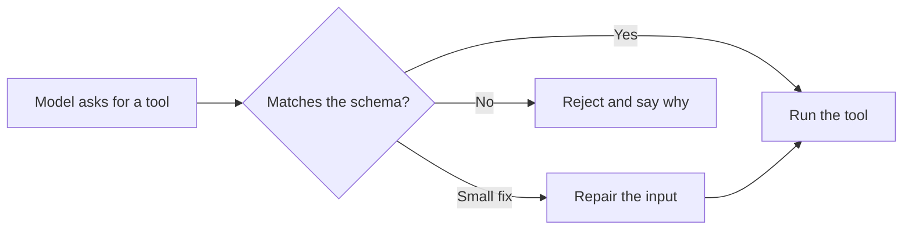

# Tool schemas and structured output

Each example asks the same plain question. The model writes a tool call, and a schema checks it first. A good call runs, and a fixable call is repaired and noted. A bad call is rejected, and the tool never runs. To test a bad call, pass the text with --call.

## The story in one picture



## The problem

A model writes tool calls as JSON text. A small mistake, such as a lower case country, can fail with no error at all.

## New words

Each word has one meaning in every lab.

- **schema**: The rules for a valid input: its fields, their types and which ones are required.
- **JSON**: A text format for data made of named fields and their values.
- **reject**: Refuse a tool call, so the tool never runs.

## Run it

Copy any line into your terminal. Each one is a real example from this lab.

```bash
bun run lab tool-schemas --question "What is the Cardioza dose in the US?" --call '{"drug": "Cardioza", "country": "us"}' --naive
bun run lab tool-schemas --question "What is the Cardioza dose in the US?"
bun run lab tool-schemas --question "What is the Cardioza dose in the US?" --call '{"drug": "Cardioza", "country": "US", "limit": 2}'
bun run lab tool-schemas --question "What is the Cardioza dose in the US?" --call '{"drug": "Cardioza", "country": "us"}'
bun run lab tool-schemas --question "What is the Cardioza dose in the US?" --call '{"drug": "Cardioza", "country": "DE", "limit": "3"}'
bun run lab tool-schemas --question "What is the Cardioza dose in the US?" --call '{"drug": "Cardioza", "country": "US", "delete_all": true}'
bun run lab tool-schemas --question "What is the Cardioza dose in the US?" --call '{"country": "US"}'
bun run lab tool-schemas --question "What is the Cardioza dose in the US?" --call '{"drug": "Cardioza", "country": "FR"}'
bun run lab tool-schemas --question "What is the Cardioza dose in the US?" --call '{"drug": "Cardioza", "country": "US", "limit": 99}'
bun run lab tool-schemas --question "What is the Cardioza dose in the US?" --call 'Please search for Cardioza in the US'
bun run lab tool-schemas --demo
```

Run `bun run lab tool-schemas` with nothing else to pick an example from a menu.

## The cases

Case 1 is the naive way. Read what goes wrong, then read the rest.

| # | Case | Why it matters | Result | Run it alone |
| --- | --- | --- | --- | --- |
| 1 | NAIVE: trust the text | The country is written in lower case. With no check, the search finds nothing and nobody is told why. It looks like there is no approved document. | silent-miss | `bun run lab tool-schemas --question "What is the Cardioza dose in the US?" --call '{"drug": "Cardioza", "country": "us"}' --naive` |
| 2 | The model writes the call | The model reads a plain question and writes the tool call itself. Then the schema checks it. | repaired | `bun run lab tool-schemas --question "What is the Cardioza dose in the US?"` |
| 3 | A good call | Every field is right. The tool runs. | ok | `bun run lab tool-schemas --question "What is the Cardioza dose in the US?" --call '{"drug": "Cardioza", "country": "US", "limit": 2}'` |
| 4 | Easy fix: lower case country | The fix is safe, so we make it and write a note. The same call now finds the document. | repaired | `bun run lab tool-schemas --question "What is the Cardioza dose in the US?" --call '{"drug": "Cardioza", "country": "us"}'` |
| 5 | Easy fix: a number written as text | The limit is the text 3. We turn it into the number 3 and note it. | repaired | `bun run lab tool-schemas --question "What is the Cardioza dose in the US?" --call '{"drug": "Cardioza", "country": "DE", "limit": "3"}'` |
| 6 | Extra field the schema does not know | A field called delete_all is dropped and noted. The tool never sees it. | repaired | `bun run lab tool-schemas --question "What is the Cardioza dose in the US?" --call '{"drug": "Cardioza", "country": "US", "delete_all": true}'` |
| 7 | Missing field | No drug, so there is nothing to search. We reject. We do not guess. | rejected | `bun run lab tool-schemas --question "What is the Cardioza dose in the US?" --call '{"country": "US"}'` |
| 8 | A country we do not serve | FR is not in the allowed list. A wrong country could show the wrong label, so we reject. | rejected | `bun run lab tool-schemas --question "What is the Cardioza dose in the US?" --call '{"drug": "Cardioza", "country": "FR"}'` |
| 9 | Number out of range | A limit of 99 is above the top of the range, which is 5. | rejected | `bun run lab tool-schemas --question "What is the Cardioza dose in the US?" --call '{"drug": "Cardioza", "country": "US", "limit": 99}'` |
| 10 | Not JSON at all | The model wrote a sentence. There is no call to run. | rejected | `bun run lab tool-schemas --question "What is the Cardioza dose in the US?" --call 'Please search for Cardioza in the US'` |

## The promise, and its test

A call that fails the schema never reaches the tool.

```bash
bun test tests/promises/05.test.ts
```

To see the test do its job, break the rule in PART 1 on purpose. The test must fail. Then undo it.

## In production

Every tool gets a schema. Real systems use a schema library and the model API's own tool format.

## Read the code

Open `labs/05-tool-schemas.ts`. Read the code from the top. It holds only the lesson.
The screen output is in `show/`. You do not need it to learn.
