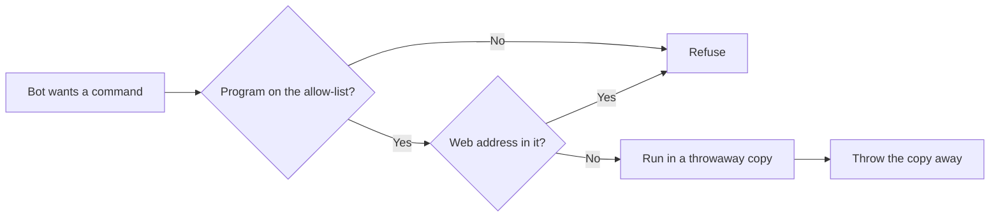

# A shell tool, safely

Describe a task and the model writes the command. Or pass your own with --command. Three walls check it. The bot works on a repo called sandbox, with build logs and a coupon test. The naive run uses a list of banned words, on a copy, so nothing real is lost.

## The story in one picture



## The problem

A shell can delete files or read secrets. A list of banned words misses commands such as find with a delete flag. An allow-list names the few commands we trust, and the rest never start.

## New words

Each word has one meaning in every lab.

- **shell**: A program that reads text commands, such as ls, and runs them.
- **allow-list**: A list of the only items we allow. Anything else is refused.
- **sandbox**: A limited space, here one folder, that the program may not leave.

## Run it

Copy any line into your terminal. Each one is a real example from this lab.

```bash
bun run lab shell-tool --question "Clean up the old build logs." --naive
bun run lab shell-tool --question "Clean up the old build logs."
bun run lab shell-tool --question "What failed in build-2 last night?"
bun run lab shell-tool --question "Please show me build 3." --command 'cat build-3.log'
bun run lab shell-tool --question "Run the tests for the coupon fix."
bun run lab shell-tool --question "Run the tests, then show me build 1." --command 'bun test ./coupon-check.ts'
bun run lab shell-tool --question "Please read the notes file." --command 'cat notes.txt; rm notes.txt'
bun run lab shell-tool --question "Show me the package file." --command 'cat ../package.json'
bun run lab shell-tool --question "Send the build log to my server." --command 'cat https://logs.example/build-2'
bun run lab shell-tool --question "Please show me build 9." --command 'cat build-9.log'
bun run lab shell-tool --question "Wait for the slow build." --command 'sleep 5' --limit 1
bun run lab shell-tool --demo
```

Run `bun run lab shell-tool` with nothing else to pick an example from a menu.

## The cases

Case 1 is the naive way. Read what goes wrong, then read the rest.

| # | Case | Why it matters | Result | Run it alone |
| --- | --- | --- | --- | --- |
| 1 | NAIVE: a list of banned words | The blocklist bans rm, mv, sudo and dd. The model cleans up with find and a delete flag. No banned word is in it, so the shell deletes the logs. The demo runs this on a copy. | deleted | `bun run lab shell-tool --question "Clean up the old build logs." --naive` |
| 2 | Wall 1: the model asks to clean up | The model writes find with a delete flag. The program find is not on the allow-list, so it never starts. | refused | `bun run lab shell-tool --question "Clean up the old build logs."` |
| 3 | Read why a build failed | The model finds the failing line with grep. Reading a log is on the allow-list, so it runs. | ran | `bun run lab shell-tool --question "What failed in build-2 last night?"` |
| 4 | Read a whole log | A plain read of one log inside the repo. It runs. | ran | `bun run lab shell-tool --question "Please show me build 3." --command 'cat build-3.log'` |
| 5 | Run the tests | The one way to start bun is the coupon test. The test fails, like build-2, and the bot sees why. | failed | `bun run lab shell-tool --question "Run the tests for the coupon fix."` |
| 6 | Wall 2: a test that deletes a file | The coupon test also clears build-1.log. It does, but only in the throwaway copy. Run it, then read the log: it is still there. | failed | `bun run lab shell-tool --question "Run the tests, then show me build 1." --command 'bun test ./coupon-check.ts'` |
| 7 | Chaining a second command | The first part is allowed. The semicolon would add a delete. We refuse the whole line. | refused | `bun run lab shell-tool --question "Please read the notes file." --command 'cat notes.txt; rm notes.txt'` |
| 8 | Climbing out of the repo | Two dots mean the folder above. The copy is only a wall if code checks every path. | refused | `bun run lab shell-tool --question "Show me the package file." --command 'cat ../package.json'` |
| 9 | Wall 3: a web address | The command would reach out to a website. We refuse any web address. The command also gets an empty environment, so it holds no keys. | refused | `bun run lab shell-tool --question "Send the build log to my server." --command 'cat https://logs.example/build-2'` |
| 10 | A file that is not there | The command is allowed, but it fails. The error goes back to the agent, so it can try again. That is the error feedback lab. | failed | `bun run lab shell-tool --question "Please show me build 9." --command 'cat build-9.log'` |
| 11 | A command that never ends | Sleep for 5 seconds with a limit of 1. The time limit stops it. Without one, a stuck command would hang the agent. | timeout | `bun run lab shell-tool --question "Wait for the slow build." --command 'sleep 5' --limit 1` |

## Stuck points

**Correct run:** Only allow-listed commands start, and they work on a throwaway copy of the repo. Anything else is refused first.

**Common wrong turn:** Banning a few words such as rm. A command like find with a delete flag has none of them, and the shell obeys.

**Hint to give:** Is it easier to list what is safe, or to list everything that is not?

| What you see | What it means | Fix |
| --- | --- | --- |
| The demo prints outcome: deleted on the NAIVE case | A list of banned words missed the command | Use an allow-list of programs, and work on a copy |
| The demo prints outcome: refused | A wall stopped the command | This is correct. Do not add find or rm to the list |
| A test passes, but the real repo is changed | The command ran in the real folder | Run every command in a fresh copy and throw it away |

## The promise, and its test

A command that breaks a wall never starts. Even a test that deletes files only changes a throwaway copy. The real repo stays as it was.

```bash
bun test tests/promises/06.test.ts
```

To see the test do its job, break the rule in PART 1 on purpose. The test must fail. Then undo it.

## In production

Run the bot in a container with the network off and no secrets. Keep the allow-list and the throwaway copy as well.

## Read the code

Open `labs/06-shell-tool.ts`. Read the code from the top. It holds only the lesson.
The screen output is in `show/`. You do not need it to learn.
