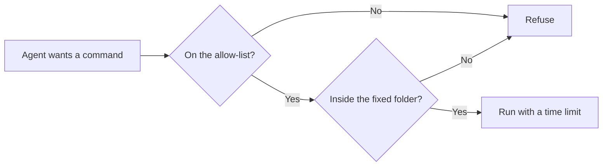

# A shell tool, safely

Describe a task and the model writes the command. Or pass a command yourself with --command, as if the model wrote it. Four rules decide if it may start. The agent works in one folder called sandbox, which holds two small files.

## The story in one picture



## The problem

A shell can delete files or read secrets. An allow-list lets only the commands we name, so an agent cannot do anything it likes.

## New words

Each word has one meaning in every lab.

- **shell**: A program that reads text commands, such as ls, and runs them.
- **allow-list**: A list of the only items we allow. Anything else is refused.
- **sandbox**: A limited space, here one folder, that the program may not leave.

## Run it

Copy any line into your terminal. Each one is a real example from this lab.

```bash
bun run lab shell-tool --question "Show me the doses file"
bun run lab shell-tool --question "Please delete the notes file for me."
bun run lab shell-tool --question "Can you show me what is in the doses file?" --command 'ls ..' --naive
bun run lab shell-tool --question "Can you show me what is in the doses file?" --command ls
bun run lab shell-tool --question "Can you show me what is in the doses file?" --command 'cat doses.txt'
bun run lab shell-tool --question "Can you show me what is in the doses file?" --command 'rm notes.txt'
bun run lab shell-tool --question "Can you show me what is in the doses file?" --command 'cat notes.txt; rm notes.txt'
bun run lab shell-tool --question "Can you show me what is in the doses file?" --command 'cat ../package.json'
bun run lab shell-tool --question "Can you show me what is in the doses file?" --command 'cat /etc/hosts'
bun run lab shell-tool --question "Can you show me what is in the doses file?" --command 'cat missing.txt'
bun run lab shell-tool --question "Can you show me what is in the doses file?" --command 'sleep 5' --limit 1
bun run lab shell-tool --demo
```

Run `bun run lab shell-tool` with nothing else to pick an example from a menu.

## The cases

| # | Case | Why it matters | Result | Run it alone |
| --- | --- | --- | --- | --- |
| 1 | The model writes the command | The model turns a plain task into a command. The four rules still decide if it starts. | ran | `bun run lab shell-tool --question "Show me the doses file"` |
| 2 | The model asks to delete | The task asks for a delete. The model writes rm. It is not on the allow-list, so it never starts. | refused | `bun run lab shell-tool --question "Please delete the notes file for me."` |
| 3 | NAIVE: hand it to a shell | The model writes ls .. and the shell obeys. It lists the folder ABOVE the sandbox. The same hole would let it read or delete there. | escaped | `bun run lab shell-tool --question "Can you show me what is in the doses file?" --command 'ls ..' --naive` |
| 4 | List the folder | A harmless command on the allow-list. It runs. | ran | `bun run lab shell-tool --question "Can you show me what is in the doses file?" --command ls` |
| 5 | Read a file | Reading a file inside the sandbox is fine. | ran | `bun run lab shell-tool --question "Can you show me what is in the doses file?" --command 'cat doses.txt'` |
| 6 | A command not on the list | rm can delete. It is not on the allow-list, so it is refused before anything starts. | refused | `bun run lab shell-tool --question "Can you show me what is in the doses file?" --command 'rm notes.txt'` |
| 7 | Chaining a second command | The first part is allowed. The semicolon would add a delete. We refuse the whole line. | refused | `bun run lab shell-tool --question "Can you show me what is in the doses file?" --command 'cat notes.txt; rm notes.txt'` |
| 8 | Climbing out of the folder | Two dots mean the folder above. The sandbox is only a rule if code enforces it. | refused | `bun run lab shell-tool --question "Can you show me what is in the doses file?" --command 'cat ../package.json'` |
| 9 | An absolute path | A path from the top of the disk could read any file. It is refused. | refused | `bun run lab shell-tool --question "Can you show me what is in the doses file?" --command 'cat /etc/hosts'` |
| 10 | A file that is not there | The command is allowed, but it fails. The error goes back to the agent, so it can try again. That is the error feedback lab. | failed | `bun run lab shell-tool --question "Can you show me what is in the doses file?" --command 'cat missing.txt'` |
| 11 | A command that never ends | Sleep for 5 seconds with a limit of 1. The time limit stops it. Without one, a stuck command would hang the agent. | timeout | `bun run lab shell-tool --question "Can you show me what is in the doses file?" --command 'sleep 5' --limit 1` |

## The promise, and its test

A command that breaks a rule never starts, so the files stay as they were.

```bash
bun test tests/promises/06.test.ts
```

To see the test do its job, break the rule in PART 1 on purpose. The test must fail. Then undo it.

## In production

Run the agent in a container with no secrets and no network. Keep this allow-list as well.

## Read the code

Open `labs/06-shell-tool.ts`. Read the code from the top. It holds only the lesson.
The screen output is in `show/`. You do not need it to learn.
