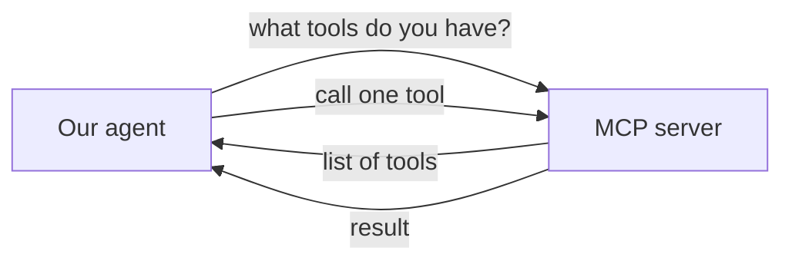

# MCP basics

The agent gets its tools from a real MCP server. That server runs as a separate program and speaks JSON-RPC messages. Nothing is hard-coded. Use --hcp dr-lee, dr-weber or dr-rao to pick the doctor.

## The story in one picture



## The problem

Every new tool means new glue code in every agent. Tool lists go out of date.

## New words

Each word has one meaning in every lab.

- **MCP**: Model Context Protocol. A standard way for an agent to find and call tools.
- **MCP server**: The program that owns the tools and runs them when asked.
- **JSON-RPC**: The message format that MCP uses. Each request and reply is one JSON message.

## Run it

Copy any line into your terminal. Each one is a real example from this lab.

```bash
bun run lab mcp-basics --question "What is the dose of Cardioza?" --naive
bun run lab mcp-basics --question "What is the dose of Cardioza?" --show wire
bun run lab mcp-basics --question "What is the dose of Cardioza?" --hcp dr-lee
bun run lab mcp-basics --question "What is the dose of Cardioza?" --hcp dr-weber --country DE
bun run lab mcp-basics --question "What is the dose of Zorbex?"
bun run lab mcp-basics --question "What is the dose of Cardioza?" --hcp dr-unknown
bun run lab mcp-basics --question "What is the dose of Cardioza?" --tool delete_everything
bun run lab mcp-basics --question "What is the dose of Cardioza?" --script src/missing-server.ts
bun run lab mcp-basics --demo
```

Run `bun run lab mcp-basics` with nothing else to pick an example from a menu.

## The cases

Case 1 is the naive way. Read what goes wrong, then read the rest.

| # | Case | Why it matters | Result | Run it alone |
| --- | --- | --- | --- | --- |
| 1 | NAIVE: a hard-coded tool list | The agent copied one tool into its own code. The server has more. The agent cannot use them, and nobody gets an error. | out-of-date | `bun run lab mcp-basics --question "What is the dose of Cardioza?" --naive` |
| 2 | See the messages | This is all MCP is: lines of JSON in, lines of JSON out. Read the method names and the tool list. | listed | `bun run lab mcp-basics --question "What is the dose of Cardioza?" --show wire` |
| 3 | The agent uses the server's tools | The agent finds three tools, then calls them one by one. The answer cites its document. | answered | `bun run lab mcp-basics --question "What is the dose of Cardioza?" --hcp dr-lee` |
| 4 | Another country | Same server, a German doctor. The search tool filters by country, so the dose is 5mg. | answered | `bun run lab mcp-basics --question "What is the dose of Cardioza?" --hcp dr-weber --country DE` |
| 5 | No approved document | The server says nothing was found. The agent refuses to guess. | no-source | `bun run lab mcp-basics --question "What is the dose of Zorbex?"` |
| 6 | A tool reports an error | Doctor dr-unknown does not exist. The server marks the result as an error, and the client passes it on as text. | tool-error | `bun run lab mcp-basics --question "What is the dose of Cardioza?" --hcp dr-unknown` |
| 7 | A tool the server does not have | The agent asks for delete_everything. The server answers with a protocol error. The call goes nowhere. | tool-error | `bun run lab mcp-basics --question "What is the dose of Cardioza?" --tool delete_everything` |
| 8 | The server is not there | The path is wrong, so nothing answers. The client finds no tools and says so, instead of hanging. | no-server | `bun run lab mcp-basics --question "What is the dose of Cardioza?" --script src/missing-server.ts` |

## Stuck points

**Correct run:** The agent asks the server for its tools when it starts, then calls them. Nothing is copied into the code.

**Common wrong turn:** Copying the tool list into the code. New server tools are then never used, and nobody gets an error.

**Hint to give:** Where should the agent learn its tool list from?

| What you see | What it means | Fix |
| --- | --- | --- |
| The demo prints outcome: out-of-date on the NAIVE case | The agent used a list copied from the server | Ask the server for its tools when the agent starts |
| The result is marked as an error | The server reported a failure, such as an unknown doctor | Read the error text, then fix the input |
| The server runs but no tools appear | The client never asked for the tool list | Ask for the list first, then call a tool |

## The promise, and its test

The agent learns its tools from the server, so a new server tool needs no agent change.

```bash
bun test tests/promises/07.test.ts
```

To see the test do its job, break the rule in PART 1 on purpose. The test must fail. Then undo it.

## In production

Use the official MCP SDK and keep the server running. Add sign-in and a time limit to every call.

## Read the code

Open `labs/07-mcp-basics.ts`. Read the code from the top. It holds only the lesson.
The screen output is in `show/`. You do not need it to learn.
