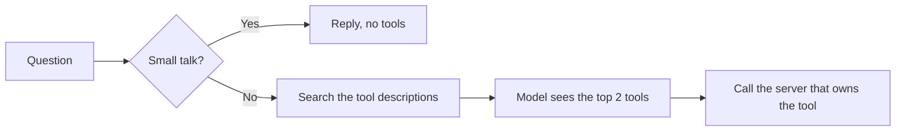

# MCP basics

Maya's inbox manager has three MCP servers: Gmail, Slack and Drive. Each runs as a separate program and speaks JSON-RPC. Each has a search tool and a get_user tool. The agent lists the tools, picks the best two, and lets the model choose between them.

## The story in one picture



## The problem

Three servers give six tools, and two pairs share a name. Sending every tool on every call costs tokens and sends a call to the wrong server.

## New words

Each word has one meaning in every lab.

- **MCP**: Model Context Protocol. A standard way for an agent to find and call tools.
- **MCP server**: The program that owns the tools and runs them when asked.
- **JSON-RPC**: The message format that MCP uses. Each request and reply is one JSON message.

## Run it

Copy any line into your terminal. Each one is a real example from this lab.

```bash
bun run lab mcp-basics --question "Who is Dana on Slack?" --naive
bun run lab mcp-basics --question "Who is Dana on Slack?"
bun run lab mcp-basics --question "Find the signed contract email"
bun run lab mcp-basics --question "Which file has the brand guide?"
bun run lab mcp-basics --question "Who owns the brand guide file?"
bun run lab mcp-basics --question "Hello there, how are you?"
bun run lab mcp-basics --question "Find the holiday thread in my mail"
bun run lab mcp-basics --question "Who sent the refund mail?"
bun run lab mcp-basics --question "Who is Dana on Slack?" --show wire
bun run lab mcp-basics --question "Delete all the Slack messages." --tool delete_everything
bun run lab mcp-basics --question "Who is Dana on Slack?" --script src/missing-server.ts
bun run lab mcp-basics --demo
```

Run `bun run lab mcp-basics` with nothing else to pick an example from a menu.

## The cases

Case 1 is the naive way. Read what goes wrong, then read the rest.

| # | Case | Why it matters | Result | Run it alone |
| --- | --- | --- | --- | --- |
| 1 | NAIVE: every tool on every call | Six tools go to the model, and two are called get_user. The call goes to the first server with that name. That is Gmail, not Slack. | wrong-server | `bun run lab mcp-basics --question "Who is Dana on Slack?" --naive` |
| 2 | Two tools, the right server | The tool search keeps two tools, and the Slack one is first. The call goes to Slack. | answered | `bun run lab mcp-basics --question "Who is Dana on Slack?"` |
| 3 | Find an email | The words signed and email point at the Gmail tools. The model sees only two tools. | answered | `bun run lab mcp-basics --question "Find the signed contract email"` |
| 4 | Find a file | Drive holds the brand guide. The Drive search tool is one of the two the model sees. | answered | `bun run lab mcp-basics --question "Which file has the brand guide?"` |
| 5 | Who owns a file | A who question picks the get_user tool. It is the Drive one, so the answer is the owner. | answered | `bun run lab mcp-basics --question "Who owns the brand guide file?"` |
| 6 | Small talk | A cheap check sees a greeting. No tool text is sent to the model, so the call costs almost nothing. | no-tools | `bun run lab mcp-basics --question "Hello there, how are you?"` |
| 7 | Nothing found | The tool runs but finds nothing. The bot says so, and does not make something up. | no-match | `bun run lab mcp-basics --question "Find the holiday thread in my mail"` |
| 8 | A tool reports an error | No mail has that word. The server marks the result as an error, and the client passes it on as text. | tool-error | `bun run lab mcp-basics --question "Who sent the refund mail?"` |
| 9 | See the messages | This is all MCP is: lines of JSON in, lines of JSON out. Read the method names and the tool list. | listed | `bun run lab mcp-basics --question "Who is Dana on Slack?" --show wire` |
| 10 | A tool the server does not have | The agent asks Slack for delete_everything. The server answers with a protocol error. The call goes nowhere. | tool-error | `bun run lab mcp-basics --question "Delete all the Slack messages." --tool delete_everything` |
| 11 | The servers are not there | The path is wrong, so nothing answers. The client finds no tools and says so, instead of hanging. | no-server | `bun run lab mcp-basics --question "Who is Dana on Slack?" --script src/missing-server.ts` |

## Stuck points

**Correct run:** The agent lists the tools, ranks them, and shows the model only the best two. Each call goes to the owning server.

**Common wrong turn:** Sending every tool on every call. It costs tokens, and a name that two servers share goes to the wrong one.

**Hint to give:** Which server owns the tool the model named?

| What you see | What it means | Fix |
| --- | --- | --- |
| The demo prints outcome: wrong-server on the NAIVE case | Two servers share the name get_user | Put the server name in front of each tool name |
| The result is marked as an error | The server reported a failure, such as no match | Read the error text, then fix the input |
| The server runs but no tools appear | The client never asked for the tool list | Ask for the list first, then call a tool |

## The promise, and its test

The model sees at most two tools. Each call goes to the server that owns the tool, and small talk sends no tools at all.

```bash
bun test tests/promises/07.test.ts
```

To see the test do its job, break the rule in PART 1 on purpose. The test must fail. Then undo it.

## In production

Use the official MCP SDK and keep each server running. Search the tool descriptions, and show the model only the top few.

## Read the code

Open `labs/07-mcp-basics.ts`. Read the code from the top. It holds only the lesson.
The screen output is in `show/`. You do not need it to learn.
