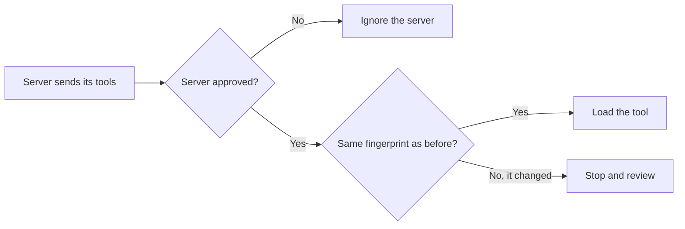

# Trusting an MCP server

Each example is a server and the tools it lists. Only the server hcp-docs is approved. Its tools were pinned when a person reviewed them. Pick a scene by typing its name.

## The story in one picture



## The problem

A tool description goes into the prompt. A server can change it later and give the model orders. That is a rug pull.

## New words

Each word has one meaning in every lab.

- **pin**: Save what a tool looked like when we approved it, so we can compare later.
- **rug pull**: A server changes a tool after we approve it.
- **fingerprint**: A short code made from a text. Change one letter and the code changes.

## Run it

Copy any line into your terminal. Each one is a real example from this lab.

```bash
bun run lab mcp-trust --question "What is the dose of Cardioza?" --server unknown-server --naive
bun run lab mcp-trust --question "What is the dose of Cardioza?" --server approved
bun run lab mcp-trust --question "What is the dose of Cardioza?" --server unknown-server
bun run lab mcp-trust --question "What is the dose of Cardioza?" --server rug-pull
bun run lab mcp-trust --question "What is the dose of Cardioza?" --server new-tool
bun run lab mcp-trust --question "What is the dose of Cardioza?" --server typo-fix
bun run lab mcp-trust --question "What is the dose of Cardioza?" --server bad-but-pinned
bun run lab mcp-trust --question "What is the dose of Cardioza?" --server re-approved --reapprove
bun run lab mcp-trust --demo
```

Run `bun run lab mcp-trust` with nothing else to pick an example from a menu.

## The cases

Case 1 is the naive way. Read what goes wrong, then read the rest.

| # | Case | Why it matters | Result | Run it alone |
| --- | --- | --- | --- | --- |
| 1 | NAIVE: trust every description | The server hides an order inside a tool description. With no check, the order goes straight into the prompt, and the model may follow it. | poisoned | `bun run lab mcp-trust --question "What is the dose of Cardioza?" --server unknown-server --naive` |
| 2 | An approved server, unchanged | Right server, and both tools match their pins. Both are loaded. | trusted | `bun run lab mcp-trust --question "What is the dose of Cardioza?" --server approved` |
| 3 | A server nobody approved | The name is not on the list. We do not even read its tools. | blocked | `bun run lab mcp-trust --question "What is the dose of Cardioza?" --server unknown-server` |
| 4 | A rug pull | The server was approved, then one tool quietly gained a hidden order. Its fingerprint no longer matches the pin, so it is held back. | changed | `bun run lab mcp-trust --question "What is the dose of Cardioza?" --server rug-pull` |
| 5 | A new tool appears | A tool that can send email shows up. Nobody reviewed it, so it is not loaded. The old tools still work. | new | `bun run lab mcp-trust --question "What is the dose of Cardioza?" --server new-tool` |
| 6 | A harmless fix is also held | Even a one word fix changes the fingerprint. We are strict on purpose. Re-approving takes one step. | changed | `bun run lab mcp-trust --question "What is the dose of Cardioza?" --server typo-fix` |
| 7 | EDGE: an order that was approved by mistake | A person pinned a tool that already held an order. The word scan still catches it. It is a rule list, so a cleverer order could slip past. That is why a person reviews too. | trap | `bun run lab mcp-trust --question "What is the dose of Cardioza?" --server bad-but-pinned` |
| 8 | A person re-approves | After a review the new text is pinned. The tool is trusted again. | trusted | `bun run lab mcp-trust --question "What is the dose of Cardioza?" --server re-approved --reapprove` |

## Stuck points

**Correct run:** Load only tools that are approved and match their pin. Anything new, changed or unapproved is held back.

**Common wrong turn:** Trusting every description. A server can hide an order inside a tool description.

**Hint to give:** What changed since the pin was saved? Compare the fingerprint.

| What you see | What it means | Fix |
| --- | --- | --- |
| The demo prints outcome: poisoned on the NAIVE case | The hidden order reached the prompt | Check each tool's fingerprint against its pin before loading |
| A tool is held with the outcome changed | Its fingerprint no longer matches the pin | A person must review it and approve it again |
| A server is blocked before its tools are read | The server is not on the approved list | Add it to the list only after a review |

## The promise, and its test

A tool that is unapproved, new, changed or carrying an order is never loaded. A changed tool shows a new fingerprint.

```bash
bun test tests/promises/08.test.ts
```

To see the test do its job, break the rule in PART 1 on purpose. The test must fail. Then undo it.

## In production

Pin on a schedule, and alert on any change. Let only a named person re-approve a tool.

## Read the code

Open `labs/08-mcp-trust.ts`. Read the code from the top. It holds only the lesson.
The screen output is in `show/`. You do not need it to learn.
