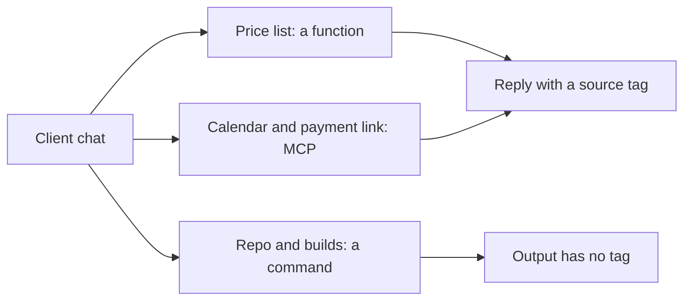

# Function, CLI or MCP

Juniper's client chat has three jobs. The price list is Juniper's own code, so it is a function. The calendar and payment links belong to an outside app, so they use MCP. A build log lives in the repo, so a command reads it. Pick a door with --door function, cli or mcp, or use --door all to compare.

## The story in one picture



## The problem

Teams pick a door by habit. Each door has its own cost, risk and speed. Most teams should ship functions first.

## New words

Each word has one meaning in every lab.

- **door**: One way an agent reaches a tool: a function, a command or an MCP server.
- **shell**: A program that reads text commands, such as ls, and runs them.
- **MCP**: Model Context Protocol. A standard way for an agent to find and call tools.

## Run it

Copy any line into your terminal. Each one is a real example from this lab.

```bash
bun run lab three-doors --question "What does a logo cost?" --naive --door cli
bun run lab three-doors --question "What does a brand kit cost?" --door function
bun run lab three-doors --question "Book me in on Thursday at 3pm" --door mcp
bun run lab three-doors --question "Send me a payment link for the website" --door mcp
bun run lab three-doors --question "Did build 3 pass or fail?" --door cli
bun run lab three-doors --question "Show me the three jobs please." --door all
bun run lab three-doors --question "What does a mascot cost?" --door function
bun run lab three-doors --question "Can we talk on Friday?" --door mcp
bun run lab three-doors --question "Book me in on Monday at 10am" --door mcp --script src/missing-server.ts
bun run lab three-doors --demo
```

Run `bun run lab three-doors` with nothing else to pick an example from a menu.

## The cases

Case 1 is the naive way. Read what goes wrong, then read the rest.

| # | Case | Why it matters | Result | Run it alone |
| --- | --- | --- | --- | --- |
| 1 | NAIVE: the price list behind a shell | The price list sits in a file, and a command reads it. The number is right, but the answer has no source tag, so the output check cannot verify it. | uncited | `bun run lab three-doors --question "What does a logo cost?" --naive --door cli` |
| 2 | Own rules are a function | The price list is Juniper's own code. A function answers at once, with a source tag. | answered | `bun run lab three-doors --question "What does a brand kit cost?" --door function` |
| 3 | An outside app over MCP | The calendar belongs to a booking app. The model picks book_slot, and the server answers with a source tag. It is slower, because a server has to start. | answered | `bun run lab three-doors --question "Book me in on Thursday at 3pm" --door mcp` |
| 4 | A payment link over MCP | The same booking app also makes payment links. Same door, a different tool. | answered | `bun run lab three-doors --question "Send me a payment link for the website" --door mcp` |
| 5 | The repo through a command | A developer's question about a build. A command reads the log. This is fine for a developer. A client answer would need a source tag. | uncited | `bun run lab three-doors --question "Did build 3 pass or fail?" --door cli` |
| 6 | Compare all three | One table: the time, and whether the answer has a source tag. Look at the time column and at the tag column. | compared | `bun run lab three-doors --question "Show me the three jobs please." --door all` |
| 7 | A service with no price | The function says it has no price. Good. It does not guess one. | no-source | `bun run lab three-doors --question "What does a mascot cost?" --door function` |
| 8 | A booking with no time | The client gave a day but no time. The booking app says so as an error, and the bot tells the client it could not book. | door-error | `bun run lab three-doors --question "Can we talk on Friday?" --door mcp` |
| 9 | The booking app is down | The function door has nothing to start, so it cannot be down. The MCP door fails with a clear error. | door-error | `bun run lab three-doors --question "Book me in on Monday at 10am" --door mcp --script src/missing-server.ts` |

## Stuck points

**Correct run:** Run one client job through each door. Compare the time, and whether the answer has a source tag.

**Common wrong turn:** Putting the price list behind a shell command. The number is right, but the answer has no source tag.

**Hint to give:** Which door gives an answer that the output check can read?

| What you see | What it means | Fix |
| --- | --- | --- |
| The demo prints outcome: uncited on the NAIVE case | The shell answer has no source tag | Use the function door for your own rules |
| The MCP door is slower | A server has to start first | This is the cost of MCP. Use it for an outside app or a shared tool |
| The booking says it needs a day and a time | The client gave only a day | The tool is right to refuse. Ask the client for a time |

## The promise, and its test

Own rules answer from a function and outside apps answer over MCP, both with a source tag. A shell answer has no tag, so it is caught as uncited.

```bash
bun test tests/promises/09.test.ts
```

To see the test do its job, break the rule in PART 1 on purpose. The test must fail. Then undo it.

## In production

Start with a function. Prefer an answer with fields a program can read. Move to MCP when an outside app or a second team needs the tool.

## Read the code

Open `labs/09-three-doors.ts`. Read the code from the top. It holds only the lesson.
The screen output is in `show/`. You do not need it to learn.
