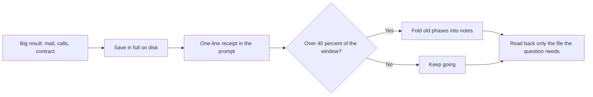

# The context budget

Each example preps a renewal for Acme Dental. The file holds mail, call notes and a contract. Use --window to change the size of the context window. Use --naive to put it all in. The answer must name the price limit in clause 7.

## The story in one picture



## The problem

Every turn sends the whole prompt again, so the bill grows. A long prompt also hides its middle. The key clause sits in the middle, and the bot says there is no limit.

## New words

Each word has one meaning in every lab.

- **context window**: The most text a model can read at one time, counted in tokens.
- **model token**: A small piece of text that a model counts. Often part of a word.
- **compaction**: Folding old work into short notes when the prompt fills up. The full text stays on disk.
- **receipt**: A one-line stand-in for a big tool result. The full result is saved on disk.

## Run it

Copy any line into your terminal. Each one is a real example from this lab.

```bash
bun run lab context-budget --question "How much can we raise Acme's price at renewal?" --naive
bun run lab context-budget --question "Maya calls Sam tomorrow. What is the price limit?" --window 6000
bun run lab context-budget --question "Is there a cap on the renewal price?" --window 2000
bun run lab context-budget --question "What did Maya promise Sam on the last call?" --window 6000
bun run lab context-budget --question "What does clause 7 say about the price?" --window 1200
bun run lab context-budget --question "What does clause 7 say about the price?" --window 500
bun run lab context-budget --demo
```

Run `bun run lab context-budget` with nothing else to pick an example from a menu.

## The cases

Case 1 is the naive way. Read what goes wrong, then read the rest.

| # | Case | Why it matters | Result | Run it alone |
| --- | --- | --- | --- | --- |
| 1 | NAIVE: put the whole file in | Three years of mail, the notes and the contract all go in. Clause 7 lands in the middle. The model says there is no limit. | clause-lost | `bun run lab context-budget --question "How much can we raise Acme's price at renewal?" --naive` |
| 2 | A roomy window | The mail becomes a receipt. The calls and the contract fit, so nothing is folded. The clause is read back. | answered | `bun run lab context-budget --question "Maya calls Sam tomorrow. What is the price limit?" --window 6000` |
| 3 | A tight window | Old phases fold into one-line notes. The full contract is still on disk. The question needs it, so it is read back. | compacted | `bun run lab context-budget --question "Is there a cap on the renewal price?" --window 2000` |
| 4 | A different question: the last call | This question needs the call notes, not the contract. Our code reads back the notes and leaves the contract on disk. | answered | `bun run lab context-budget --question "What did Maya promise Sam on the last call?" --window 6000` |
| 5 | A very tight window | Almost everything folds. The contract is read back whole, and it is the only text that must fit. | compacted | `bun run lab context-budget --question "What does clause 7 say about the price?" --window 1200` |
| 6 | EDGE: the window is too small | The contract alone is bigger than 500 tokens. We say so. We never send a prompt that does not fit. | too-small | `bun run lab context-budget --question "What does clause 7 say about the price?" --window 500` |

## Stuck points

**Correct run:** Count tokens in our code and shrink big results to a receipt. Fold old phases into notes and read back only what is needed.

**Common wrong turn:** Putting the whole file in. The bill grows on every turn, and the model misses the clause in the middle.

**Hint to give:** Where is the full contract? Our code can read it back from disk.

| What you see | What it means | Fix |
| --- | --- | --- |
| The demo prints outcome: clause-lost on the NAIVE case | The key clause sits in the middle of a long prompt | Save big results to disk and read back only the file the question needs |
| The demo prints outcome: too-small | The prompt needs more than the window holds | Raise the window, or read back less. Never send a prompt that does not fit |
| The bill is high but the answer is right | Old phases were never folded | Fold the oldest phases into notes at 40 percent of the window |

## The promise, and its test

Our code counts model tokens. A big result becomes a receipt. Compaction folds old phases into notes at 40 percent. The key clause is read back from disk.

```bash
bun test tests/promises/10.test.ts
```

To see the test do its job, break the rule in PART 1 on purpose. The test must fail. Then undo it.

## In production

Count tokens in your own code, not in the model. Save every big result to disk and keep a receipt in the prompt. Fold old phases into notes at 40 percent.

## Read the code

Open `labs/10-context-budget.ts`. Read the code from the top. It holds only the lesson.
The screen output is in `show/`. You do not need it to learn.
