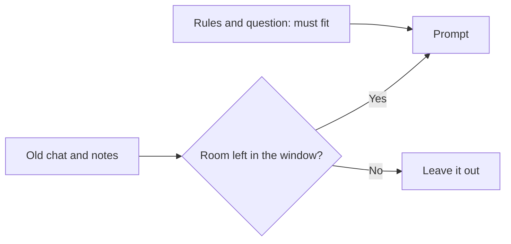

# The context budget

Each example builds the prompt for one question under a token budget. The model reads only the context window, so the budget keeps the prompt inside it. Use --window 80 to change the budget. The prompt holds rules, a doctor note, documents, chat history and the question.

## The story in one picture



## The problem

A prompt grows every turn. A model counts its text in model tokens. When the prompt passes the context window, something is cut, and nobody chooses what.

## New words

Each word has one meaning in every lab.

- **context window**: The most text a model can read at one time, counted in tokens.
- **model token**: A small piece of text that a model counts. Often part of a word.
- **budget**: The most we allow ourselves to spend, in tokens, money, steps or time.

## Run it

Copy any line into your terminal. Each one is a real example from this lab.

```bash
bun run lab context-budget --question "What is the dose of Cardioza?" --naive --window 60
bun run lab context-budget --question "What is the dose of Cardioza?" --window 200
bun run lab context-budget --question "What is the dose of Cardioza?" --window 70
bun run lab context-budget --question "What is the dose of Cardioza?" --window 50
bun run lab context-budget --question "What are the doses of Cardioza and Neurovex?" --window 60
bun run lab context-budget --question "What is the dose of Cardioza?" --window 10
bun run lab context-budget --demo
bun run lab context-budget --demo
```

Run `bun run lab context-budget` with nothing else to pick an example from a menu.

## The cases

Case 1 is the naive way. Read what goes wrong, then read the rest.

| # | Case | Why it matters | Result | Run it alone |
| --- | --- | --- | --- | --- |
| 1 | NAIVE: let the window cut the oldest text | The rules come first, so they are the oldest text. When the window is full, they are the first thing cut. The model now answers with no rules. | rules-lost | `bun run lab context-budget --question "What is the dose of Cardioza?" --naive --window 60` |
| 2 | Plenty of room | Everything fits, so everything is sent. | all-fit | `bun run lab context-budget --question "What is the dose of Cardioza?" --window 200` |
| 3 | A tighter window | The chat history is the least useful part, so it goes first. | dropped: history | `bun run lab context-budget --question "What is the dose of Cardioza?" --window 70` |
| 4 | A tight window | The documents also stop fitting. We keep the rules, the question and the small doctor note. The model has to refuse, which is safe. | dropped: documents, history | `bun run lab context-budget --question "What is the dose of Cardioza?" --window 50` |
| 5 | Two drugs, bigger documents | Two documents are larger. The window drops the history and then the documents, and the doctor note survives. | dropped: documents, history | `bun run lab context-budget --question "What are the doses of Cardioza and Neurovex?" --window 60` |
| 6 | The must parts do not fit | A budget of 10 cannot hold the rules and the question. We say so. We never send a prompt without its rules. | too-small | `bun run lab context-budget --question "What is the dose of Cardioza?" --window 10` |
| 7 | A very long question | The question alone is bigger than the window. The doctor must shorten it. We do not cut it for them. | too-small | `bun run lab context-budget --demo` |

## The promise, and its test

The prompt never passes the budget, and the rules and the question are never dropped.

```bash
bun test tests/promises/10.test.ts
```

To see the test do its job, break the rule in PART 1 on purpose. The test must fail. Then undo it.

## In production

Count with the model's own counter. Keep a reserve for the reply. Log what was dropped on every call.

## Read the code

Open `labs/10-context-budget.ts`. Read the code from the top. It holds only the lesson.
The screen output is in `show/`. You do not need it to learn.
