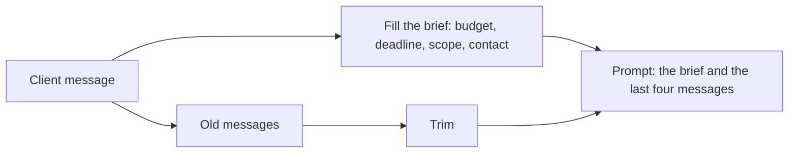

# Trimming the chat history

Each example is an intake chat with a new client. The bot must fill a brief with budget, deadline, scope and contact. Pick a chat by name, such as short, long, changed, no-budget or new. Use --keep to change how many recent messages stay.

## The story in one picture



## The problem

The chat gets long, so old messages are cut. The client said the deadline early. After the cut, the bot asks for it again.

## New words

Each word has one meaning in every lab.

- **history**: The earlier turns of a chat, which the model reads again on each call.
- **trim**: Leave out old turns to make room in the prompt.
- **brief**: A short record of the facts a client gave. We fill it as the chat goes on.

## Run it

Copy any line into your terminal. Each one is a real example from this lab.

```bash
bun run lab history-trimming --question "Can you send me the quote today?" --chat long --naive --keep 8
bun run lab history-trimming --question "What do you need from me next?" --chat short --keep 4
bun run lab history-trimming --question "Could you put the price and date in an email?" --chat long --keep 4
bun run lab history-trimming --question "So are we still starting on Monday?" --chat changed --keep 4
bun run lab history-trimming --question "Please send me the quote." --chat long --keep 0
bun run lab history-trimming --question "How long will the site take?" --chat no-budget --keep 4
bun run lab history-trimming --question "Hello, are you open for new work?" --chat new --keep 4
bun run lab history-trimming --demo
```

Run `bun run lab history-trimming` with nothing else to pick an example from a menu.

## The cases

Case 1 is the naive way. Read what goes wrong, then read the rest.

| # | Case | Why it matters | Result | Run it alone |
| --- | --- | --- | --- | --- |
| 1 | NAIVE: keep only the last messages | Priya gave the scope, budget and deadline early. Those messages are cut. The bot asks for all three again. | fact-lost | `bun run lab history-trimming --question "Can you send me the quote today?" --chat long --naive --keep 8` |
| 2 | A short chat | The chat is short. The brief still holds all four facts, so the quote is ready. | quote-ready | `bun run lab history-trimming --question "What do you need from me next?" --chat short --keep 4` |
| 3 | A long chat, brief kept | More than 20 messages. Only the last four stay. The brief has the deadline, so the quote is ready. | quote-ready | `bun run lab history-trimming --question "Could you put the price and date in an email?" --chat long --keep 4` |
| 4 | The deadline changes | The client said Friday, then Monday. The newest answer replaces the old one in the brief. | quote-ready | `bun run lab history-trimming --question "So are we still starting on Monday?" --chat changed --keep 4` |
| 5 | No messages kept | We keep zero recent messages. The brief alone is enough to write the quote. | quote-ready | `bun run lab history-trimming --question "Please send me the quote." --chat long --keep 0` |
| 6 | EDGE: the client never gave a budget | The brief has a gap. The bot asks only for the budget and nothing else. | asks: budget | `bun run lab history-trimming --question "How long will the site take?" --chat no-budget --keep 4` |
| 7 | EDGE: a brand new chat | There is no history. The brief is empty, so the bot asks for all four facts. Nothing breaks. | asks: budget, deadline, scope, contact | `bun run lab history-trimming --question "Hello, are you open for new work?" --chat new --keep 4` |

## Stuck points

**Correct run:** Fill the brief as the client talks. Send the brief and only the last messages.

**Common wrong turn:** Keeping only the last messages. The deadline was said early, so the bot asks for it again.

**Hint to give:** Where could the deadline live after its message is cut?

| What you see | What it means | Fix |
| --- | --- | --- |
| The demo prints outcome: fact-lost on the NAIVE case | The old messages with the facts were cut | Fill a brief from every client message before you trim |
| The demo prints outcome: asks: budget | The client never gave a budget | This is correct. The bot asks only for what is missing |
| The quote shows an old deadline | An old answer was kept over a newer one | Let the newest answer replace the old one in the brief |

## The promise, and its test

The brief keeps every fact the client gave, and the newest answer wins. The prompt holds the brief and only the last messages.

```bash
bun test tests/promises/11.test.ts
```

To see the test do its job, break the rule in PART 1 on purpose. The test must fail. Then undo it.

## In production

Save each fact in the brief the moment it is said, not at trim time. Show the brief to the client and let them fix it.

## Read the code

Open `labs/11-history-trimming.ts`. Read the code from the top. It holds only the lesson.
The screen output is in `show/`. You do not need it to learn.
