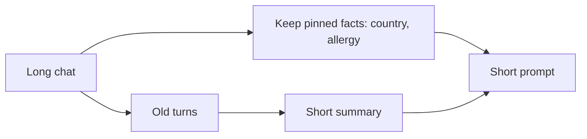

# Trimming the chat history

Each example is a chat between a doctor and the agent. The last question needs a fact from the start of the chat. Pick a chat by name: short, long, two-facts, no-facts or empty. Use --keep 4 to change how many recent turns stay.

## The story in one picture



## The problem

The chat history gets long, and it does not fit. Trimming the oldest turns also removes early facts, like the doctor's country.

## New words

Each word has one meaning in every lab.

- **history**: The earlier turns of a chat, which the model reads again on each call.
- **trim**: Leave out old turns to make room in the prompt.
- **pinned fact**: A fact, such as a country or an allergy, that we always keep.

## Run it

Copy any line into your terminal. Each one is a real example from this lab.

```bash
bun run lab history-trimming --question "What is the dose of Cardioza for me?" --chat long --naive --keep 4
bun run lab history-trimming --question "What is the dose of Cardioza for me?" --chat short --keep 4
bun run lab history-trimming --question "What is the dose of Cardioza for me?" --chat long --keep 4
bun run lab history-trimming --question "What is the dose of Cardioza for me?" --chat two-facts --keep 3
bun run lab history-trimming --question "What is the dose of Cardioza for me?" --chat long --keep 0
bun run lab history-trimming --question "What is the dose of Cardioza for me?" --chat no-facts --keep 4
bun run lab history-trimming --question "What is the dose of Cardioza for me?" --chat long --keep 50
bun run lab history-trimming --question "What is the dose of Cardioza for me?" --chat empty --keep 4
bun run lab history-trimming --demo
```

Run `bun run lab history-trimming` with nothing else to pick an example from a menu.

## The cases

Case 1 is the naive way. Read what goes wrong, then read the rest.

| # | Case | Why it matters | Result | Run it alone |
| --- | --- | --- | --- | --- |
| 1 | NAIVE: keep only the last turns | The doctor said Germany in the first turn. That turn is old, so it is cut. The agent no longer knows which label to use. | fact-lost | `bun run lab history-trimming --question "What is the dose of Cardioza for me?" --chat long --naive --keep 4` |
| 2 | A short chat | The chat is shorter than the limit, so nothing is cut. | nothing-to-trim | `bun run lab history-trimming --question "What is the dose of Cardioza for me?" --chat short --keep 4` |
| 3 | A long chat, fact pinned | The old chatter is cut. The country turn stays, because it is pinned. | trimmed | `bun run lab history-trimming --question "What is the dose of Cardioza for me?" --chat long --keep 4` |
| 4 | Two pinned facts | Two old facts are pinned, one early and one in the middle. Both stay. | trimmed | `bun run lab history-trimming --question "What is the dose of Cardioza for me?" --chat two-facts --keep 3` |
| 5 | Facts only | We keep zero recent turns. Only the pinned facts remain. The current question is sent on its own, as in the context budget lab. | facts-only | `bun run lab history-trimming --question "What is the dose of Cardioza for me?" --chat long --keep 0` |
| 6 | A chat with no facts | Nothing is pinned, so only the last turns stay. This is safe, because nothing there was needed. | trimmed | `bun run lab history-trimming --question "What is the dose of Cardioza for me?" --chat no-facts --keep 4` |
| 7 | A limit larger than the chat | We allow 50 recent turns, and the chat has fewer. Nothing is cut. | nothing-to-trim | `bun run lab history-trimming --question "What is the dose of Cardioza for me?" --chat long --keep 50` |
| 8 | An empty chat | A new chat has no history. There is nothing to trim, and nothing breaks. | empty | `bun run lab history-trimming --question "What is the dose of Cardioza for me?" --chat empty --keep 4` |

## Stuck points

**Correct run:** Keep the pinned facts and the most recent turns, in order. Everything else is cut.

**Common wrong turn:** Keeping only the last turns. The country from the first turn is cut, so the agent forgets it.

**Hint to give:** Which fact must survive, however old its turn is?

| What you see | What it means | Fix |
| --- | --- | --- |
| The demo prints outcome: fact-lost on the NAIVE case | The pinned fact was cut with the old turns | Pin the country and the allergy before trimming |
| The demo prints outcome: nothing-to-trim | The chat fits within the limit | This is correct. No trim is needed |
| Facts-only keeps no recent turns | Zero recent turns were kept, on purpose | This is correct for the facts-only case |

## The promise, and its test

Pinned facts and the most recent turns always survive, in order. Nothing else does.

```bash
bun test tests/promises/11.test.ts
```

To see the test do its job, break the rule in PART 1 on purpose. The test must fail. Then undo it.

## In production

Save each fact when it is said, not at trim time. Write a short summary of the turns left out.

## Read the code

Open `labs/11-history-trimming.ts`. Read the code from the top. It holds only the lesson.
The screen output is in `show/`. You do not need it to learn.
