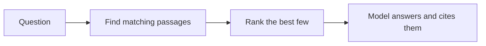

# Retrieval

Each example is a question about a drug. Six invented chunks are searched. Each chunk gets a score for how well it matches. Use --country DE for a German doctor, and only chunks from that country are searched.

## The story in one picture



## The problem

The model cannot read every document. If retrieval sends the wrong chunk, the model answers from the wrong source.

## New words

Each word has one meaning in every lab.

- **chunk**: A small piece of a document, such as one paragraph.
- **BM25**: A standard formula that scores a chunk by the rare words it shares with the question.
- **score**: A number that says how well one chunk matches the question.
- **retrieval**: Finding the chunks that best answer a question, before the model reads them.

## Run it

Copy any line into your terminal. Each one is a real example from this lab.

```bash
bun run lab retrieval --question "What is the dose of Cardioza?" --naive --country DE
bun run lab retrieval --question "What is the dose of Cardioza?" --country US
bun run lab retrieval --question "What is the dose of Cardioza?" --country DE
bun run lab retrieval --question "What are the side effects of Cardioza?" --country US
bun run lab retrieval --question "Cardioza dose and Neurovex dose" --country US
bun run lab retrieval --question "WHAT IS THE CARDIOZA DOSE?!" --country US
bun run lab retrieval --question "Can you tell me about Cardioza please?" --country US
bun run lab retrieval --question "How do I use the Dermalin cream?" --country DE
bun run lab retrieval --question "What is the weather in Berlin today?" --country DE
bun run lab retrieval --demo
```

Run `bun run lab retrieval` with nothing else to pick an example from a menu.

## The cases

Case 1 is the naive way. Read what goes wrong, then read the rest.

| # | Case | Why it matters | Result | Run it alone |
| --- | --- | --- | --- | --- |
| 1 | NAIVE: best chunk from anywhere | A German doctor asks for the dose. Two chunks match equally well and the US chunk comes first. The doctor gets the US dose. | wrong-country | `bun run lab retrieval --question "What is the dose of Cardioza?" --naive --country DE` |
| 2 | A US doctor asks for a dose | The right chunk matches on two words. The side effects chunk matches on only one, so it stays out. | found | `bun run lab retrieval --question "What is the dose of Cardioza?" --country US` |
| 3 | A German doctor asks for a dose | The same question gives the German chunk, because we filter by country first. | found | `bun run lab retrieval --question "What is the dose of Cardioza?" --country DE` |
| 4 | A different topic for one drug | Side effects of the same drug. The score picks the side effects chunk and not the dose chunk. | found | `bun run lab retrieval --question "What are the side effects of Cardioza?" --country US` |
| 5 | Two drugs in one question | Both drugs match, so we send two chunks. We never send more than two. | found | `bun run lab retrieval --question "Cardioza dose and Neurovex dose" --country US` |
| 6 | Capital letters and punctuation | The words are cleaned first, so shouting does not change the answer. | found | `bun run lab retrieval --question "WHAT IS THE CARDIOZA DOSE?!" --country US` |
| 7 | A question with one matching word | Only the drug name matches. One word is too weak to trust. We ask the doctor to say more. | too-vague | `bun run lab retrieval --question "Can you tell me about Cardioza please?" --country US` |
| 8 | A drug with no chunk in this country | Dermalin has only a US chunk. We never fall back to another country. We say there is no source. | no-source | `bun run lab retrieval --question "How do I use the Dermalin cream?" --country DE` |
| 9 | Nothing to do with drugs | No word matches any chunk. The answer is no source. We do not send the closest bad match. | no-source | `bun run lab retrieval --question "What is the weather in Berlin today?" --country DE` |

## Stuck points

**Correct run:** Search only the doctor's country, score the chunks, and return the strong ones. Say so when none are strong.

**Common wrong turn:** Searching all countries. The best match may come from another country, which gives the wrong dose.

**Hint to give:** Which filter must run before the score?

| What you see | What it means | Fix |
| --- | --- | --- |
| The demo prints outcome: wrong-country on the NAIVE case | A chunk from another country was returned | Filter by country before ranking |
| The demo prints outcome: no-source | No chunk has a strong score for this country | This is correct. Say there is no source |
| Two chunks tie on score | The score cannot pick one | Sort ties in a fixed order, so the answer never changes |

## The promise, and its test

Only chunks from the doctor's country, with a strong score, are returned. Otherwise we say there is no source.

```bash
bun test tests/promises/12.test.ts
```

To see the test do its job, break the rule in PART 1 on purpose. The test must fail. Then undo it.

## In production

The search ranks with BM25, a standard ranking for words. Rank by meaning too, as src/meaning.ts does with --meaning --live. Log which chunk ids were sent on every answer.

## Read the code

Open `labs/12-retrieval.ts`. Read the code from the top. It holds only the lesson.
The screen output is in `show/`. You do not need it to learn.
