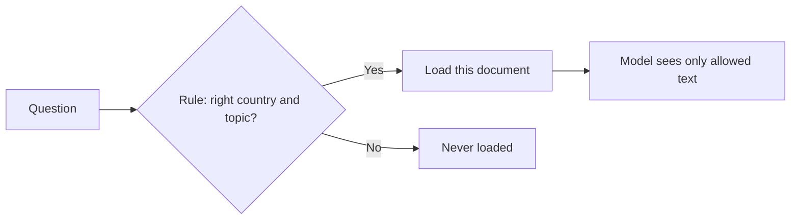

# Picking what goes in

Each example is a question from Dr. Lee. Three sources are on the shelf: documents, the doctor's profile and past emails. We load only the ones the question needs.

## The story in one picture



## The problem

Loading everything is easy. It costs tokens and hides the useful part. It also shows private data that has nothing to do with the question.

## New words

source = a place facts come from. picking = choosing sources per question. overloaded = more context than the question needs.

## Run it

Copy any line into your terminal. Each one is a real example from this lab.

```bash
bun run lab pick-context --question "What is the Cardioza dose?" --naive
bun run lab pick-context --question "What is the Cardioza dose?"
bun run lab pick-context --question "Which email was sent to me last?"
bun run lab pick-context --question "Given my profile, what is the label?"
bun run lab pick-context --question "WHAT IS THE CARDIOZA DOSE???"
bun run lab pick-context --question "Hello there, how are you today?"
bun run lab pick-context --question "I never read my email anyway"
bun run lab pick-context --question ""
bun run lab pick-context --demo
```

Run `bun run lab pick-context` with nothing else to pick an example from a menu.

## The cases

Case 1 is the naive way. Read what goes wrong, then read the rest.

| # | Case | Why it matters | Result | Run it alone |
| --- | --- | --- | --- | --- |
| 1 | NAIVE: load every source | Every question carries the documents, the profile and the emails. A dose question does not need the emails, and now the model can quote them. | overloaded | `bun run lab pick-context --question "What is the Cardioza dose?" --naive` |
| 2 | A dose question | Only the documents are loaded. The profile and the emails stay on the shelf. | picked | `bun run lab pick-context --question "What is the Cardioza dose?"` |
| 3 | An email question | Only the emails are loaded. | picked | `bun run lab pick-context --question "Which email was sent to me last?"` |
| 4 | Two needs in one question | The question needs the profile and the documents, so both are loaded. The emails are not. | picked | `bun run lab pick-context --question "Given my profile, what is the label?"` |
| 5 | Capital letters | The model reads the meaning, so shouting changes nothing. | picked | `bun run lab pick-context --question "WHAT IS THE CARDIOZA DOSE???"` |
| 6 | Small talk | No source helps. We load nothing, and the agent asks what the doctor needs. | unclear | `bun run lab pick-context --question "Hello there, how are you today?"` |
| 7 | EDGE: a word used in another way | A doctor jokes about email. A word list would load the emails. The model reads the meaning, so it can load nothing. | unclear | `bun run lab pick-context --question "I never read my email anyway"` |
| 8 | An empty question | No question means no source helps, so nothing is loaded. | unclear | `bun run lab pick-context --question ""` |

## The promise, and its test

A question loads only the sources whose keyword it holds. A question with no keyword loads nothing, and the agent asks.

```bash
bun test tests/promises/13.test.ts
```

To see the test do its job, break the rule in PART 1 on purpose. The test must fail. Then undo it.

## In production

Let the model choose with a tool call, and log which sources each answer used.

## Read the code

Open `labs/13-pick-context.ts`. Read the code from the top. It holds only the lesson.
The screen output is in `show/`. You do not need it to learn.
