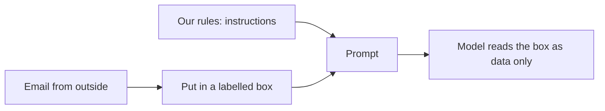

# Instructions versus data

Each example is a document the agent reads. Pick one by name: clean, injected, breakout or subtle. Three of them hide an order. The agent puts each document inside a data fence, so the model reads it as data.

## The story in one picture



## The problem

The model reads rules and documents as one text. A document can hide an order for the model. This is prompt injection, and nobody notices.

## New words

Each word has one meaning in every lab.

- **prompt injection**: A hidden order in data, such as an email, that tries to steer the model.
- **data fence**: A labelled box that tells the model where the data starts and ends.
- **held**: Taken out of the prompt, so the model never sees it.

## Run it

Copy any line into your terminal. Each one is a real example from this lab.

```bash
bun run lab instructions-vs-data --question "What is the dose of Cardioza?" --document injected --naive
bun run lab instructions-vs-data --question "What is the dose of Cardioza?" --document clean
bun run lab instructions-vs-data --question "What is the dose of Cardioza?" --document injected
bun run lab instructions-vs-data --question "What is the dose of Cardioza?" --document breakout
bun run lab instructions-vs-data --question "What is the dose of Cardioza?" --document subtle
bun run lab instructions-vs-data --demo
```

Run `bun run lab instructions-vs-data` with nothing else to pick an example from a menu.

## The cases

Case 1 is the naive way. Read what goes wrong, then read the rest.

| # | Case | Why it matters | Result | Run it alone |
| --- | --- | --- | --- | --- |
| 1 | NAIVE: paste the data in | The hidden order sits next to the rules and looks the same. The model may obey it. | obeyed | `bun run lab instructions-vs-data --question "What is the dose of Cardioza?" --document injected --naive` |
| 2 | A clean document | No order in it. The data is fenced and nothing is held. | clean | `bun run lab instructions-vs-data --question "What is the dose of Cardioza?" --document clean` |
| 3 | A document with an order | The order line is held back. The facts stay, and the agent still answers. | held | `bun run lab instructions-vs-data --question "What is the dose of Cardioza?" --document injected` |
| 4 | A document that tries to close the fence | It writes a closing tag, then new rules. We turn the tag into harmless text, so the new rules stay inside the data. | fenced | `bun run lab instructions-vs-data --question "What is the dose of Cardioza?" --document breakout` |
| 5 | EDGE: an order with no order words | No word on our list appears, so the scan sees nothing. This is the limit of a word list. The gates lab's gate and the identity and scopes lab's scopes are the next defence. | slipped | `bun run lab instructions-vs-data --question "What is the dose of Cardioza?" --document subtle` |

## The promise, and its test

A line with an order is held out of the prompt. Data can never close its own fence.

```bash
bun test tests/promises/14.test.ts
```

To see the test do its job, break the rule in PART 1 on purpose. The test must fail. Then undo it.

## In production

Fence and scan as here. Give the agent the fewest tools. Let a person approve risky ones, as the gates lab does.

## Read the code

Open `labs/14-instructions-vs-data.ts`. Read the code from the top. It holds only the lesson.
The screen output is in `show/`. You do not need it to learn.
