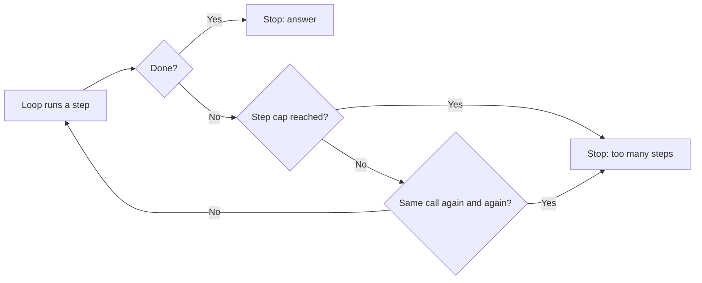

# When the loop must stop

Each example asks one question, and each trip round the loop is one step. The loop allows 6 steps, 2 identical calls and 400 tokens of budget. Change them with --steps, --repeats and --budget. Two pretend habits help: --model stuck repeats one search, and --model wanders tries new words.

## The story in one picture



## The problem

A model that is stuck makes the same call again and again. This is a stuck call, and it never says it is done.

## New words

Each word has one meaning in every lab.

- **step**: One trip round the loop: the model acts, then the code reacts.
- **stuck call**: The same tool call, with the same input, made again and again with no progress.
- **budget**: The most we allow ourselves to spend, in tokens, money, steps or time.

## Run it

Copy any line into your terminal. Each one is a real example from this lab.

```bash
bun run lab stop-conditions --question "What is the dose of Zorbex?" --model stuck --naive
bun run lab stop-conditions --question "What is the dose of Cardioza?"
bun run lab stop-conditions --question "What is the dose of Zorbex?" --model stuck
bun run lab stop-conditions --question "What is the dose of Zorbex?" --model wanders
bun run lab stop-conditions --question "What is the dose of Cardioza?" --budget 20
bun run lab stop-conditions --question "What is the dose of Cardioza?" --steps 1
bun run lab stop-conditions --question "What is the dose of Zorbex?" --model stuck --repeats 9 --steps 3
bun run lab stop-conditions --demo
```

Run `bun run lab stop-conditions` with nothing else to pick an example from a menu.

## The cases

Case 1 is the naive way. Read what goes wrong, then read the rest.

| # | Case | Why it matters | Result | Run it alone |
| --- | --- | --- | --- | --- |
| 1 | NAIVE: trust the model to stop | The model keeps making the same call. With no limit of our own, the loop never ends. The demo cuts it at 200 rounds. | never-stopped | `bun run lab stop-conditions --question "What is the dose of Zorbex?" --model stuck --naive` |
| 2 | A model that answers | One search, then an answer. The normal case. No limit is touched. | answered | `bun run lab stop-conditions --question "What is the dose of Cardioza?"` |
| 3 | A model that is stuck | The same call again and again. We allow it twice, because a retry can be fair. The third time we stop. | repeat | `bun run lab stop-conditions --question "What is the dose of Zorbex?" --model stuck` |
| 4 | A model that wanders | New words each time, so it is not a repeat. The step limit ends it. | max-steps | `bun run lab stop-conditions --question "What is the dose of Zorbex?" --model wanders` |
| 5 | A small budget | Every round sends the whole chat again. A budget of 20 tokens is gone before the model is asked a second time. | out-of-budget | `bun run lab stop-conditions --question "What is the dose of Cardioza?" --budget 20` |
| 6 | One step only | We allow one round. The model wants a second one, so we stop it, even though it was close to an answer. | max-steps | `bun run lab stop-conditions --question "What is the dose of Cardioza?" --steps 1` |
| 7 | A fair retry | Two identical calls are allowed. A model that retries once and then answers is fine. Here the limit is raised to show the rule. | max-steps | `bun run lab stop-conditions --question "What is the dose of Zorbex?" --model stuck --repeats 9 --steps 3` |

## The promise, and its test

A run always stops within its steps and its budget, and says why it stopped.

```bash
bun test tests/promises/15.test.ts
```

To see the test do its job, break the rule in PART 1 on purpose. The test must fail. Then undo it.

## In production

Set the limits for each task. Alert when a run hits one. Show the stop reason to the person.

## Read the code

Open `labs/15-stop-conditions.ts`. Read the code from the top. It holds only the lesson.
The screen output is in `show/`. You do not need it to learn.
