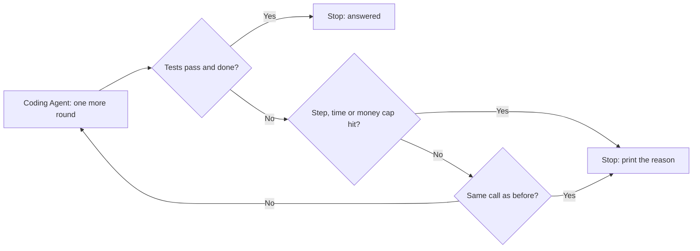

# When the loop must stop

The Coding Agent tries to fix the failing coupon test from build 2. One trip round the loop is a step. It allows 6 steps, 1 call made twice, 120 seconds and 6 cents. Change them with --steps, --repeats, --seconds and --cents. Try --model stuck to repeat one edit, or --model wanders to try new edits.

## The story in one picture



## The problem

A model that is stuck makes the same edit again and again. It never says it is done, and every round costs more than the last.

## New words

Each word has one meaning in every lab.

- **step**: One trip round the loop: the model acts, then the code reacts.
- **cap**: A hard limit we set, such as the money one run may spend.

## Run it

Copy any line into your terminal. Each one is a real example from this lab.

```bash
bun run lab stop-conditions --question "Fix the failing coupon test" --model stuck --naive
bun run lab stop-conditions --question "Fix the failing coupon test"
bun run lab stop-conditions --question "Fix the failing coupon test" --model stuck
bun run lab stop-conditions --question "Fix the failing coupon test" --model wanders --seconds 9999
bun run lab stop-conditions --question "Fix the failing coupon test" --model wanders --steps 12 --seconds 90 --cents 50
bun run lab stop-conditions --question "Fix the failing coupon test" --cents 1
bun run lab stop-conditions --question "Fix the failing coupon test" --steps 2
bun run lab stop-conditions --question "Fix the failing coupon test" --model stuck --repeats 9 --steps 3
bun run lab stop-conditions --demo
```

Run `bun run lab stop-conditions` with nothing else to pick an example from a menu.

## The cases

Case 1 is the naive way. Read what goes wrong, then read the rest.

| # | Case | Why it matters | Result | Run it alone |
| --- | --- | --- | --- | --- |
| 1 | NAIVE: trust the model to stop | The model makes the same edit again and again. With no limit of our own, the loop never ends. The demo cuts it at 200 rounds. | never-stopped | `bun run lab stop-conditions --question "Fix the failing coupon test" --model stuck --naive` |
| 2 | A model that fixes it | One edit, one test run, then an answer. The normal case. No limit is touched. | answered | `bun run lab stop-conditions --question "Fix the failing coupon test"` |
| 3 | The same edit twice | The model sends the edit it already tried. Nothing changed, so a second try is a waste. The loop stops it and prints why. | same-call | `bun run lab stop-conditions --question "Fix the failing coupon test" --model stuck` |
| 4 | A model that wanders | New edits each time, so it is not a repeat. The step limit ends it. | max-steps | `bun run lab stop-conditions --question "Fix the failing coupon test" --model wanders --seconds 9999` |
| 5 | A slow test run | Each test run takes 45 seconds. A model that tries new edits and runs the tests each time uses up the time cap. | out-of-time | `bun run lab stop-conditions --question "Fix the failing coupon test" --model wanders --steps 12 --seconds 90 --cents 50` |
| 6 | A small money cap | Every round sends the whole chat again. A cap of 1 cent is gone by the third round. | out-of-money | `bun run lab stop-conditions --question "Fix the failing coupon test" --cents 1` |
| 7 | Two rounds only | We allow two rounds. The model needs three, so we stop it, even though it was close to an answer. | max-steps | `bun run lab stop-conditions --question "Fix the failing coupon test" --steps 2` |
| 8 | A fair retry | A test can fail by chance, so a retry can be fair. Here the repeat limit is raised to 9, and the step limit ends the run instead. | max-steps | `bun run lab stop-conditions --question "Fix the failing coupon test" --model stuck --repeats 9 --steps 3` |

## Stuck points

**Correct run:** Stop at the first limit reached, whether steps, a repeat, time or money. The run says why it stopped.

**Common wrong turn:** Trusting the model to stop. A stuck model makes the same edit again and again and never says it is done.

**Hint to give:** Which limit would stop this loop, and when?

| What you see | What it means | Fix |
| --- | --- | --- |
| The demo prints outcome: never-stopped on the NAIVE case | No limit of our own was set | Set a step limit, a same-call limit, a time cap and a money cap |
| The run prints a stop reason | A limit was hit before the answer | Read the reason. Raise a limit only if the task needs it |
| The run stops with same-call after one edit | The model sent the same edit twice | Good. If a retry can be fair, such as a flaky test, raise --repeats |

## The promise, and its test

A run always stops within its steps, its time and its money, and says why it stopped. The same call twice stops it.

```bash
bun test tests/promises/15.test.ts
```

To see the test do its job, break the rule in PART 1 on purpose. The test must fail. Then undo it.

## In production

Set the limits for each task. Alert when a run hits one. Show the stop reason to the person.

## Read the code

Open `labs/15-stop-conditions.ts`. Read the code from the top. It holds only the lesson.
The screen output is in `show/`. You do not need it to learn.
