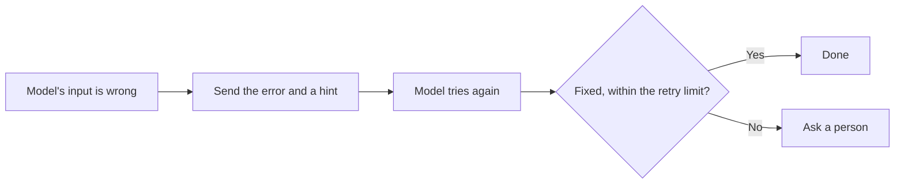

# A useful error

Each example is a question like Cardioza in Germany. The model writes the tool call, reads each error, and fixes the call, up to 3 tries. Each try after a failure is a retry.

## The story in one picture



## The problem

A bare ERROR gives the model no hint to fix. It repeats the same call until the loop runs out.

## New words

Each word has one meaning in every lab.

- **retry**: Try the same call again after it failed.
- **hint**: A short line that says what the error expected, so the model can fix its call.
- **ask a person**: Stop and let a person decide, because only they know what was meant.

## Run it

Copy any line into your terminal. Each one is a real example from this lab.

```bash
bun run lab error-feedback --question "What is the dose of Cardioza in Germany?" --naive
bun run lab error-feedback --question "What is the dose of Cardioza in the US?"
bun run lab error-feedback --question "What is the dose of Cardioza in Germany?"
bun run lab error-feedback --question "What is the dose of Cardiozza in the US?"
bun run lab error-feedback --question "What is the dose of Cardiozza in Germany?"
bun run lab error-feedback --question "What is the dose of Cardioza in France?"
bun run lab error-feedback --question "What is the dose of Zorbex in the US?"
bun run lab error-feedback --question "What is the dose of Dermalin in Germany?"
bun run lab error-feedback --demo
```

Run `bun run lab error-feedback` with nothing else to pick an example from a menu.

## The cases

Case 1 is the naive way. Read what goes wrong, then read the rest.

| # | Case | Why it matters | Result | Run it alone |
| --- | --- | --- | --- | --- |
| 1 | NAIVE: an error that says nothing | The country is Germany, which the tool does not accept. The error only says ERROR, so the model sends the same call three times and gives up. | gave-up | `bun run lab error-feedback --question "What is the dose of Cardioza in Germany?" --naive` |
| 2 | A call that works | Nothing to fix. One try. | answered | `bun run lab error-feedback --question "What is the dose of Cardioza in the US?"` |
| 3 | A country spelled out | The error says to use US or DE. The model maps Germany to DE and tries again. | fixed | `bun run lab error-feedback --question "What is the dose of Cardioza in Germany?"` |
| 4 | A drug with a typo | The error lists the known drugs. The model picks the one that looks like its typo. | fixed | `bun run lab error-feedback --question "What is the dose of Cardiozza in the US?"` |
| 5 | EDGE: two mistakes in one call | The country is fixed first, then the drug. That is three tries, which is exactly the limit. | fixed | `bun run lab error-feedback --question "What is the dose of Cardiozza in Germany?"` |
| 6 | A country we do not serve | France is not US or DE. The model must not swap it for US, because that is a different doctor's label. A person decides. | ask-person | `bun run lab error-feedback --question "What is the dose of Cardioza in France?"` |
| 7 | A drug nobody knows | Zorbex is not close to any known drug. Guessing could be dangerous, so a person decides. | ask-person | `bun run lab error-feedback --question "What is the dose of Zorbex in the US?"` |
| 8 | Valid call, no document | Dermalin has no German document. That is not an error, so there is no retry. The answer is no source. | no-source | `bun run lab error-feedback --question "What is the dose of Dermalin in Germany?"` |

## Stuck points

**Correct run:** Return an error that says what is valid, so the model can fix its call. A call that cannot be fixed goes to a person.

**Common wrong turn:** Returning a bare ERROR. The model repeats the same call until it runs out of tries.

**Hint to give:** What would the model need to read to change its call?

| What you see | What it means | Fix |
| --- | --- | --- |
| The demo prints outcome: gave-up on the NAIVE case | The same call was sent three times | Send the valid countries in the error text |
| The model fixed its call, and the tool ran | The error said what was wrong | This is correct. The hint did its job |
| A retry never stops | The retry cap is missing | Cap the retries, then ask a person |

## The promise, and its test

An error says what is valid. Retries are capped. A call that cannot be fixed means we ask a person.

```bash
bun test tests/promises/16.test.ts
```

To see the test do its job, break the rule in PART 1 on purpose. The test must fail. Then undo it.

## In production

Write every tool error for a reader that cannot ask questions, and count how often each error appears.

## Read the code

Open `labs/16-error-feedback.ts`. Read the code from the top. It holds only the lesson.
The screen output is in `show/`. You do not need it to learn.
