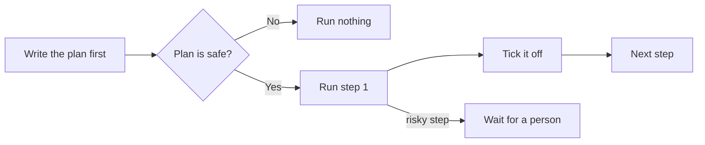

# Plan, then act

Each example is a plan the model wrote. Pick one by name: look-up, send-reply, delete-files, too-long or no-source. The code checks the plan before any step runs.

## The story in one picture



## The problem

Step by step, an email can go out before anyone sees the plan was wrong. A risky step, such as sending an email, cannot be undone.

## New words

Each word has one meaning in every lab.

- **plan**: A list of steps, written before the first step runs.
- **risky step**: A step that cannot be undone, such as sending an email.

## Run it

Copy any line into your terminal. Each one is a real example from this lab.

```bash
bun run lab plan-then-act --question "Look up the Cardioza dose and email it to me" --naive
bun run lab plan-then-act --question "Look up the Cardioza dose and write a reply"
bun run lab plan-then-act --question "Look up the Cardioza dose and email it to me"
bun run lab plan-then-act --question "Look up the Cardioza dose and email it to me" --approve
bun run lab plan-then-act --demo
bun run lab plan-then-act --demo
bun run lab plan-then-act --question "Look up the Zorbex dose and write a reply"
bun run lab plan-then-act --demo
```

Run `bun run lab plan-then-act` with nothing else to pick an example from a menu.

## The cases

Case 1 is the naive way. Read what goes wrong, then read the rest.

| # | Case | Why it matters | Result | Run it alone |
| --- | --- | --- | --- | --- |
| 1 | NAIVE: act with no plan | The plan runs as it is written. The email is sent before anyone could say no. | ran-unchecked | `bun run lab plan-then-act --question "Look up the Cardioza dose and email it to me" --naive` |
| 2 | A safe plan | Search, then draft. Nothing risky, so it runs. | done | `bun run lab plan-then-act --question "Look up the Cardioza dose and write a reply"` |
| 3 | A plan that sends an email | Sending cannot be undone. Nothing runs until a person approves, not even the safe steps. | needs-approval | `bun run lab plan-then-act --question "Look up the Cardioza dose and email it to me"` |
| 4 | The same plan, approved | A person said yes, so every step runs. | done | `bun run lab plan-then-act --question "Look up the Cardioza dose and email it to me" --approve` |
| 5 | A plan with a tool we never gave | A typed plan. There is no delete_records tool. The plan is rejected, and the search never runs. | rejected | `bun run lab plan-then-act --demo` |
| 6 | EDGE: a plan that is too long | A typed plan of six steps is over our limit of five. A long plan is a sign the model is lost. | rejected | `bun run lab plan-then-act --demo` |
| 7 | EDGE: the first step finds nothing | There is no approved document for Zorbex. The draft would be made up, so the run stops. | stopped | `bun run lab plan-then-act --question "Look up the Zorbex dose and write a reply"` |

## Stuck points

**Correct run:** Check the whole plan before any step runs. A risky step waits for a person, and a failed step stops the rest.

**Common wrong turn:** Running each step as it is written. The email goes out before anyone sees the plan was wrong.

**Hint to give:** Which step can never be undone? Should it run before a person checks?

| What you see | What it means | Fix |
| --- | --- | --- |
| The demo prints outcome: ran-unchecked on the NAIVE case | The plan ran with no check | Check the plan before the first step |
| The run waits at a risky step | The step cannot be undone, so a person decides | Approve the step, or stop the plan |
| The plan stops at one step | A failed step stops the rest | This is correct. Fix that step, then run again |

## The promise, and its test

A plan is checked before it runs. A risky step needs a person. A failed step stops the rest.

```bash
bun test tests/promises/17.test.ts
```

To see the test do its job, break the rule in PART 1 on purpose. The test must fail. Then undo it.

## In production

Show the plan to the person and keep it with the run. Then compare what ran with the plan.

## Read the code

Open `labs/17-plan-then-act.ts`. Read the code from the top. It holds only the lesson.
The screen output is in `show/`. You do not need it to learn.
