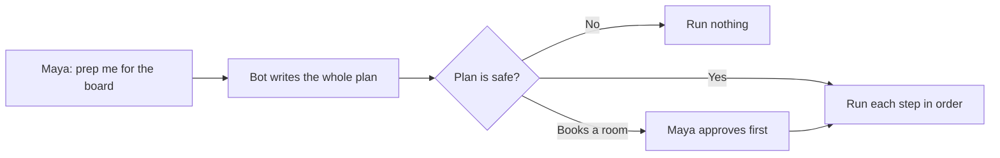

# Plan, then act

Each example is a job for the Chief of Staff bot, or a plan someone typed. The model writes the plan. The code checks the plan before any step runs, and Maya approves it if a step is risky.

## The story in one picture



## The problem

Step by step, the bot forgets what it did and books the room twice. A risky step, such as booking a room, cannot be undone.

## New words

Each word has one meaning in every lab.

- **plan**: A list of steps, written before the first step runs.
- **risky step**: A step that cannot be undone, such as booking a room.

## Run it

Copy any line into your terminal. Each one is a real example from this lab.

```bash
bun run lab plan-then-act --question "Prep me for Thursday's board meeting." --naive
bun run lab plan-then-act --question "Draft the agenda for the board meeting."
bun run lab plan-then-act --question "Prep me for Thursday's board meeting."
bun run lab plan-then-act --question "Prep me for Thursday's board meeting." --approve
bun run lab plan-then-act --demo
bun run lab plan-then-act --demo
bun run lab plan-then-act --demo
bun run lab plan-then-act --question "Prep me for Monday's board meeting." --approve
bun run lab plan-then-act --demo
```

Run `bun run lab plan-then-act` with nothing else to pick an example from a menu.

## The cases

Case 1 is the naive way. Read what goes wrong, then read the rest.

| # | Case | Why it matters | Result | Run it alone |
| --- | --- | --- | --- | --- |
| 1 | NAIVE: act with no plan | The bot sees only the last result. It books the room, then books it again after the agenda. | ran-unchecked | `bun run lab plan-then-act --question "Prep me for Thursday's board meeting." --naive` |
| 2 | A safe plan | Papers, numbers, agenda. Nothing risky, so it runs. | done | `bun run lab plan-then-act --question "Draft the agenda for the board meeting."` |
| 3 | A plan that books a room | A booking cannot be undone. Nothing runs until Maya approves, not even the safe steps. | needs-approval | `bun run lab plan-then-act --question "Prep me for Thursday's board meeting."` |
| 4 | The same plan, approved | Maya said yes, so every step runs, and the room is booked once. | done | `bun run lab plan-then-act --question "Prep me for Thursday's board meeting." --approve` |
| 5 | A plan with a tool we never gave | A typed plan. There is no pay_invoice tool. The plan is rejected, and the calendar is never read. | rejected | `bun run lab plan-then-act --demo` |
| 6 | EDGE: a plan that books twice | The same booking appears two times. The check rejects it, so the double booking never happens. | rejected | `bun run lab plan-then-act --demo` |
| 7 | EDGE: a plan that is too long | A typed plan of six steps is over our limit of five. A long plan is a sign the model is lost. | rejected | `bun run lab plan-then-act --demo` |
| 8 | EDGE: the first step finds nothing | Monday has no free slot. Booking a room anyway would be a guess, so the run stops. | stopped | `bun run lab plan-then-act --question "Prep me for Monday's board meeting." --approve` |

## Stuck points

**Correct run:** Check the whole plan before any step runs. A risky step waits for a person, and a failed step stops the rest.

**Common wrong turn:** Picking one step at a time. The bot forgets what it did and books the room twice.

**Hint to give:** Which step can never be undone? Should it run before Maya checks?

| What you see | What it means | Fix |
| --- | --- | --- |
| The demo prints outcome: ran-unchecked on the NAIVE case | The bot ran with no plan and no check | Write the plan first, and check it before step one |
| The demo prints outcome: needs-approval on the booking plan | The step cannot be undone, so Maya decides | Approve the plan, or stop it |
| The plan stops at one step | A failed step stops the rest | This is correct. Fix that step, then run again |

## The promise, and its test

A plan is checked before it runs. A risky step needs Maya. A failed step stops the rest.

```bash
bun test tests/promises/17.test.ts
```

To see the test do its job, break the rule in PART 1 on purpose. The test must fail. Then undo it.

## In production

Show Maya the plan and keep it with the run. Then compare what ran with the plan.

## Read the code

Open `labs/17-plan-then-act.ts`. Read the code from the top. It holds only the lesson.
The screen output is in `show/`. You do not need it to learn.
