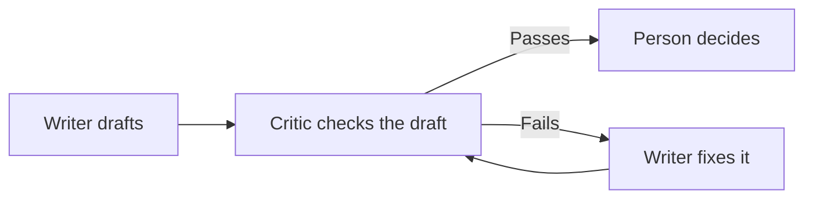

# Check the draft, then fix it

Each example is a doctor's question. The pretend model writes a draft, and sometimes the draft is wrong. Pick how it acts with --model. Use ok, nocite (no citation), overclaim (an extra claim), invent (a wrong dose) or stubborn. Stubborn is a wrong dose it will not fix.

## The story in one picture



## The problem

A model that grades its own work has no new facts. It says the draft looks good, even when the dose is wrong.

## New words

Each word has one meaning in every lab.

- **draft**: The first answer, before it is checked.
- **check**: A rule in plain code that a draft must pass before it goes out.
- **round**: One fix, followed by one more check.

## Run it

Copy any line into your terminal. Each one is a real example from this lab.

```bash
bun run lab reflect-and-fix --question "How much Cardioza does an adult take each day?" --model invent --naive
bun run lab reflect-and-fix --question "What is the dose of Cardioza?"
bun run lab reflect-and-fix --question "What is the dose of Cardioza?" --model nocite
bun run lab reflect-and-fix --question "What is the dose of Cardioza?" --model invent
bun run lab reflect-and-fix --question "What is the dose of Cardioza?" --model stubborn
bun run lab reflect-and-fix --question "What is the dose of Cardioza?" --model overclaim
bun run lab reflect-and-fix --question "How much Cardioza should an adult take?" --form
bun run lab reflect-and-fix --question "How much Cardioza should I give?" --form
bun run lab reflect-and-fix --question "Is Zorbex safe for children?"
bun run lab reflect-and-fix --demo
```

Run `bun run lab reflect-and-fix` with nothing else to pick an example from a menu.

## The cases

Case 1 is the naive way. Read what goes wrong, then read the rest.

| # | Case | Why it matters | Result | Run it alone |
| --- | --- | --- | --- | --- |
| 1 | NAIVE: ask the model if it is fine | The model writes 20mg. The document says 10mg. We ask the model if the draft is fine. It has no new facts, so it says yes. | self-approved | `bun run lab reflect-and-fix --question "How much Cardioza does an adult take each day?" --model invent --naive` |
| 2 | A good draft | It cites the document and the dose matches. No fix is needed. | accepted | `bun run lab reflect-and-fix --question "What is the dose of Cardioza?"` |
| 3 | A missing citation | The check finds no citation. The model adds one, and the second check passes. | fixed | `bun run lab reflect-and-fix --question "What is the dose of Cardioza?" --model nocite` |
| 4 | A wrong dose | The check finds 20mg is not in the document. The model changes it to 10mg. | fixed | `bun run lab reflect-and-fix --question "What is the dose of Cardioza?" --model invent` |
| 5 | EDGE: a model that will not change | The model sends the same wrong draft twice. After two rounds we stop and give it to a person. | gave-up | `bun run lab reflect-and-fix --question "What is the dose of Cardioza?" --model stubborn` |
| 6 | A second reader catches what code cannot | The numbers and the citation are right. But the draft adds that the drug is safe for children. The source never says that. The critic sees only the draft and the source, and it fails the draft. | needs-person | `bun run lab reflect-and-fix --question "What is the dose of Cardioza?" --model overclaim` |
| 7 | A form, then code writes the number | The model fills drug and age. It never writes a dose. Code takes the adult dose from the newest label, version 2. Version 1 said 20mg and is ignored. | from-label | `bun run lab reflect-and-fix --question "How much Cardioza should an adult take?" --form` |
| 8 | EDGE: no age means both doses | The doctor gave no age. The form says unknown, so code prints the adult dose and the child dose. | from-label | `bun run lab reflect-and-fix --question "How much Cardioza should I give?" --form` |
| 9 | No approved document | Zorbex has no approved document. With nothing to check against, there is no answer to give. | no-source | `bun run lab reflect-and-fix --question "Is Zorbex safe for children?"` |

## Stuck points

**Correct run:** Check each draft in code against the source. A fix gets two rounds at most, then a person decides.

**Common wrong turn:** Asking the model if its draft is fine. It has no new facts, so it says yes.

**Hint to give:** What can code check that the model cannot judge by itself?

| What you see | What it means | Fix |
| --- | --- | --- |
| The demo prints outcome: self-approved on the NAIVE case | The model approved its own wrong dose | Check the dose and the citation in code, not with the model |
| The log shows round 1, round 2, then a person | The fix limit was reached | This is correct. A person decides when the fixes fail |
| A draft with no source is passed | The check had no source to compare with | With no source, stop and ask. Do not pass it |

## The promise, and its test

Code runs a check on every draft against the source. A fix gets two rounds at most. With no source there is nothing to check.

```bash
bun test tests/promises/18.test.ts
```

To see the test do its job, break the rule in PART 1 on purpose. The test must fail. Then undo it.

## In production

Check what code can check, like numbers and citations. The model fills a small form. Code looks the number up in the newest label. A critic that sees only the draft and the source checks the rest. Send what is left to a person, and keep every round in the log.

## Read the code

Open `labs/18-reflect-and-fix.ts`. Read the code from the top. It holds only the lesson.
The screen output is in `show/`. You do not need it to learn.
