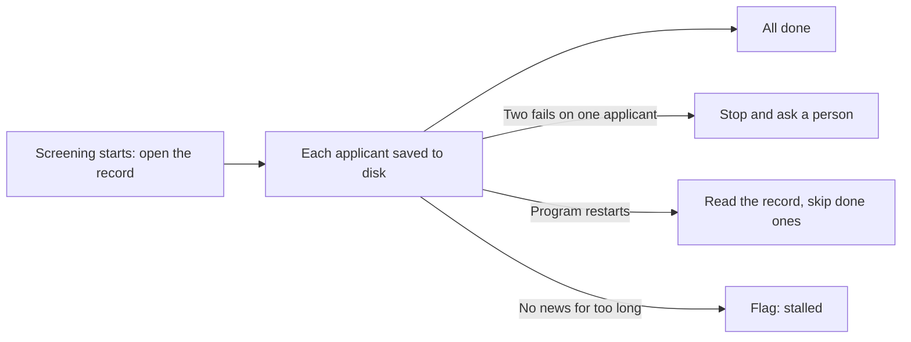

# Run state

Each example is a night of screening for the Talent Scout bot. It saves a run record to disk after every try. Afterwards we read the record back, the way a restart or a person would.

## The story in one picture



## The problem

Progress kept in memory is gone when the program restarts. The bot would screen every applicant again. Nobody can say what the run was doing, or if it is still alive.

## New words

Each word has one meaning in every lab.

- **run**: One job from its start to its end.
- **run record**: A file that saves the run's id, its status and one line for each applicant.
- **stalled**: Still marked as running, but no step has finished for too long.

## Run it

Copy any line into your terminal. Each one is a real example from this lab.

```bash
bun run lab run-state --demo
bun run lab run-state --question "Score the first 30 applicants today." --from 1 --count 30
bun run lab run-state --question "Screen thirty applicants, and the laptop sleeps." --from 1 --count 30 --crash 12
bun run lab run-state --question "Screen applicants 71 to 80." --from 71 --count 10
bun run lab run-state --question "Screen all 120 applicants tonight." --from 1 --count 120
bun run lab run-state --question "Is the overnight screening still going?" --stalled
bun run lab run-state --question "What is run R-nothing doing?" --ask --run R-nothing
bun run lab run-state --demo
```

Run `bun run lab run-state` with nothing else to pick an example from a menu.

## The cases

Case 1 is the naive way. Read what goes wrong, then read the rest.

| # | Case | Why it matters | Result | Run it alone |
| --- | --- | --- | --- | --- |
| 1 | NAIVE: progress in memory | The program dies after twelve applicants. The restart knows nothing, so it screens those twelve again. | starts-over | `bun run lab run-state --demo` |
| 2 | A run that works | Thirty applicants, no trouble. The record on disk says done. | done | `bun run lab run-state --question "Score the first 30 applicants today." --from 1 --count 30` |
| 3 | A restart in the middle | The program dies after twelve applicants. The restart reads the record, skips them, and screens only the other eighteen. | resumed | `bun run lab run-state --question "Screen thirty applicants, and the laptop sleeps." --from 1 --count 30 --crash 12` |
| 4 | A busy service | The CV service is busy for applicant 77. The bot tries again, the second try works, and the record says two tries. | recovered | `bun run lab run-state --question "Screen applicants 71 to 80." --from 71 --count 10` |
| 5 | Two fails on one applicant | The CV file of applicant 40 is empty. Two tries fail, so a third would too. The run stops and asks a person. | needs-person | `bun run lab run-state --question "Screen all 120 applicants tonight." --from 1 --count 120` |
| 6 | EDGE: a run that went quiet | A run saved one applicant, then its program died. The record still says running. Ten minutes of silence means stalled. | stalled | `bun run lab run-state --question "Is the overnight screening still going?" --stalled` |
| 7 | EDGE: a run that never existed | Asking about an id we never saved gives a clear answer, not a crash. | unknown | `bun run lab run-state --question "What is run R-nothing doing?" --ask --run R-nothing` |

## Stuck points

**Correct run:** Save one entry per applicant after every try. A restart reads the record and skips the done ones.

**Common wrong turn:** Keeping progress in memory. A restart screens every applicant again.

**Hint to give:** What could a restarted program read to know where it stopped?

| What you see | What it means | Fix |
| --- | --- | --- |
| The demo prints outcome: starts-over on the NAIVE case | Progress was only in memory | Save the record to disk after each try |
| The run shows as stalled | No try finished for too long | Check the applicant that is waiting, and restart it |
| The demo prints outcome: needs-person on the full run | One applicant failed twice, so the run stopped | This is correct. Fix that CV, then run again |

## The promise, and its test

Every run has a record from its first step. The record is saved after every try. A restart picks up where it stopped. Two fails on one applicant stop the run. A quiet run is called stalled.

```bash
bun test tests/promises/19.test.ts
```

To see the test do its job, break the rule in PART 1 on purpose. The test must fail. Then undo it.

## In production

Keep run records in a database, show them on a board, and alert on a stalled run.

## Read the code

Open `labs/19-run-state.ts`. Read the code from the top. It holds only the lesson.
The screen output is in `show/`. You do not need it to learn.
