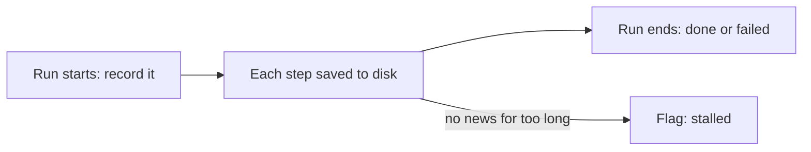

# Run state

Each example is one run of the agent. Each run saves a run record to disk. Afterwards we read the record back, the way another person or program would.

## The story in one picture



## The problem

A printed log is gone when the program ends. Nobody can say what the run was doing, or if it is still alive.

## New words

Each word has one meaning in every lab.

- **run**: One job from its start to its end.
- **run record**: A file that saves the run's id, its status and its steps.
- **stalled**: Still marked as running, but no step has finished for too long.

## Run it

Copy any line into your terminal. Each one is a real example from this lab.

```bash
bun run lab run-state --question "What is the dose of Cardioza?" --naive
bun run lab run-state --question "What is the dose of Cardioza?"
bun run lab run-state --question "Is Zorbex safe for children?"
bun run lab run-state --question "What is the dose of Cardioza?" --stalled
bun run lab run-state --question "What is the dose of Cardioza?" --ask --run R-nothing
bun run lab run-state --demo
```

Run `bun run lab run-state` with nothing else to pick an example from a menu.

## The cases

Case 1 is the naive way. Read what goes wrong, then read the rest.

| # | Case | Why it matters | Result | Run it alone |
| --- | --- | --- | --- | --- |
| 1 | NAIVE: only a printed log | The agent prints what it is doing. When it ends, there is no record. Nobody can ask about it later. | no-record | `bun run lab run-state --question "What is the dose of Cardioza?" --naive` |
| 2 | A run that works | The record is saved after each step. We read it back from disk. It says done, with its steps. | done | `bun run lab run-state --question "What is the dose of Cardioza?"` |
| 3 | A run that fails | Zorbex has no approved document. The record says failed, and why. | failed | `bun run lab run-state --question "Is Zorbex safe for children?"` |
| 4 | EDGE: a run that went quiet | A run saved one step, then its program died. The record still says running. Ten minutes of silence means stalled. | stalled | `bun run lab run-state --question "What is the dose of Cardioza?" --stalled` |
| 5 | EDGE: a run that never existed | Asking about an id we never saved gives a clear answer, not a crash. | unknown | `bun run lab run-state --question "What is the dose of Cardioza?" --ask --run R-nothing` |

## The promise, and its test

Every run has a record from its first step. The record is saved after every step. A quiet run is called stalled.

```bash
bun test tests/promises/19.test.ts
```

To see the test do its job, break the rule in PART 1 on purpose. The test must fail. Then undo it.

## In production

Keep run records in a database, show them on a board, and alert on a stalled run.

## Read the code

Open `labs/19-run-state.ts`. Read the code from the top. It holds only the lesson.
The screen output is in `show/`. You do not need it to learn.
