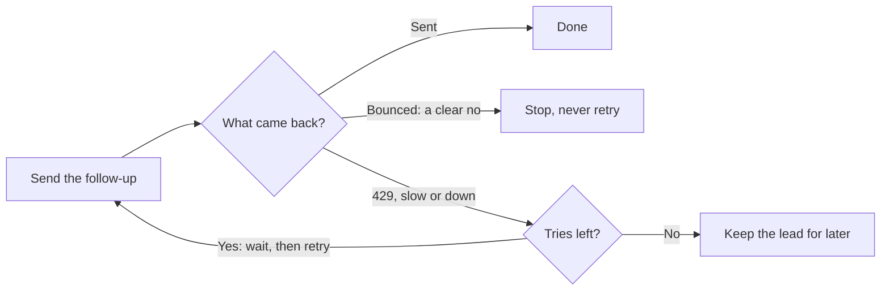

# When tools fail

Each example starts a real mail service on your computer. Pick how it behaves with --service: ok, busy (says 429 twice), slow (answers after three seconds) or down.

## The story in one picture



## The problem

Follow-ups hit 429s, slow replies and bounces. A transient failure passes if we wait. A bounced address never does. A bot that retries everything hammers a dead address and delays the real leads.

## New words

Each word has one meaning in every lab.

- **timeout**: The longest time we wait for a reply before we give up on the call.
- **retry**: Try the same call again after it failed.
- **backoff**: Wait longer before each retry.
- **transient**: A failure that may pass if we try again, such as a brief outage.

## Run it

Copy any line into your terminal. Each one is a real example from this lab.

```bash
bun run lab tool-failures --question "Follow up with Quill Stationery about the quote." --service ok --lead quill-stationery --naive
bun run lab tool-failures --question "Nudge Harbor Dental about the new price list." --lead harbor-dental
bun run lab tool-failures --question "Remind Maple Legal about the contract draft." --service busy --lead maple-legal
bun run lab tool-failures --question "Check in with Cedar Books after the demo." --service slow --lead cedar-books
bun run lab tool-failures --question "Thank Atlas Movers for the call last week." --service down --lead atlas-movers
bun run lab tool-failures --question "Ask Xylo Music if they still want the trial." --lead xylo-music
bun run lab tool-failures --question "Send a note to the lead from the trade show." --lead trade-show-lead
bun run lab tool-failures --demo
```

Run `bun run lab tool-failures` with nothing else to pick an example from a menu.

## The cases

Case 1 is the naive way. Read what goes wrong, then read the rest.

| # | Case | Why it matters | Result | Run it alone |
| --- | --- | --- | --- | --- |
| 1 | NAIVE: retry everything at once | Quill Stationery bounced last week. The naive bot hears no, and asks again and again, with no wait. | retried-a-no | `bun run lab tool-failures --question "Follow up with Quill Stationery about the quote." --service ok --lead quill-stationery --naive` |
| 2 | A healthy service | The first try works. No waiting, no retry. | sent | `bun run lab tool-failures --question "Nudge Harbor Dental about the new price list." --lead harbor-dental` |
| 3 | A busy service | The first two tries get a 429. We wait 200 ms, then 400 ms. The third try works. | sent | `bun run lab tool-failures --question "Remind Maple Legal about the contract draft." --service busy --lead maple-legal` |
| 4 | A slow service | The service takes three seconds. We stop each try after one second. After three tries the lead stays in the queue. | gave-up | `bun run lab tool-failures --question "Check in with Cedar Books after the demo." --service slow --lead cedar-books` |
| 5 | A service that is down | Every try fails with a 503. After three tries we stop and keep the lead for later. | gave-up | `bun run lab tool-failures --question "Thank Atlas Movers for the call last week." --service down --lead atlas-movers` |
| 6 | EDGE: the address bounced | Xylo Music has a dead mailbox. The service says no with a 422. Trying again cannot help, so we stop at once. | bounced | `bun run lab tool-failures --question "Ask Xylo Music if they still want the trial." --lead xylo-music` |
| 7 | EDGE: a lead we do not know | The lead id is not in our list. The check stops it before any call is made. | bad-input | `bun run lab tool-failures --question "Send a note to the lead from the trade show." --lead trade-show-lead` |

## Stuck points

**Correct run:** Stop each call at its timeout. Retry a 429 or a timeout with a growing backoff, but never retry a bounce.

**Common wrong turn:** Retrying every failure at once. A dead address is asked again and again.

**Hint to give:** Which failure passes if we wait, and which one is a clear no?

| What you see | What it means | Fix |
| --- | --- | --- |
| The demo prints outcome: retried-a-no on the NAIVE case | A bounce was treated like a busy service | Stop at once on a bounce, and retry only the rest |
| The demo prints outcome: gave-up on the slow case | Every try ran past the time limit | This is correct. The lead stays in the queue |
| The demo prints outcome: bounced on the EDGE case | The address is dead | This is correct. Remove it from the list |

## The promise, and its test

An unknown lead never reaches the service. A slow call stops at its timeout. A 429 or a 5xx is retried, with a backoff. A bounced address is never tried again.

```bash
bun test tests/promises/20.test.ts
```

To see the test do its job, break the rule in PART 1 on purpose. The test must fail. Then undo it.

## In production

Keep the bounced addresses in a list, so no later run tries them. Add a random wait so many bots do not retry together.

## Read the code

Open `labs/20-tool-failures.ts`. Read the code from the top. It holds only the lesson.
The screen output is in `show/`. You do not need it to learn.
