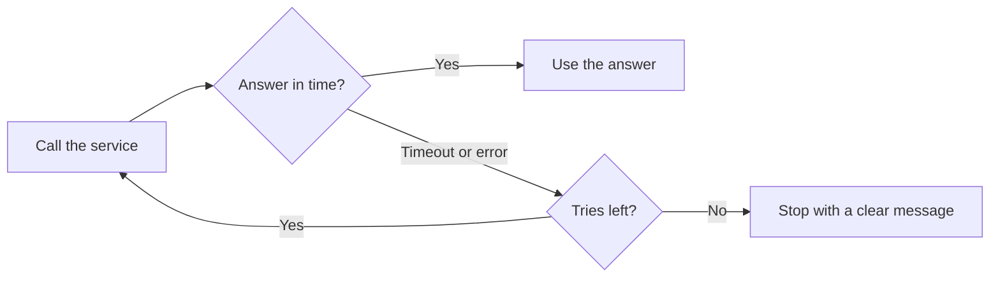

# When tools fail

Each example starts a real document service on your computer. Pick how it behaves with --service: ok, flaky (fails twice), slow (answers after three seconds) or down.

## The story in one picture



## The problem

A service can be slow, fail for a moment, or say no. One try with no time limit hangs on the slow one and gives up on the flaky one.

## New words

timeout = the most time we will wait. retry = try the same call again. backoff = wait longer before each retry. transient = a failure that may pass.

## Run it

Copy any line into your terminal. Each one is a real example from this lab.

```bash
bun run lab tool-failures --question "What is the dose of Cardioza?" --service flaky --naive
bun run lab tool-failures --question "What is the dose of Cardioza?"
bun run lab tool-failures --question "What is the dose of Cardioza?" --service flaky
bun run lab tool-failures --question "What is the dose of Cardioza?" --service slow
bun run lab tool-failures --question "What is the dose of Cardioza?" --service down
bun run lab tool-failures --question "What is the dose of Cardioza?" --country FR
bun run lab tool-failures --question "What is the dose of Cardioza?" --empty
bun run lab tool-failures --demo
```

Run `bun run lab tool-failures` with nothing else to pick an example from a menu.

## The cases

Case 1 is the naive way. Read what goes wrong, then read the rest.

| # | Case | Why it matters | Result | Run it alone |
| --- | --- | --- | --- | --- |
| 1 | NAIVE: one try, no time limit | The service fails once, as services do. One try gives up on the first 503, and the doctor gets no dose. | unavailable | `bun run lab tool-failures --question "What is the dose of Cardioza?" --service flaky --naive` |
| 2 | A healthy service | The first try works. No waiting, no retry. | ok | `bun run lab tool-failures --question "What is the dose of Cardioza?"` |
| 3 | A flaky service | The first two tries fail with 503. We wait 200 ms, then 400 ms. The third try works. | ok | `bun run lab tool-failures --question "What is the dose of Cardioza?" --service flaky` |
| 4 | A slow service | The service takes three seconds. We stop each try after one second. After three tries we say so and do not guess. | unavailable | `bun run lab tool-failures --question "What is the dose of Cardioza?" --service slow` |
| 5 | A service that is down | Every try fails. After three tries we stop and say the service is unavailable. | unavailable | `bun run lab tool-failures --question "What is the dose of Cardioza?" --service down` |
| 6 | EDGE: the service says no | France is not a country we serve. The service answers 400. Trying again cannot help, so we stop at once. | rejected | `bun run lab tool-failures --question "What is the dose of Cardioza?" --country FR` |
| 7 | EDGE: empty search words | The input check stops an empty query before any call is made. | bad-input | `bun run lab tool-failures --question "What is the dose of Cardioza?" --empty` |

## The promise, and its test

Bad input never leaves our code. A slow call stops at the time limit. A failure that may pass is tried again, with growing waits. A no is never tried again.

```bash
bun test tests/promises/20.test.ts
```

To see the test do its job, break the rule in PART 1 on purpose. The test must fail. Then undo it.

## In production

Add a circuit breaker for a service that stays down. Add a random wait so many agents do not retry together.

## Read the code

Open `labs/20-tool-failures.ts`. Read the code from the top. It holds only the lesson.
The screen output is in `show/`. You do not need it to learn.
