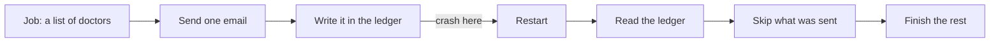

# Crash and resume

Each example emails three doctors. Some examples send a SIGKILL, which stops the program at once, and then start it again. Pick one with --scenario: naive, clean, resume, between or done. Each finished step is written in the ledger.

## The story in one picture



## The problem

A kill in the middle of a job loses work or does it twice. Start again from the top, and the first doctors get the same email twice.

## New words

Each word has one meaning in every lab.

- **ledger**: A file on disk that lists each step already finished.
- **idempotency key**: A unique name for one action, so it happens once, even if asked twice.
- **resume**: Start again from the ledger and carry on, not from the beginning.
- **SIGKILL**: A signal that stops a program at once. The program cannot catch it or clean up.

## Run it

Copy any line into your terminal. Each one is a real example from this lab.

```bash
bun run lab crash-and-resume --question "Email the Cardioza update to three doctors" --scenario naive
bun run lab crash-and-resume --question "Email the Cardioza update to three doctors" --scenario clean
bun run lab crash-and-resume --question "Email the Cardioza update to three doctors" --scenario resume
bun run lab crash-and-resume --question "Email the Cardioza update to three doctors" --scenario between
bun run lab crash-and-resume --question "Email the Cardioza update to three doctors" --scenario done
bun run lab crash-and-resume --demo
```

Run `bun run lab crash-and-resume` with nothing else to pick an example from a menu.

## The cases

Case 1 is the naive way. Read what goes wrong, then read the rest.

| # | Case | Why it matters | Result | Run it alone |
| --- | --- | --- | --- | --- |
| 1 | NAIVE: start over after a kill | The program dies after it emails Dr. Weber. The restart begins at the top. Dr. Lee and Dr. Weber get a second email. | duplicates | `bun run lab crash-and-resume --question "Email the Cardioza update to three doctors" --scenario naive` |
| 2 | No crash | All three doctors get one email, and the ledger lists all three. | ok | `bun run lab crash-and-resume --question "Email the Cardioza update to three doctors" --scenario clean` |
| 3 | A kill, then a restart | The program dies after the ledger holds Dr. Weber. The restart skips two doctors and emails Dr. Rao. | ok | `bun run lab crash-and-resume --question "Email the Cardioza update to three doctors" --scenario resume` |
| 4 | EDGE: a kill between the send and the ledger | The email went out but the ledger line was not written. The restart tries Dr. Weber again, and the outbox refuses the key. | ok | `bun run lab crash-and-resume --question "Email the Cardioza update to three doctors" --scenario between` |
| 5 | EDGE: run a finished job again | Every doctor is in the ledger. The second run does nothing at all. | ok | `bun run lab crash-and-resume --question "Email the Cardioza update to three doctors" --scenario done` |

## The promise, and its test

After a kill and a restart, every doctor has exactly one email. A step in the ledger is never done again. An idempotency key stops a send from happening twice.

```bash
bun test tests/promises/21.test.ts
```

To see the test do its job, break the rule in PART 1 on purpose. The test must fail. Then undo it.

## In production

Keep the ledger in a database. Ask your email service to honour the idempotency key. Then a crash between our two writes is still safe.

## Read the code

Open `labs/21-crash-and-resume.ts`. Read the code from the top. It holds only the lesson.
The screen output is in `show/`. You do not need it to learn.
