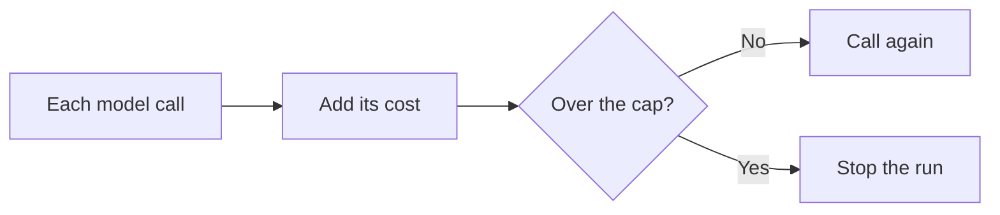

# Money caps

Each example runs the loop with a cost cap. The run cap is 1 cent and the day cap is 3 cents, so you see them hit. Change them with --run and --day, in whole cents. Also use --before (millicents spent today), --hops and --again.

## The story in one picture



## The problem

A stuck model keeps spending, and one person can start many runs in a day. A count of tokens does not stop a company bill.

## New words

Each word has one meaning in every lab.

- **millicent**: A thousandth of a cent. Using it keeps every amount a whole number.
- **cap**: A hard limit we set, such as the money one run may spend.
- **worst case**: The most one call can cost, if the model uses its longest answer.
- **hop**: One step where work passes from one bot or agent to another.

## Run it

Copy any line into your terminal. Each one is a real example from this lab.

```bash
bun run lab budgets --question "What is the dose of Zorbex?" --model stuck --naive
bun run lab budgets --question "What is the dose of Cardioza?"
bun run lab budgets --question "What is the dose of Zorbex?" --model stuck
bun run lab budgets --question "What is the dose of Cardioza?" --before 2500
bun run lab budgets --question "What is the dose of Cardioza?" --hops 3
bun run lab budgets --question "What is the dose of Cardioza?" --again 3 --day 1
bun run lab budgets --demo
```

Run `bun run lab budgets` with nothing else to pick an example from a menu.

## The cases

Case 1 is the naive way. Read what goes wrong, then read the rest.

| # | Case | Why it matters | Result | Run it alone |
| --- | --- | --- | --- | --- |
| 1 | NAIVE: no money cap | The model keeps making the same call, and nothing in our code counts money. The demo cuts it at 200 rounds, and the bill is long. | never-stopped | `bun run lab budgets --question "What is the dose of Zorbex?" --model stuck --naive` |
| 2 | A normal question | Two rounds, a fraction of a cent. No cap is touched. | answered | `bun run lab budgets --question "What is the dose of Cardioza?"` |
| 3 | A stuck model and a run cap | Each round sends the whole chat again, so each round costs more. The run cap of 1 cent stops it before the call that would pass it. | run-cap | `bun run lab budgets --question "What is the dose of Zorbex?" --model stuck` |
| 4 | EDGE: today's money is already used | This person spent 2500 millicents earlier today. The day cap is 3000. The worst case of the next call does not fit, so no call starts. | day-cap | `bun run lab budgets --question "What is the dose of Cardioza?" --before 2500` |
| 5 | EDGE: handed on too many times | This run is the third hand-over, and the cap is three hops. It is refused before any money is spent. | hop-cap | `bun run lab budgets --question "What is the dose of Cardioza?" --hops 3` |
| 6 | EDGE: many runs in one day | Each run is small. The ledger on disk adds them up. The day cap stops the second run in a row. | day-cap | `bun run lab budgets --question "What is the dose of Cardioza?" --again 3 --day 1` |

## Stuck points

**Correct run:** Check the worst case before each call. Refuse a call that would pass the run cap or the day cap.

**Common wrong turn:** Counting tokens and calling that a budget. A count of tokens does not stop a money bill.

**Hint to give:** What is the most this call can cost, and which cap does it meet?

| What you see | What it means | Fix |
| --- | --- | --- |
| The demo prints outcome: never-stopped on the NAIVE case | No money cap in the code | Add a run cap and a day cap, checked before each call |
| A call is refused before any money is spent | Its worst case passed a cap | This is correct. Raise a cap only with a reason |
| A run is refused as too many hops | The hop limit was reached | Shorten the hand-overs, or raise the hop limit |

## The promise, and its test

A call never starts if its worst case would pass a cap. What a call really cost is written to disk. A run with too many hops is refused.

```bash
bun test tests/promises/22.test.ts
```

To see the test do its job, break the rule in PART 1 on purpose. The test must fail. Then undo it.

## In production

Take the price list from your provider. Keep the ledger in a database that every server shares. Alert a person when a cap is hit.

## Read the code

Open `labs/22-budgets.ts`. Read the code from the top. It holds only the lesson.
The screen output is in `show/`. You do not need it to learn.
