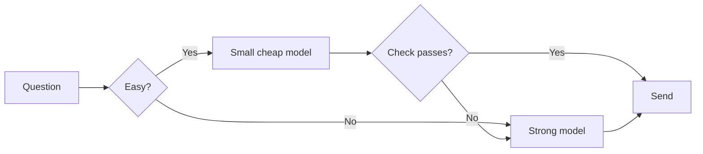

# Which model answers

Each example has a small model and a strong model. Our code routes each question to one, then checks the answer. The cascade tries the small model first. Pretend habits: --small and --big can be ok, nocite or invent.

## The story in one picture



## The problem

The strong model costs ten times more. Using it for every question wastes money. Using the small one alone sends wrong doses to doctors.

## New words

Each word has one meaning in every lab.

- **route**: Pick which model or helper handles a request.
- **cascade**: Try the cheap model first, and use a stronger one only if the answer fails the check.
- **check**: A rule in plain code that a draft must pass before it goes out.

## Run it

Copy any line into your terminal. Each one is a real example from this lab.

```bash
bun run lab model-routing --question "What is the dose of Cardioza?" --naive
bun run lab model-routing --question "What is the dose of Cardioza?"
bun run lab model-routing --question "What is the dose of Cardioza?" --small nocite
bun run lab model-routing --question "What is the dose of Cardioza?" --small invent
bun run lab model-routing --question "What is the dose of Cardioza?" --small nocite --big nocite
bun run lab model-routing --question "What is the dose of Zorbex?"
bun run lab model-routing --demo
```

Run `bun run lab model-routing` with nothing else to pick an example from a menu.

## The cases

Case 1 is the naive way. Read what goes wrong, then read the rest.

| # | Case | Why it matters | Result | Run it alone |
| --- | --- | --- | --- | --- |
| 1 | NAIVE: always the strong model | Every question goes to the strong model, and nobody checks the answer. It works, but it costs ten times more than it needs to. | always-big | `bun run lab model-routing --question "What is the dose of Cardioza?" --naive` |
| 2 | The small model is good enough | The small answer cites its source and the dose matches. It is sent as it is, and the strong model is never called. | small | `bun run lab model-routing --question "What is the dose of Cardioza?"` |
| 3 | The small model forgets the citation | The check fails: no citation. We ask the strong model, and its answer passes. | big | `bun run lab model-routing --question "What is the dose of Cardioza?" --small nocite` |
| 4 | EDGE: the small model invents a dose | It says 20mg. The document says 10mg. The check catches it in code, and the strong model answers. | big | `bun run lab model-routing --question "What is the dose of Cardioza?" --small invent` |
| 5 | EDGE: both models fail | Neither answer passes the check. We send nothing, and a person looks at it. | refused | `bun run lab model-routing --question "What is the dose of Cardioza?" --small nocite --big nocite` |
| 6 | EDGE: no approved document | There is no source for Zorbex. The small model says so, and no dose is made up. That is a good answer. | small | `bun run lab model-routing --question "What is the dose of Zorbex?"` |

## The promise, and its test

The small model answers first. An answer that fails the check is never sent. The strong model is asked only after a failed check. If both fail, nothing is sent.

```bash
bun test tests/promises/23.test.ts
```

To see the test do its job, break the rule in PART 1 on purpose. The test must fail. Then undo it.

## In production

Log which tier answered each question. Watch how often the small model fails the check, and move the line when it changes.

## Read the code

Open `labs/23-model-routing.ts`. Read the code from the top. It holds only the lesson.
The screen output is in `show/`. You do not need it to learn.
