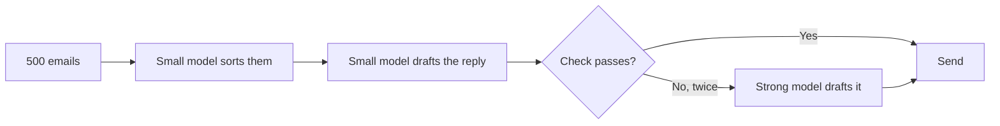

# Which model answers

Each example has a small and a strong model. The small one sorts 500 emails. Then it drafts a reply, and our code checks it. Small first, then strong, is a cascade. Set --small and --big to ok, nocite or invent, and pick the email with --mail.

## The story in one picture



## The problem

The strong model costs ten times more. Using it for all 500 emails wastes money. Using the small one alone can put a wrong total in a contract reply.

## New words

Each word has one meaning in every lab.

- **route**: Pick which model or helper handles a request.
- **cascade**: Try the cheap model first, and use a stronger one only if the answer fails the check.
- **check**: A rule in plain code that a draft must pass before it goes out.

## Run it

Copy any line into your terminal. Each one is a real example from this lab.

```bash
bun run lab model-routing --question "Sort the week's 500 emails and reply to Acme" --mail mail-contract --naive
bun run lab model-routing --question "Reply to Sam about moving the call to Thursday" --mail mail-meeting
bun run lab model-routing --question "Reply to the signed Acme contract" --mail mail-contract --small nocite
bun run lab model-routing --question "Confirm the Acme total in the reply" --mail mail-contract --small invent
bun run lab model-routing --question "Draft the contract thank-you for Maya" --mail mail-contract --small invent --big invent
bun run lab model-routing --demo
```

Run `bun run lab model-routing` with nothing else to pick an example from a menu.

## The cases

Case 1 is the naive way. Read what goes wrong, then read the rest.

| # | Case | Why it matters | Result | Run it alone |
| --- | --- | --- | --- | --- |
| 1 | NAIVE: always the strong model | All 500 emails and the Acme reply go to the strong model, and nobody checks the reply. It works, but it costs ten times more than it needs to. | always-big | `bun run lab model-routing --question "Sort the week's 500 emails and reply to Acme" --mail mail-contract --naive` |
| 2 | The small model is good enough | Sam asks to move a call. The small reply is polite, signed and has no amounts to check. It is sent as it is. | small | `bun run lab model-routing --question "Reply to Sam about moving the call to Thursday" --mail mail-meeting` |
| 3 | The small model forgets the total | The Acme reply leaves out the 18000 total. The check names the problem, the small model tries again, and the second try passes. | small-retry | `bun run lab model-routing --question "Reply to the signed Acme contract" --mail mail-contract --small nocite` |
| 4 | EDGE: the small model invents a total | It writes 19000 each time. The check catches it in code, twice. Like a junior who fails twice, the job moves up to the strong model. | big | `bun run lab model-routing --question "Confirm the Acme total in the reply" --mail mail-contract --small invent` |
| 5 | EDGE: every model fails | Neither the small nor the strong model passes the check. We send nothing, and Maya looks at it. | refused | `bun run lab model-routing --question "Draft the contract thank-you for Maya" --mail mail-contract --small invent --big invent` |

## Stuck points

**Correct run:** The small model drafts first and gets a second try. Only two failed checks send the job to the strong model.

**Common wrong turn:** Always using the strong model. It works, but it costs about ten times more than it needs.

**Hint to give:** Which answers need the strong model, and how would we know?

| What you see | What it means | Fix |
| --- | --- | --- |
| The demo prints outcome: always-big on the NAIVE case | The strong model answered every question | Try the small model first, then check its answer |
| The demo prints outcome: small-retry | The first small draft failed the check | This is correct. The check named the problem, and the retry passed |
| Nothing is sent after both fail | Neither answer passed the check | This is correct. A person should decide |

## The promise, and its test

The small model goes first, and a reply that fails the check is never sent. A small model that fails twice moves the job up. If the strong model fails too, nothing is sent.

```bash
bun test tests/promises/23.test.ts
```

To see the test do its job, break the rule in PART 1 on purpose. The test must fail. Then undo it.

## In production

Route the sorting to the small model, and check each draft in code. After two failed small tries, route the job to the strong model. Log which tier answered.

## Read the code

Open `labs/23-model-routing.ts`. Read the code from the top. It holds only the lesson.
The screen output is in `show/`. You do not need it to learn.
