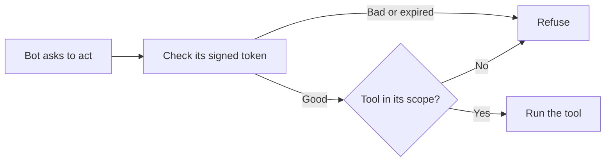

# Identity and scopes

Each example sends a doctor's request to one of three bots. Pick the bot with --bot. Each bot proves its identity with a signed token, and the token lists its scopes.

## The story in one picture



## The problem

If every bot shares one key, any bot can do anything. A bot that only answers questions could still send email, which is more than it needs.

## New words

Each word has one meaning in every lab.

- **identity**: Who is calling: a named bot or a named person.
- **scope**: A right, such as reading documents, that a token gives.
- **least privilege**: Give each bot only the scopes it needs, and no more.
- **signed token**: A note, signed by us, that lists what a bot may do and until when.

## Run it

Copy any line into your terminal. Each one is a real example from this lab.

```bash
bun run lab identity-and-scopes --demo
bun run lab identity-and-scopes --question "What is the dose of Cardioza?" --bot answer
bun run lab identity-and-scopes --demo
bun run lab identity-and-scopes --demo
bun run lab identity-and-scopes --question "How many doctors are in our CRM?" --bot report
bun run lab identity-and-scopes --question "How many doctors are in our CRM?" --bot answer
bun run lab identity-and-scopes --question "What is the dose of Cardioza?" --bot answer --forge
bun run lab identity-and-scopes --question "What is the dose of Cardioza?" --bot answer --expired
bun run lab identity-and-scopes --demo
```

Run `bun run lab identity-and-scopes` with nothing else to pick an example from a menu.

## The cases

Case 1 is the naive way. Read what goes wrong, then read the rest.

| # | Case | Why it matters | Result | Run it alone |
| --- | --- | --- | --- | --- |
| 1 | NAIVE: one key for every bot | All bots share one key that may do everything. The answer bot was asked to email Dr. Lee, and it did. | overreach | `bun run lab identity-and-scopes --demo` |
| 2 | The answer bot answers | The request needs only the search tool. The answer bot's token lists docs.read, so it runs. | allowed | `bun run lab identity-and-scopes --question "What is the dose of Cardioza?" --bot answer` |
| 3 | The answer bot is asked to email | The search runs. The email does not, because the answer bot's token has no email.send. | partly-denied | `bun run lab identity-and-scopes --demo` |
| 4 | The outreach bot may email | Its token lists email.send, so both tools run. It is the right bot for this job. | allowed | `bun run lab identity-and-scopes --demo` |
| 5 | The report bot reads the CRM | Its token lists crm.read. It counts the doctors and nothing more. | allowed | `bun run lab identity-and-scopes --question "How many doctors are in our CRM?" --bot report` |
| 6 | The answer bot is asked about the CRM | The answer bot has no crm.read. Doctor records stay closed to it. | denied | `bun run lab identity-and-scopes --question "How many doctors are in our CRM?" --bot answer` |
| 7 | EDGE: a token with a changed scope | Someone edits the answer bot's token to add email.send. The signature no longer matches, so every call is refused. | denied | `bun run lab identity-and-scopes --question "What is the dose of Cardioza?" --bot answer --forge` |
| 8 | EDGE: an old token | The token lasted five minutes and that time has passed. A stolen token stops working on its own. | denied | `bun run lab identity-and-scopes --question "What is the dose of Cardioza?" --bot answer --expired` |

## Stuck points

**Correct run:** Check each bot's signed token, and run only the tools its scopes name.

**Common wrong turn:** Sharing one key for every bot. Any bot can then do anything, including email it should not send.

**Hint to give:** Which scope does this tool need, and does the token list it?

| What you see | What it means | Fix |
| --- | --- | --- |
| The demo prints outcome: overreach on the NAIVE case | The answer bot sent an email | Give each bot its own token with only its scopes |
| A tool call is refused | The token is missing the scope, or has expired | Issue a new token with the scope the tool needs |
| A token is refused after an edit | The signature no longer matches | Never edit a token. Issue a new one |

## The promise, and its test

A tool call runs only when the token is real and not expired. The token must list the scope the tool needs. Least privilege means a bot never does more than its list.

```bash
bun test tests/promises/24.test.ts
```

To see the test do its job, break the rule in PART 1 on purpose. The test must fail. Then undo it.

## In production

Keep the secret in a vault and rotate it. Issue short tokens from one place. Log the bot name on every call.

## Read the code

Open `labs/24-identity-and-scopes.ts`. Read the code from the top. It holds only the lesson.
The screen output is in `show/`. You do not need it to learn.
