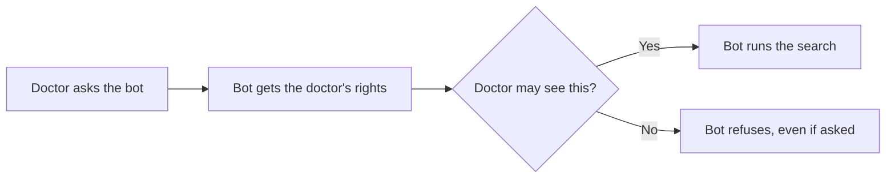

# Act for the user

Each example is one doctor asking the bot a question. The bot can act for a user, with that user's rights. Pick the doctor with --hcp: dr-lee is Dr Lee (US), dr-weber is Dr Weber (Germany).

## The story in one picture



## The problem

A bot on a service key answers as the key allows. No person is on that key, so nobody is named. A German doctor who asks about the US label gets the wrong dose for her.

## New words

Each word has one meaning in every lab.

- **act for a user**: Do a task as a named person, with only the rights that person has.
- **delegation**: A person lets a bot act for her, for one set job.
- **service key**: One shared secret that a bot uses. No person is on it, so no one is named.

## Run it

Copy any line into your terminal. Each one is a real example from this lab.

```bash
bun run lab act-for-user --question "What is the Cardioza dose in the US?" --hcp dr-weber --naive
bun run lab act-for-user --question "What is the dose of Cardioza?" --hcp dr-lee
bun run lab act-for-user --question "What is the dose of Cardioza?" --hcp dr-weber
bun run lab act-for-user --question "What is the Cardioza dose in the US?" --hcp dr-weber
bun run lab act-for-user --question "What is the dose of Cardioza?" --hcp dr-unknown
bun run lab act-for-user --question "What is the dose of Cardioza?" --hcp dr-weber --forge
bun run lab act-for-user --question "What is the dose of Cardioza?" --hcp dr-lee --bot report
bun run lab act-for-user --demo
```

Run `bun run lab act-for-user` with nothing else to pick an example from a menu.

## The cases

Case 1 is the naive way. Read what goes wrong, then read the rest.

| # | Case | Why it matters | Result | Run it alone |
| --- | --- | --- | --- | --- |
| 1 | NAIVE: the bot's own key | Dr. Weber is in Germany and asks about the US. The service key searches the US, so she gets 10mg, the wrong label for her. | wrong-label | `bun run lab act-for-user --question "What is the Cardioza dose in the US?" --hcp dr-weber --naive` |
| 2 | A US doctor | The token names Dr. Lee. The search uses US, and she gets the US label. | own-label | `bun run lab act-for-user --question "What is the dose of Cardioza?" --hcp dr-lee` |
| 3 | A German doctor | The token names Dr. Weber. The search uses DE, and she gets 5mg. | own-label | `bun run lab act-for-user --question "What is the dose of Cardioza?" --hcp dr-weber` |
| 4 | EDGE: she asks about the US | The country comes from her record, not from her words. She still gets the German label. | own-label | `bun run lab act-for-user --question "What is the Cardioza dose in the US?" --hcp dr-weber` |
| 5 | EDGE: a doctor who is not in the CRM | The token is real, but nobody by that id exists. Nothing is searched. | denied | `bun run lab act-for-user --question "What is the dose of Cardioza?" --hcp dr-unknown` |
| 6 | EDGE: a token changed to another doctor | Someone edits Dr. Weber's token to say dr-lee. The signature breaks, so nothing runs. | denied | `bun run lab act-for-user --question "What is the dose of Cardioza?" --hcp dr-weber --forge` |
| 7 | EDGE: a bot that may not read documents | The report bot's token has no docs.read, even for a real doctor. | denied | `bun run lab act-for-user --question "What is the dose of Cardioza?" --hcp dr-lee --bot report` |

## Stuck points

**Correct run:** The bot searches only the country of the doctor its token names. The doctor's rights limit the bot.

**Common wrong turn:** Using the bot's own service key. It searches the wrong country, so a German doctor gets the US label.

**Hint to give:** Whose rights should the search use: the bot's or the doctor's?

| What you see | What it means | Fix |
| --- | --- | --- |
| The demo prints outcome: wrong-label on the NAIVE case | The service key searched the US | Pass the delegation token, and search by its country |
| A bad token answers nothing | The token is not valid for this doctor | Issue a fresh token when the doctor signs in |
| Typing another country changes nothing | The country comes from the token, not the question | This is correct. The token wins |

## The promise, and its test

The bot searches only the country of the doctor its token names. What the doctor or the model types cannot change it. A bad token answers nothing.

```bash
bun test tests/promises/25.test.ts
```

To see the test do its job, break the rule in PART 1 on purpose. The test must fail. Then undo it.

## In production

Issue the delegation token when the doctor signs in, and keep it short. Pass it on every call, and log the doctor with each one.

## Read the code

Open `labs/25-act-for-user.ts`. Read the code from the top. It holds only the lesson.
The screen output is in `show/`. You do not need it to learn.
