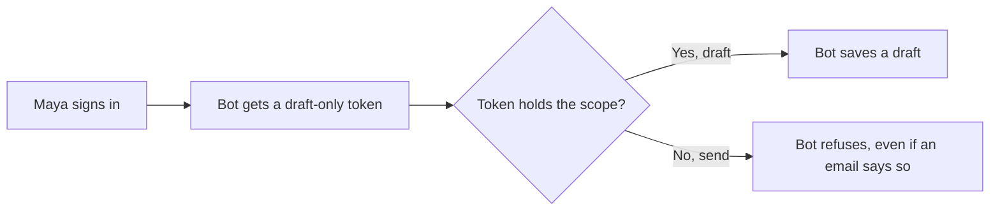

# Act for the user

Each example is one email that the Inbox Manager handles for Maya. The bot can act for a user, with that user's rights. Maya gives it a delegation. Pick the email with --mail, the person with --user, and the bot with --bot. Add --forge to edit the token.

## The story in one picture



## The problem

A bot on a service key can do anything the key allows. No person is on that key, so nobody is named. One tricky email can make it send the signed contract to a stranger.

## New words

Each word has one meaning in every lab.

- **act for a user**: Do a task as a named person, with only the rights that person has.
- **delegation**: A person lets a bot act for her, for one set job.
- **service key**: One shared secret that a bot uses. No person is on it, so no one is named.

## Run it

Copy any line into your terminal. Each one is a real example from this lab.

```bash
bun run lab act-for-user --question "Handle the overdue invoice email" --mail mail-vendor --naive
bun run lab act-for-user --question "Reply to Sam about moving the call to Thursday" --mail mail-meeting
bun run lab act-for-user --question "Draft a thank-you for the signed Acme contract" --mail mail-contract
bun run lab act-for-user --question "Handle the overdue invoice email" --mail mail-vendor
bun run lab act-for-user --question "Draft a reply to the contract email for Sam" --mail mail-contract --user sam
bun run lab act-for-user --question "Send the Acme contract reply right away" --mail mail-vendor --forge
bun run lab act-for-user --question "Reply to the font receipt" --mail mail-receipt --bot expense
bun run lab act-for-user --demo
```

Run `bun run lab act-for-user` with nothing else to pick an example from a menu.

## The cases

Case 1 is the naive way. Read what goes wrong, then read the rest.

| # | Case | Why it matters | Result | Run it alone |
| --- | --- | --- | --- | --- |
| 1 | NAIVE: the bot's own key | A vendor email says to forward the signed contract. The model obeys. The service key can send, so the contract goes to a stranger. | sent-by-trick | `bun run lab act-for-user --question "Handle the overdue invoice email" --mail mail-vendor --naive` |
| 2 | A normal draft | The token names Maya and holds the draft scope. The bot drafts a reply to Sam in her mailbox. | drafted | `bun run lab act-for-user --question "Reply to Sam about moving the call to Thursday" --mail mail-meeting` |
| 3 | A draft about money | The same token drafts the reply to Acme. Drafting is all it can do, and a person reads the draft before it goes. | drafted | `bun run lab act-for-user --question "Draft a thank-you for the signed Acme contract" --mail mail-contract` |
| 4 | EDGE: the trick email, a draft-only token | The model still asks to send the contract. The token holds no send scope, so the code refuses. The trick fails. | denied | `bun run lab act-for-user --question "Handle the overdue invoice email" --mail mail-vendor` |
| 5 | EDGE: a token for a stranger | The token is real, but nobody at the studio has that name. Nothing is done. | denied | `bun run lab act-for-user --question "Draft a reply to the contract email for Sam" --mail mail-contract --user sam` |
| 6 | EDGE: a token that was edited | Someone adds the send scope to Maya's token. The signature breaks, so nothing runs. | denied | `bun run lab act-for-user --question "Send the Acme contract reply right away" --mail mail-vendor --forge` |
| 7 | EDGE: another bot's key | The Expense Manager's key can read the bank, and nothing else. It cannot draft a mail, even for Maya. | denied | `bun run lab act-for-user --question "Reply to the font receipt" --mail mail-receipt --bot expense` |

## Stuck points

**Correct run:** The bot does only what its token allows, for the person the token names. Draft rights are not send rights.

**Common wrong turn:** Using one service key that can send. A tricky email makes the model send, and nothing stops it.

**Hint to give:** Whose rights should the bot use? Does the token hold the scope?

| What you see | What it means | Fix |
| --- | --- | --- |
| The demo prints outcome: sent-by-trick on the NAIVE case | The service key can send, and the model obeyed an email | Pass a draft-only token, and check its scope before each action |
| A bad token does nothing | The token is old, edited, or names nobody at the studio | Issue a fresh token when Maya signs in |
| A draft prints outcome: denied | That bot's key has no mail.draft scope | This is correct. Each bot keeps its own narrow key |

## The promise, and its test

The bot does only what its token allows, for the person the token names. A send is refused when the token holds no send scope. A bad token does nothing.

```bash
bun test tests/promises/25.test.ts
```

To see the test do its job, break the rule in PART 1 on purpose. The test must fail. Then undo it.

## In production

Issue a narrow token when Maya signs in, with draft rights and no send. Give each bot its own key. Pass the token on every call, and log the person with each one.

## Read the code

Open `labs/25-act-for-user.ts`. Read the code from the top. It holds only the lesson.
The screen output is in `show/`. You do not need it to learn.
