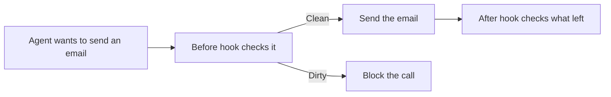

# Hooks

Each example asks the bot to use tools. The model says which tools. A before hook can block a call, and an after hook cleans what comes back. The first example runs with no hooks, to show the harm.

## The story in one picture



## The problem

A rule written in the prompt can be ignored. The model can email a note with an SSN to a private mailbox, and nothing stops it.

## New words

Each word has one meaning in every lab.

- **hook**: Code that runs before or after every tool call.
- **before hook**: Code that runs first, and may stop the call.
- **after hook**: Code that runs last, and may check or change the output.
- **fail closed**: If the check itself breaks, refuse the action.

## Run it

Copy any line into your terminal. Each one is a real example from this lab.

```bash
bun run lab hooks --demo
bun run lab hooks --question "Can you read the last call note for Dr. Lee?"
bun run lab hooks --demo
bun run lab hooks --demo
bun run lab hooks --question "What is the dose of Cardioza?"
bun run lab hooks --demo
bun run lab hooks --demo
```

Run `bun run lab hooks` with nothing else to pick an example from a menu.

## The cases

Case 1 is the naive way. Read what goes wrong, then read the rest.

| # | Case | Why it matters | Result | Run it alone |
| --- | --- | --- | --- | --- |
| 1 | NAIVE: no hooks | The note is read and emailed to a private mailbox, with the patient name and SSN in it. | leaked | `bun run lab hooks --demo` |
| 2 | Read the note, clean | The tool returns the note. The after hook swaps the private details for tokens. | clean | `bun run lab hooks --question "Can you read the last call note for Dr. Lee?"` |
| 3 | Email to the hospital | The address is on an approved domain, and the text is already clean. The email goes. | sent-clean | `bun run lab hooks --demo` |
| 4 | Email to a private mailbox | The before hook sees the domain is not approved. The email never goes. | blocked | `bun run lab hooks --demo` |
| 5 | A question that needs no hook | A plain dose search. No hook has anything to say, and the answer comes through. | clean | `bun run lab hooks --question "What is the dose of Cardioza?"` |
| 6 | EDGE: a hook that crashes | A buggy hook throws an error. We do not let the call through. Every call is blocked. | blocked | `bun run lab hooks --demo` |

## Stuck points

**Correct run:** Run a before hook on every call and an after hook on every output. A hook that crashes blocks the call.

**Common wrong turn:** Writing the rule only in the prompt. The model can ignore it and email the note.

**Hint to give:** Where could a check run that the model cannot skip?

| What you see | What it means | Fix |
| --- | --- | --- |
| The demo prints outcome: leaked on the NAIVE case | No hook ran, and the note was emailed | Add a before hook that checks each email |
| A call is blocked by a hook | The before hook said no | This is correct. Read the hook name in the log |
| Every call is blocked | A hook crashed, and fail closed blocks the call | Fix the crash. Do not remove the hook |

## The promise, and its test

Every tool call passes the before hooks, and every output passes the after hooks. A hook that crashes blocks the call, which is fail closed.

```bash
bun test tests/promises/26.test.ts
```

To see the test do its job, break the rule in PART 1 on purpose. The test must fail. Then undo it.

## In production

Keep hooks in one list for every tool. Log each block with the hook name. Test a hook by making it crash.

## Read the code

Open `labs/26-hooks.ts`. Read the code from the top. It holds only the lesson.
The screen output is in `show/`. You do not need it to learn.
