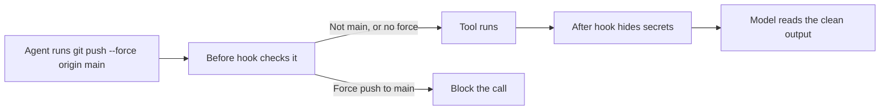

# Hooks

Each example gives the Coding Agent a task. The model says which tool calls it needs. A before hook can block a call, such as a force push to main. An after hook cleans what comes back, such as a key in a file. The first example runs with no hooks, to show the harm.

## The story in one picture



## The problem

A rule written in the prompt can be ignored. The agent can force push to main. It can read an API key into the chat. Nothing stops it.

## New words

Each word has one meaning in every lab.

- **hook**: Code that runs before or after every tool call.
- **before hook**: Code that runs first, and may stop the call.
- **after hook**: Code that runs last, and may check or change the output.
- **fail closed**: If the check itself breaks, refuse the action.

## Run it

Copy any line into your terminal. Each one is a real example from this lab.

```bash
bun run lab hooks --demo
bun run lab hooks --demo
bun run lab hooks --question "Push the coupon fix to branch fix-coupon"
bun run lab hooks --question "Force push my rebased branch fix-coupon"
bun run lab hooks --demo
bun run lab hooks --question "Read .env to see which Stripe mode is on"
bun run lab hooks --question "Show me why build 3 failed"
bun run lab hooks --question "Please run the coupon test now"
bun run lab hooks --demo
bun run lab hooks --demo
```

Run `bun run lab hooks` with nothing else to pick an example from a menu.

## The cases

Case 1 is the naive way. Read what goes wrong, then read the rest.

| # | Case | Why it matters | Result | Run it alone |
| --- | --- | --- | --- | --- |
| 1 | NAIVE: no hooks | The agent force pushes to main, and the API key from .env reaches the model. Nothing stops either one. | unsafe | `bun run lab hooks --demo` |
| 2 | A force push to main | The before hook sees a force push aimed at main. The push never runs. The test run before it is fine. | blocked | `bun run lab hooks --demo` |
| 3 | A plain push to a branch | A normal push to the fix branch is allowed. A hook that blocks everything would be useless. | pushed | `bun run lab hooks --question "Push the coupon fix to branch fix-coupon"` |
| 4 | A force push to a branch | A rebased branch needs a force push. It is not main, so the hook lets it through. | pushed | `bun run lab hooks --question "Force push my rebased branch fix-coupon"` |
| 5 | Two pushes in one command | The agent joins a safe push and a force push to main with &&. The hook reads the whole command, so it still blocks. | blocked | `bun run lab hooks --demo` |
| 6 | A key in .env | The agent reads .env to check the Stripe mode. The after hook swaps the key for a token before the model sees it. | clean | `bun run lab hooks --question "Read .env to see which Stripe mode is on"` |
| 7 | A token in a build log | A log holds a GitHub token from a failed request. The after hook hides it. The useful lines stay. | clean | `bun run lab hooks --question "Show me why build 3 failed"` |
| 8 | A task that needs no hook | A plain test run. No hook has anything to say, and the output comes through. | clean | `bun run lab hooks --question "Please run the coupon test now"` |
| 9 | EDGE: a hook that crashes | A buggy hook throws an error. We do not let the call through. Every call is blocked. | blocked | `bun run lab hooks --demo` |

## Stuck points

**Correct run:** Run a before hook on every call and an after hook on every output. A hook that crashes blocks the call.

**Common wrong turn:** Writing the rule only in the prompt. The agent can ignore it, force push to main and read a key.

**Hint to give:** Where could a check run that the model cannot skip?

| What you see | What it means | Fix |
| --- | --- | --- |
| The demo prints outcome: unsafe on the NAIVE case | No hook ran, so the push and the key got through | Add a before hook for pushes and an after hook for secrets |
| A call is blocked by a hook | The before hook said no | This is correct. Read the hook name in the log |
| Every call is blocked | A hook crashed, and fail closed blocks the call | Fix the crash. Do not remove the hook |

## The promise, and its test

Every tool call passes the before hooks, and every output passes the after hooks. A hook that crashes blocks the call, which is fail closed.

```bash
bun test tests/promises/26.test.ts
```

To see the test do its job, break the rule in PART 1 on purpose. The test must fail. Then undo it.

## In production

Keep hooks in one list for every tool. Log each block with the hook name. Test a hook by making it crash.

## Read the code

Open `labs/26-hooks.ts`. Read the code from the top. It holds only the lesson.
The screen output is in `show/`. You do not need it to learn.
