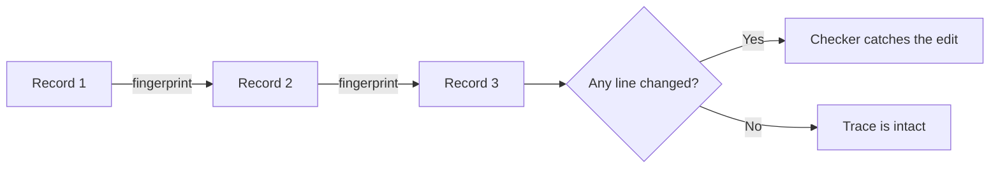

# Traces and the audit ledger

Each example answers Dr Weber, writes the trace, and then someone edits the file. Pick the edit with --tamper: edit, delete, cut or rewrite. Then we check the hash chain against the saved head.

## The story in one picture



## The problem

A month later someone asks why the bot said 5mg. A plain log can be edited to tell any story, and nobody can tell.

## New words

Each word has one meaning in every lab.

- **trace**: A record of every step that a run took.
- **fingerprint**: A short code made from a text. Change one letter and the code changes.
- **hash chain**: A list where each line stores the fingerprint of the line before it.
- **head**: The last fingerprint, saved where an edit to the list cannot reach it.

## Run it

Copy any line into your terminal. Each one is a real example from this lab.

```bash
bun run lab traces-and-audit --question "What is the dose of Cardioza?" --hcp H-2 --tamper edit --naive
bun run lab traces-and-audit --question "What is the dose of Cardioza?" --hcp H-2
bun run lab traces-and-audit --question "What is the dose of Cardioza?" --hcp H-2 --tamper edit
bun run lab traces-and-audit --question "What is the dose of Cardioza?" --hcp H-2 --tamper delete
bun run lab traces-and-audit --question "What is the dose of Cardioza?" --hcp H-2 --tamper cut
bun run lab traces-and-audit --question "What is the dose of Cardioza?" --hcp H-2 --tamper rewrite
bun run lab traces-and-audit --demo
```

Run `bun run lab traces-and-audit` with nothing else to pick an example from a menu.

## The cases

Case 1 is the naive way. Read what goes wrong, then read the rest.

| # | Case | Why it matters | Result | Run it alone |
| --- | --- | --- | --- | --- |
| 1 | NAIVE: a plain log | Someone changes the document id in the log. The file still reads fine, and nothing notices. | unnoticed | `bun run lab traces-and-audit --question "What is the dose of Cardioza?" --hcp H-2 --tamper edit --naive` |
| 2 | Nobody touches the trace | Every line is in order and every fingerprint matches. | intact | `bun run lab traces-and-audit --question "What is the dose of Cardioza?" --hcp H-2` |
| 3 | EDGE: one word is changed | The document id in the result line is changed. The fingerprint of that line no longer matches. | caught | `bun run lab traces-and-audit --question "What is the dose of Cardioza?" --hcp H-2 --tamper edit` |
| 4 | EDGE: a line is removed | The search line is deleted. The next line points at a line that is gone. | caught | `bun run lab traces-and-audit --question "What is the dose of Cardioza?" --hcp H-2 --tamper delete` |
| 5 | EDGE: the end is cut off | The answer line is removed. The chain is still fine, but the last fingerprint is not the saved one. | caught | `bun run lab traces-and-audit --question "What is the dose of Cardioza?" --hcp H-2 --tamper cut` |
| 6 | EDGE: the whole file is rewritten | Someone edits a line and works every fingerprint out again. The chain is fine, but the head is not the saved one. | caught | `bun run lab traces-and-audit --question "What is the dose of Cardioza?" --hcp H-2 --tamper rewrite` |

## Stuck points

**Correct run:** Write each step with a fingerprint of the one before it. Check the chain against the saved head.

**Common wrong turn:** Trusting a plain log. Someone can edit it to tell any story, and nothing shows the edit.

**Hint to give:** If one line changed, which fingerprint would stop matching?

| What you see | What it means | Fix |
| --- | --- | --- |
| The demo prints outcome: unnoticed on the NAIVE case | The edit in the plain log was not seen | Chain each line to the one before, and check the head |
| The check reports a broken line | A line was changed, removed or cut | Restore the file from the saved copy, then find who changed it |
| The head matches but the check fails | The head was saved where the trace is kept | Save the head somewhere with a different owner |

## The promise, and its test

Every step is written down. Each line holds a fingerprint of the line before it. The chain is checked against the saved head, and it finds any edit.

```bash
bun test tests/promises/27.test.ts
```

To see the test do its job, break the rule in PART 1 on purpose. The test must fail. Then undo it.

## In production

Send each line to storage that cannot be changed. Save the head in a second place with a different owner. Check the chain on a schedule.

## Read the code

Open `labs/27-traces-and-audit.ts`. Read the code from the top. It holds only the lesson.
The screen output is in `show/`. You do not need it to learn.
