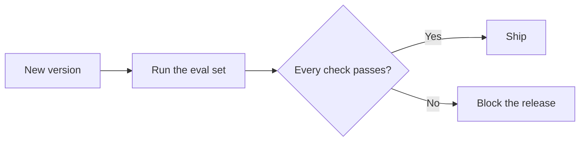

# Evals and the release gate

Each example is a new version of the document search. We run every eval in the eval set through it. The release gate then decides if the version may ship. Pick the version with --version: current, wide or invents.

## The story in one picture



## The problem

A change that looks fine ships, because it still answers. It can give a German doctor the US dose, and nobody finds out until she does. That is a regression.

## New words

Each word has one meaning in every lab.

- **eval**: A test question, with the facts that a right answer must contain.
- **eval set**: The full list of evals, run before each release.
- **release gate**: A check that blocks a new version when a test fails.
- **regression**: Something that used to work and now fails.

## Run it

Copy any line into your terminal. Each one is a real example from this lab.

```bash
bun run lab evals-and-release --question "Is this new version ready to release?" --version wide --naive
bun run lab evals-and-release --question "Is this new version ready to release?" --version current
bun run lab evals-and-release --question "Is this new version ready to release?" --version wide
bun run lab evals-and-release --question "Is this new version ready to release?" --version invents
bun run lab evals-and-release --question "Is this new version ready to release?" --version current --evals none
bun run lab evals-and-release --demo
```

Run `bun run lab evals-and-release` with nothing else to pick an example from a menu.

## The cases

Case 1 is the naive way. Read what goes wrong, then read the rest.

| # | Case | Why it matters | Result | Run it alone |
| --- | --- | --- | --- | --- |
| 1 | NAIVE: ship if it runs | The wide version answers every question, so the naive gate ships it. Dr. Weber gets the US dose. | shipped-wrong | `bun run lab evals-and-release --question "Is this new version ready to release?" --version wide --naive` |
| 2 | The current version | Every eval passes, so the release goes out. | released | `bun run lab evals-and-release --question "Is this new version ready to release?" --version current` |
| 3 | EDGE: the wide version | Dr. Weber's question gets the US document. That eval fails and the release is blocked. | blocked | `bun run lab evals-and-release --question "Is this new version ready to release?" --version wide` |
| 4 | EDGE: the version that makes things up | For an unknown drug it writes a made-up document and a dose. The Zorbex eval fails. | blocked | `bun run lab evals-and-release --question "Is this new version ready to release?" --version invents` |
| 5 | EDGE: nobody wrote any evals | Zero evals pass, but nothing was tested. An empty set blocks the release. | blocked | `bun run lab evals-and-release --question "Is this new version ready to release?" --version current --evals none` |

## Stuck points

**Correct run:** Run every eval on the new version. Ship only when all evals pass.

**Common wrong turn:** Shipping because the version still answers. A regression can give the wrong dose, and no one sees it.

**Hint to give:** Which eval would catch a German doctor getting the US dose?

| What you see | What it means | Fix |
| --- | --- | --- |
| The demo prints outcome: shipped-wrong on the NAIVE case | The naive gate shipped a wrong version | Run every eval, and block on any failure |
| The release is blocked and names a question | One eval failed | Fix the version, or the eval if it is wrong. Never delete the eval |
| The release is blocked on an empty eval set | There are no evals, so nothing can pass | Write at least one eval for each risk |

## The promise, and its test

A version ships only when every eval passes. A failed eval blocks it and names the question. An empty eval set blocks everything.

```bash
bun test tests/promises/28.test.ts
```

To see the test do its job, break the rule in PART 1 on purpose. The test must fail. Then undo it.

## In production

Run the evals on every change, on the same model you ship. Add a new eval each time a bug gets out. Never delete one to make a release pass.

## Read the code

Open `labs/28-evals-and-release.ts`. Read the code from the top. It holds only the lesson.
The screen output is in `show/`. You do not need it to learn.
