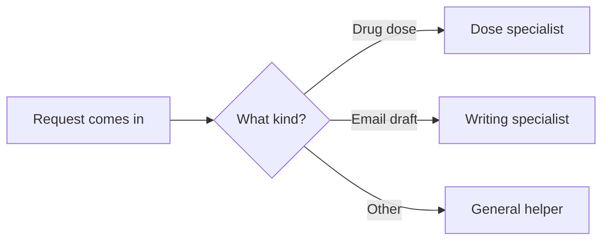

# Routing

Each example is one message in the care team inbox. Pick the doctor with --hcp. The router sends each message to a specialist: the answer bot, the outreach bot or a person. A message that fits no rule goes to the fallback.

## The story in one picture



## The problem

One bot that answers everything also answers the rash message with a dose. A doctor reads it and trusts it.

## New words

Each word has one meaning in every lab.

- **router**: The step that picks who handles each message.
- **specialist**: A bot or a person that handles one kind of job well.
- **fallback**: Where a message goes when no rule fits it.

## Run it

Copy any line into your terminal. Each one is a real example from this lab.

```bash
bun run lab routing --demo
bun run lab routing --question "What is the dose of Cardioza?" --hcp dr-lee
bun run lab routing --demo
bun run lab routing --demo
bun run lab routing --question "Can you tell me why my last invoice was wrong?" --hcp dr-lee
bun run lab routing --demo
bun run lab routing --demo
```

Run `bun run lab routing` with nothing else to pick an example from a menu.

## The cases

Case 1 is the naive way. Read what goes wrong, then read the rest.

| # | Case | Why it matters | Result | Run it alone |
| --- | --- | --- | --- | --- |
| 1 | NAIVE: one bot for everything | The rash message reaches the answer bot, which replies from a dose document. | unsafe | `bun run lab routing --demo` |
| 2 | A dose question | The model says answer, and the answer bot finds the label. | answer | `bun run lab routing --question "What is the dose of Cardioza?" --hcp dr-lee` |
| 3 | A request for an email | The model says outreach, and the outreach bot writes the email. | outreach | `bun run lab routing --demo` |
| 4 | EDGE: a rash on a patient | A danger word. The code sends it to a person before the model is asked. | human | `bun run lab routing --demo` |
| 5 | EDGE: a message that fits no specialist | An invoice question is not the job of either bot. It goes to a person. | human | `bun run lab routing --question "Can you tell me why my last invoice was wrong?" --hcp dr-lee` |
| 6 | EDGE: the doctor tells the router where to go | She asks for the answer bot, but the danger word wins. | human | `bun run lab routing --demo` |

## Stuck points

**Correct run:** The router sends each message to one specialist. A danger word, or an unknown route, goes to a person.

**Common wrong turn:** One bot for every message. It answers a rash message with a dose.

**Hint to give:** Which message must never reach the answer bot?

| What you see | What it means | Fix |
| --- | --- | --- |
| The demo prints outcome: unsafe on the NAIVE case | The rash message reached the answer bot | Send messages with a danger word to a person |
| A message goes to the fallback | No rule fits it | This is correct. A person reads it |
| The outreach bot gets a dose question | The route rule is too wide | Narrow the route rule to its own kind of message |

## The promise, and its test

A message with a danger word always goes to a person. Any route not on our list goes to a person. The other messages reach the specialist that fits.

```bash
bun test tests/promises/29.test.ts
```

To see the test do its job, break the rule in PART 1 on purpose. The test must fail. Then undo it.

## In production

Log every route with the message id. Review the person queue each week, and add a danger word when one slips past.

## Read the code

Open `labs/29-routing.ts`. Read the code from the top. It holds only the lesson.
The screen output is in `show/`. You do not need it to learn.
