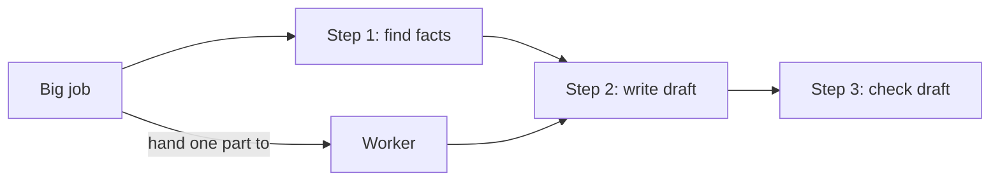

# Chains and delegation

Each example is one job for three doctors. Pick the doctors with --hcps, for example H-1,H-2,H-3. A lead splits the job and gives each doctor to a worker with a short chain.

## The story in one picture



## The problem

One bot, one search and one letter for three doctors. The search ran for one country, so the others get the wrong label.

## New words

chain = steps where each result feeds the next. delegate = hand a part of the job to a worker. lead = the one that splits the job and collects. worker = does one small part.

## Run it

Copy any line into your terminal. Each one is a real example from this lab.

```bash
bun run lab chain-and-delegate --demo
bun run lab chain-and-delegate --demo
bun run lab chain-and-delegate --question "Write the Cardioza update for Dr. Weber please." --hcps H-2
bun run lab chain-and-delegate --demo
bun run lab chain-and-delegate --demo
```

Run `bun run lab chain-and-delegate` with nothing else to pick an example from a menu.

## The cases

Case 1 is the naive way. Read what goes wrong, then read the rest.

| # | Case | Why it matters | Result | Run it alone |
| --- | --- | --- | --- | --- |
| 1 | NAIVE: one letter for everyone | One search runs for Dr. Lee's country. Dr. Weber gets the US dose in his letter. | wrong-label | `bun run lab chain-and-delegate --demo` |
| 2 | Three doctors, three chains | Each worker searches its own doctor's country. Dr. Weber's letter cites the German document. | all-sent | `bun run lab chain-and-delegate --demo` |
| 3 | One doctor | A job for one doctor is one worker and one chain. | all-sent | `bun run lab chain-and-delegate --question "Write the Cardioza update for Dr. Weber please." --hcps H-2` |
| 4 | EDGE: one worker has nothing to write from | There is no German Neurovex document. Dr. Weber's worker holds its letter, and the other two still go. | partial | `bun run lab chain-and-delegate --demo` |

## The promise, and its test

Each doctor's letter is written from a document of the doctor's own country, and it passes a check. A worker that fails is named and the others still go.

```bash
bun test tests/promises/30.test.ts
```

To see the test do its job, break the rule in PART 1 on purpose. The test must fail. Then undo it.

## In production

Give each worker only what its part needs. Log each worker's result by name. Retry a failed worker once, then hand it to a person.

## Read the code

Open `labs/30-chain-and-delegate.ts`. Read the code from the top. It holds only the lesson.
The screen output is in `show/`. You do not need it to learn.
