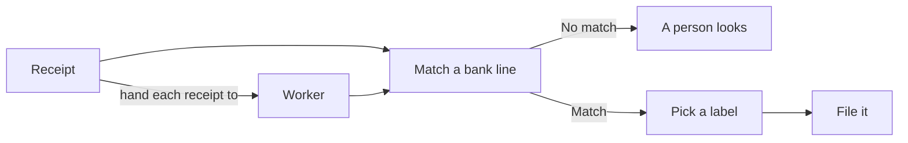

# Chains and delegation

Each example files receipts for Juniper Studio. The lead hands each receipt to a worker, and each step in the chain feeds the next one. Pick receipts with --receipts. Add --open true for a lead that plans its own workers.

## The story in one picture



## The problem

One long prompt matches, labels and files at once. It grabs the first bank line, so the books fill with wrong entries that look right.

## New words

Each word has one meaning in every lab.

- **chain**: Steps where each result feeds the next step.
- **delegate**: Hand one part of a job to a worker, and wait for its result.
- **lead**: The agent that splits the job and gathers the results.
- **worker**: A program or agent that does one small part of a job.

## Run it

Copy any line into your terminal. Each one is a real example from this lab.

```bash
bun run lab chain-and-delegate --question "File all the April receipts" --naive
bun run lab chain-and-delegate --question "Match the April receipts to the bank and file them"
bun run lab chain-and-delegate --question "File the font licence from the email" --receipts receipt-fontshop
bun run lab chain-and-delegate --question "Where did the Acme client lunch go in the bank?" --receipts receipt-lunch
bun run lab chain-and-delegate --question "Label the font licence for the books" --receipts receipt-fontshop --model invent
bun run lab chain-and-delegate --question "Plan the filing for the cloud bill" --receipts receipt-cloud --open
bun run lab chain-and-delegate --question "Plan the filing for the cloud bill, with checks" --receipts receipt-cloud --open --model wanders
bun run lab chain-and-delegate --demo
```

Run `bun run lab chain-and-delegate` with nothing else to pick an example from a menu.

## The cases

Case 1 is the naive way. Read what goes wrong, then read the rest.

| # | Case | Why it matters | Result | Run it alone |
| --- | --- | --- | --- | --- |
| 1 | NAIVE: one long prompt | One prompt must match, label and file all the April receipts. It grabs the first bank line each time. Two entries are wrong, and the euro lunch is filed anyway. | wrong-filing | `bun run lab chain-and-delegate --question "File all the April receipts" --naive` |
| 2 | Three receipts, three chains | The font licence and the cloud bill match and are filed. The Acme lunch is in euros. The bank line is in dollars. So it goes to a person. | partial | `bun run lab chain-and-delegate --question "Match the April receipts to the bank and file them"` |
| 3 | One receipt | One worker matches the font licence to bank-1 and files it as software. | all-filed | `bun run lab chain-and-delegate --question "File the font licence from the email" --receipts receipt-fontshop` |
| 4 | EDGE: nothing matches | The Acme lunch has no bank line in euros. The worker will not guess. It hands the receipt to Maya. | to-a-person | `bun run lab chain-and-delegate --question "Where did the Acme client lunch go in the bank?" --receipts receipt-lunch` |
| 5 | EDGE: a label the books do not use | The model calls the font licence gadgets. The books have no such label, so the worker holds it. | to-a-person | `bun run lab chain-and-delegate --question "Label the font licence for the books" --receipts receipt-fontshop --model invent` |
| 6 | An open ended lead | This lead plans its own workers. It asks for match, categorize and file, which is three. That fits the cap. | all-filed | `bun run lab chain-and-delegate --question "Plan the filing for the cloud bill" --receipts receipt-cloud --open` |
| 7 | EDGE: a plan with too many workers | The lead plans six workers and repeats the same ones. The cap is three, so the code refuses the plan. | capped | `bun run lab chain-and-delegate --question "Plan the filing for the cloud bill, with checks" --receipts receipt-cloud --open --model wanders` |

## Stuck points

**Correct run:** Hand each receipt to a worker that matches, labels and files it in order. A receipt that does not match goes to a person.

**Common wrong turn:** One long prompt for every step. It grabs the first bank line, and the books fill with wrong entries.

**Hint to give:** Which bank line holds this receipt's money, and does the label exist in the books?

| What you see | What it means | Fix |
| --- | --- | --- |
| The demo prints outcome: wrong-filing on the NAIVE case | One long prompt did every step | Give each receipt a worker with a fixed chain |
| A receipt prints outcome: to-a-person | No bank line fits it, or the label is not in the books | Maya decides. Never let the worker guess |
| A plan prints outcome: capped | An open ended lead asked for more than three workers | Cap the workers in code, and fix the plan |

## The promise, and its test

Each receipt is matched to a real bank line and given a label the books use. One that does not match is held for a person. The other receipts still go. A lead that plans its own workers is capped at three.

```bash
bun test tests/promises/30.test.ts
```

To see the test do its job, break the rule in PART 1 on purpose. The test must fail. Then undo it.

## In production

Run the same chain for every receipt, and hand each to its own worker. Never guess a match. Send what does not fit to Maya, with the reason. Cap how many workers an open ended lead may start.

## Read the code

Open `labs/30-chain-and-delegate.ts`. Read the code from the top. It holds only the lesson.
The screen output is in `show/`. You do not need it to learn.
