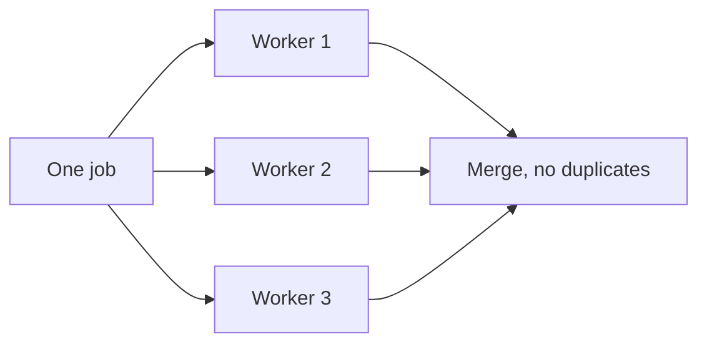

# Parallel workers

Each example prepares a call brief from three systems. A worker reads each system, and the workers run in parallel. Pick the doctor with --hcp. Make a system fail with --stuck or --crash, and name it: docs, profile or emails.

## The story in one picture



## The problem

Three slow systems one after another take three seconds. One stuck system holds up the whole brief, and the rep walks into the call with nothing.

## New words

Each word has one meaning in every lab.

- **parallel**: At the same time, not one after another.
- **deadline**: The time after which we stop waiting for a worker.
- **merge**: Join pieces from several sources into one result.
- **worker**: A program or agent that does one small part of a job.

## Run it

Copy any line into your terminal. Each one is a real example from this lab.

```bash
bun run lab parallel-workers --question "Please prepare a call brief for Dr. Lee." --hcp H-1 --naive
bun run lab parallel-workers --question "Please prepare a call brief for Dr. Lee." --hcp H-1
bun run lab parallel-workers --question "Please prepare a call brief for Dr. Weber." --hcp H-2
bun run lab parallel-workers --question "Please prepare a call brief for Dr. Lee." --hcp H-1 --stuck emails
bun run lab parallel-workers --question "Please prepare a call brief for Dr. Lee." --hcp H-1 --crash profile
bun run lab parallel-workers --demo
```

Run `bun run lab parallel-workers` with nothing else to pick an example from a menu.

## The cases

Case 1 is the naive way. Read what goes wrong, then read the rest.

| # | Case | Why it matters | Result | Run it alone |
| --- | --- | --- | --- | --- |
| 1 | NAIVE: one system after another | The systems run in a line. Three seconds go by before the brief is ready. | slow | `bun run lab parallel-workers --question "Please prepare a call brief for Dr. Lee." --hcp H-1 --naive` |
| 2 | Three workers at once | All three start together. The brief is ready in about one second. | complete | `bun run lab parallel-workers --question "Please prepare a call brief for Dr. Lee." --hcp H-1` |
| 3 | A German doctor | Dr. Weber has no emails. That worker answers that there are none, and the brief is still complete. | complete | `bun run lab parallel-workers --question "Please prepare a call brief for Dr. Weber." --hcp H-2` |
| 4 | EDGE: one system is stuck | The emails system never answers. The lead stops it at the deadline and sends the rest. | partial | `bun run lab parallel-workers --question "Please prepare a call brief for Dr. Lee." --hcp H-1 --stuck emails` |
| 5 | EDGE: one worker crashes | The profile worker dies. The brief names the missing part, and the other two come through. | partial | `bun run lab parallel-workers --question "Please prepare a call brief for Dr. Lee." --hcp H-1 --crash profile` |

## The promise, and its test

All workers start at once. A worker that is late is stopped at the deadline, and one that crashes is named. The brief goes out with the parts that came back.

```bash
bun test tests/promises/31.test.ts
```

To see the test do its job, break the rule in PART 1 on purpose. The test must fail. Then undo it.

## In production

Give each worker its own result file, so none overwrites another. Set the deadline from how long the rep can wait. The merge keeps the parts that came back.

## Read the code

Open `labs/31-parallel-workers.ts`. Read the code from the top. It holds only the lesson.
The screen output is in `show/`. You do not need it to learn.
