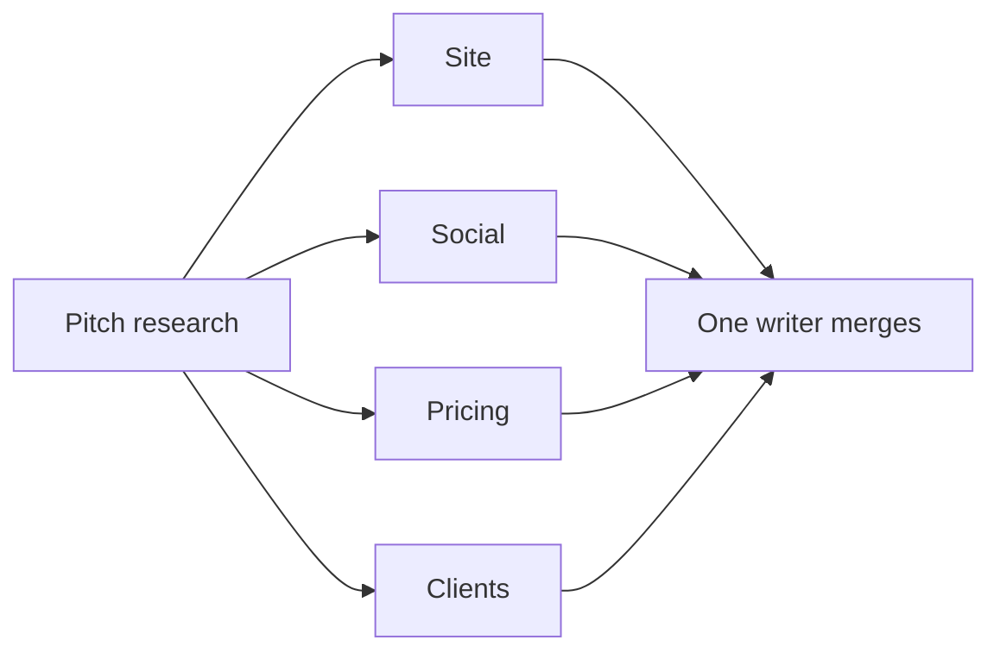

# Parallel workers

Each example researches a prospect's rival for a pitch. A worker reads each of four sources, and the workers run in parallel. Pick the prospect with --prospect. Make a source fail with --stuck or --crash, and name it: site, social, pricing or clients.

## The story in one picture



## The problem

Four slow sources one after another take four seconds. One stuck source holds up the whole note, and the team walks into the pitch with nothing.

## New words

Each word has one meaning in every lab.

- **parallel**: At the same time, not one after another.
- **deadline**: The time after which we stop waiting for a worker.
- **merge**: Join pieces from several sources into one result.
- **worker**: A program or agent that does one small part of a job.

## Run it

Copy any line into your terminal. Each one is a real example from this lab.

```bash
bun run lab parallel-workers --question "Research the rival of the bakery before Friday." --prospect prospect-bakery --naive
bun run lab parallel-workers --question "Research the rival of the bakery before Friday." --prospect prospect-bakery
bun run lab parallel-workers --question "Research the rival of the gym before Friday." --prospect prospect-gym
bun run lab parallel-workers --question "Research the rival of the bakery before Friday." --prospect prospect-bakery --stuck social
bun run lab parallel-workers --question "Research the rival of the bakery before Friday." --prospect prospect-bakery --crash pricing
bun run lab parallel-workers --demo
```

Run `bun run lab parallel-workers` with nothing else to pick an example from a menu.

## The cases

Case 1 is the naive way. Read what goes wrong, then read the rest.

| # | Case | Why it matters | Result | Run it alone |
| --- | --- | --- | --- | --- |
| 1 | NAIVE: one source after another | The sources run in a line. Four seconds go by before the note is ready. | slow | `bun run lab parallel-workers --question "Research the rival of the bakery before Friday." --prospect prospect-bakery --naive` |
| 2 | Four workers at once | All four start together. The note is ready in about one second. | complete | `bun run lab parallel-workers --question "Research the rival of the bakery before Friday." --prospect prospect-bakery` |
| 3 | A different prospect | The gym has a rival with a busy social feed. The same four workers still run at once. | complete | `bun run lab parallel-workers --question "Research the rival of the gym before Friday." --prospect prospect-gym` |
| 4 | EDGE: one source is stuck | The social feed never answers. The lead stops that worker at the deadline and sends the rest. | partial | `bun run lab parallel-workers --question "Research the rival of the bakery before Friday." --prospect prospect-bakery --stuck social` |
| 5 | EDGE: one worker crashes | The pricing worker dies. The note names the missing part, and the other three come through. | partial | `bun run lab parallel-workers --question "Research the rival of the bakery before Friday." --prospect prospect-bakery --crash pricing` |

## Stuck points

**Correct run:** Start all workers at once. Stop a late worker at the deadline, and send the note with the parts that came back.

**Common wrong turn:** Running the sources one after another. A stuck source then holds up the whole note.

**Hint to give:** What happens to the note if one source never answers?

| What you see | What it means | Fix |
| --- | --- | --- |
| The demo prints outcome: slow on the NAIVE case | The sources ran one after another | Start all workers at the same time |
| A part is missing from the note | That worker missed the deadline | This is correct. Say which part is missing |
| A worker crashed | The crash is named in the note | Read the name, then fix that source |

## The promise, and its test

All workers start at once. A worker that is late is stopped at the deadline, and one that crashes is named. One writer merges the parts that came back.

```bash
bun test tests/promises/31.test.ts
```

To see the test do its job, break the rule in PART 1 on purpose. The test must fail. Then undo it.

## In production

Give each worker its own result file, so none overwrites another. Set the deadline from how long the team can wait. The merge keeps the parts that came back.

## Read the code

Open `labs/31-parallel-workers.ts`. Read the code from the top. It holds only the lesson.
The screen output is in `show/`. You do not need it to learn.
