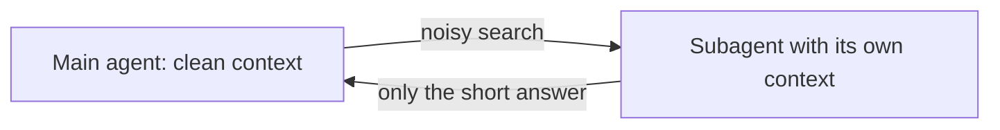

# Keep noisy work apart

Each example asks for a dose. The document search returns many old drafts with wrong doses. A helper reads that noise in its own context, and sends back a short report. Pick the doctor with --hcp, and how the model acts with --model.

## The story in one picture



## The problem

A search can return pages of old and wrong text. If the main agent reads it all, its context is full of junk. It may copy a wrong dose.

## New words

Each word has one meaning in every lab.

- **helper**: A second agent with its own context, used for noisy work.
- **context**: Everything an agent has read so far, which it keeps in its window.
- **report**: The short answer a helper sends back.

## Run it

Copy any line into your terminal. Each one is a real example from this lab.

```bash
bun run lab subagent-isolation --question "What is the dose of Cardioza for Dr. Lee?" --hcp H-1 --naive
bun run lab subagent-isolation --question "What is the dose of Cardioza for Dr. Lee?" --hcp H-1
bun run lab subagent-isolation --question "What is the dose of Cardioza for Dr. Weber?" --hcp H-2
bun run lab subagent-isolation --question "What is the dose of Zorbex for Dr. Lee?" --hcp H-1
bun run lab subagent-isolation --question "What is the dose of Cardioza for Dr. Lee?" --hcp H-1 --model invent
bun run lab subagent-isolation --question "What is the dose of Cardioza for Dr. Lee?" --hcp H-1 --model stuck
bun run lab subagent-isolation --demo
```

Run `bun run lab subagent-isolation` with nothing else to pick an example from a menu.

## The cases

Case 1 is the naive way. Read what goes wrong, then read the rest.

| # | Case | Why it matters | Result | Run it alone |
| --- | --- | --- | --- | --- |
| 1 | NAIVE: the main agent reads everything | The main agent searches by itself. Forty old drafts fill its space. | flooded | `bun run lab subagent-isolation --question "What is the dose of Cardioza for Dr. Lee?" --hcp H-1 --naive` |
| 2 | A helper does the search | The helper reads the drafts. The main agent keeps one short report. | clean | `bun run lab subagent-isolation --question "What is the dose of Cardioza for Dr. Lee?" --hcp H-1` |
| 3 | A German doctor | Dr. Weber is in Germany, so the report holds the German dose. | clean | `bun run lab subagent-isolation --question "What is the dose of Cardioza for Dr. Weber?" --hcp H-2` |
| 4 | EDGE: no approved document | There is no approved document for Zorbex. The helper says so, and the main agent makes nothing up. | no-answer | `bun run lab subagent-isolation --question "What is the dose of Zorbex for Dr. Lee?" --hcp H-1` |
| 5 | EDGE: the helper makes up a dose | The helper writes a dose that no approved document has. The main agent checks the report and refuses it. | no-answer | `bun run lab subagent-isolation --question "What is the dose of Cardioza for Dr. Lee?" --hcp H-1 --model invent` |
| 6 | EDGE: the helper gets stuck | The helper never finishes. The main agent gets a short failure note, not the helper's whole log. | no-answer | `bun run lab subagent-isolation --question "What is the dose of Cardioza for Dr. Lee?" --hcp H-1 --model stuck` |

## The promise, and its test

The helper reads the noise, and the main agent keeps only a short report. It checks the report against the approved source before it answers.

```bash
bun test tests/promises/32.test.ts
```

To see the test do its job, break the rule in PART 1 on purpose. The test must fail. Then undo it.

## In production

Give the helper its own model call and its own tools. Cap the size of the report. Log how much the helper read, so you can see a helper that reads too much.

## Read the code

Open `labs/32-subagent-isolation.ts`. Read the code from the top. It holds only the lesson.
The screen output is in `show/`. You do not need it to learn.
