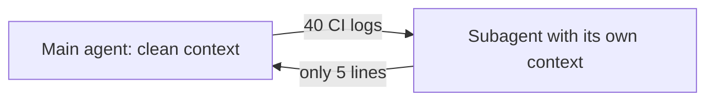

# Keep noisy work apart

Each example triages forty CI build logs for the Bug Triage bot. A helper reads all the logs in its own context, and sends back a short report. Choose how the model acts with --model.

## The story in one picture



## The problem

Forty logs hold pages of quiet lines. If the main agent reads them all, its context is full of junk. The real failures are hard to find.

## New words

Each word has one meaning in every lab.

- **helper**: A second agent with its own context, used for noisy work.
- **context**: Everything an agent has read so far, which it keeps in its window.
- **report**: The short answer a helper sends back.

## Run it

Copy any line into your terminal. Each one is a real example from this lab.

```bash
bun run lab subagent-isolation --question "Triage this week's CI logs." --naive
bun run lab subagent-isolation --question "Which builds failed this week, and why?"
bun run lab subagent-isolation --question "Why did the coupon test break?"
bun run lab subagent-isolation --question "Did anything time out overnight?"
bun run lab subagent-isolation --question "Which builds failed for Acme?" --model invent
bun run lab subagent-isolation --question "Which builds failed before the launch?" --model stuck
bun run lab subagent-isolation --demo
```

Run `bun run lab subagent-isolation` with nothing else to pick an example from a menu.

## The cases

Case 1 is the naive way. Read what goes wrong, then read the rest.

| # | Case | Why it matters | Result | Run it alone |
| --- | --- | --- | --- | --- |
| 1 | NAIVE: the main agent reads everything | The main agent reads all forty logs by itself. Its space fills with quiet lines. | flooded | `bun run lab subagent-isolation --question "Triage this week's CI logs." --naive` |
| 2 | A helper reads the logs | The helper reads the forty logs. The main agent keeps three short lines. | clean | `bun run lab subagent-isolation --question "Which builds failed this week, and why?"` |
| 3 | A question about one test | The report names the coupon test in build-2 and build-3. It stays three short lines. | clean | `bun run lab subagent-isolation --question "Why did the coupon test break?"` |
| 4 | A question about time outs | The helper finds one build that timed out. The main agent keeps the same short report. | clean | `bun run lab subagent-isolation --question "Did anything time out overnight?"` |
| 5 | EDGE: the helper makes up a build | The helper lists a build that is not in the logs. The main agent checks the report and refuses it. | no-answer | `bun run lab subagent-isolation --question "Which builds failed for Acme?" --model invent` |
| 6 | EDGE: the helper gets stuck | The helper never finishes. The main agent gets a short failure note, not the helper's whole log. | no-answer | `bun run lab subagent-isolation --question "Which builds failed before the launch?" --model stuck` |

## Stuck points

**Correct run:** The helper reads the forty logs. The main agent keeps only the short report, then checks it.

**Common wrong turn:** Letting the main agent read every log. Its context fills with quiet lines, and it may trust a made-up failure.

**Hint to give:** Which lines does the main agent really need to answer?

| What you see | What it means | Fix |
| --- | --- | --- |
| The demo prints outcome: flooded on the NAIVE case | The main agent read all forty logs | Hand the logs to a helper |
| The report is cut to the limit | The helper wrote more than the limit | This is correct. Read the report, not the log |
| A made-up build is refused | The check found a build that has no failure in the logs | This is correct. The check did its job |

## The promise, and its test

The helper reads the logs, and the main agent keeps only a short report. It checks every line of the report against the real logs before it answers.

```bash
bun test tests/promises/32.test.ts
```

To see the test do its job, break the rule in PART 1 on purpose. The test must fail. Then undo it.

## In production

Give the helper its own model call and its own tools. Cap the size of the report. Log how much the helper read, so you can see a helper that reads too much.

## Read the code

Open `labs/32-subagent-isolation.ts`. Read the code from the top. It holds only the lesson.
The screen output is in `show/`. You do not need it to learn.
