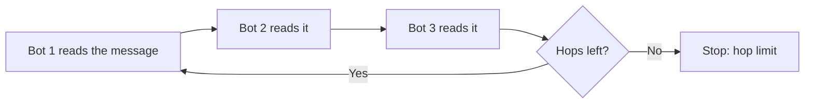

# Handing work between bots

Each example sends one message through a team of bots: intake, answer and outreach. Each handoff passes it to the next bot in an envelope. Pick the doctor with --hcp, and change the hop limit with --limit.

## The story in one picture



## The problem

Two bots can each think the other should do the work. The message goes back and forth, and no doctor gets a reply.

## New words

Each word has one meaning in every lab.

- **handoff**: One bot passes the work to another bot.
- **envelope**: The wrapper around a message. It counts the hops and lists the bots it passed.
- **hop**: One step where work passes from one bot or agent to another.
- **loop breaker**: A rule that stops a message that keeps going round in circles.

## Run it

Copy any line into your terminal. Each one is a real example from this lab.

```bash
bun run lab handoffs --question "Please email Dr. Lee the dose of Cardioza." --hcp dr-lee --naive
bun run lab handoffs --question "What is the dose of Cardioza for Dr. Lee?" --hcp dr-lee
bun run lab handoffs --demo
bun run lab handoffs --question "Please email Dr. Lee the dose of Cardioza." --hcp dr-lee
bun run lab handoffs --question "Please call me back about my last invoice." --hcp dr-lee
bun run lab handoffs --question "What is the dose of Cardioza for Dr. Lee?" --hcp dr-lee --limit 0
bun run lab handoffs --demo
```

Run `bun run lab handoffs` with nothing else to pick an example from a menu.

## The cases

Case 1 is the naive way. Read what goes wrong, then read the rest.

| # | Case | Why it matters | Result | Run it alone |
| --- | --- | --- | --- | --- |
| 1 | NAIVE: no envelope, no count | The outreach bot and the answer bot pass the message back and forth until we cut it off. | looped | `bun run lab handoffs --question "Please email Dr. Lee the dose of Cardioza." --hcp dr-lee --naive` |
| 2 | A dose goes to the answer bot | Intake sends it to the answer bot, which gives the dose. | delivered | `bun run lab handoffs --question "What is the dose of Cardioza for Dr. Lee?" --hcp dr-lee` |
| 3 | An email goes to the outreach bot | Intake sends it to the outreach bot, which writes the email. | delivered | `bun run lab handoffs --demo` |
| 4 | EDGE: two bots send it back and forth | The envelope sees the outreach bot a second time and stops. A person gets the path. | stopped | `bun run lab handoffs --question "Please email Dr. Lee the dose of Cardioza." --hcp dr-lee` |
| 5 | EDGE: a message that fits no bot | The intake bot has no bot for an invoice, so a person gets it at once. | human | `bun run lab handoffs --question "Please call me back about my last invoice." --hcp dr-lee` |
| 6 | EDGE: the hop limit is tiny | The limit is zero hops. Even the first handoff is refused, though nothing is wrong. | stopped | `bun run lab handoffs --question "What is the dose of Cardioza for Dr. Lee?" --hcp dr-lee --limit 0` |

## Stuck points

**Correct run:** Put each message in an envelope, and stop it at the hop limit or a repeat. Then send it to a person.

**Common wrong turn:** Passing messages with no count. The bots send the message back and forth for ever.

**Hint to give:** How would a bot know it has seen this message before?

| What you see | What it means | Fix |
| --- | --- | --- |
| The demo prints outcome: looped on the NAIVE case | No envelope, so no count or path | Add an envelope with a hop count and a path |
| The message is stopped at the limit | The hop limit was reached | Read the path, then fix the loop |
| A bot is met twice | The loop breaker fired | This is correct. A person gets the list of bots |

## The promise, and its test

Every message travels in an envelope. It stops at the hop limit, or when it meets a bot twice. Then a person gets it, with the list of bots it met.

```bash
bun test tests/promises/33.test.ts
```

To see the test do its job, break the rule in PART 1 on purpose. The test must fail. Then undo it.

## In production

Put the envelope on a queue, with its id, hop count and path. A loop breaker alerts a person when a message is stopped. Keep the limit small.

## Read the code

Open `labs/33-handoffs.ts`. Read the code from the top. It holds only the lesson.
The screen output is in `show/`. You do not need it to learn.
