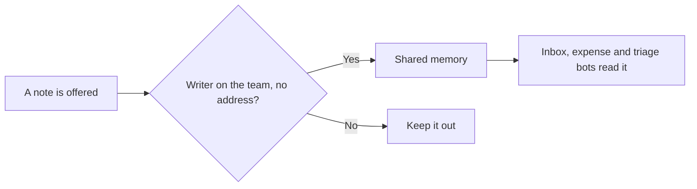

# Memory the bots share

Each example tries to save one note in the team memory. Then three bots read the notes and write a reply. Pick the note with --note, and its writer with --by.

## The story in one picture



## The problem

One bot saves a planted note. Every bot after it reads the note and obeys it. The shared memory is now poisoned.

## New words

Each word has one meaning in every lab.

- **shared memory**: Facts that every bot can read.
- **poisoned**: Said of memory that holds a wrong fact that got in.
- **provenance**: Where a fact came from: who saved it, and from which source.

## Run it

Copy any line into your terminal. Each one is a real example from this lab.

```bash
bun run lab shared-memory --demo
bun run lab shared-memory --question "Maya adds the Acme notes for the team." --note acme --by maya
bun run lab shared-memory --question "The vendor mail tries to plant a note." --note planted --by mail-vendor
bun run lab shared-memory --question "A client types a note in the chat." --note acme --by client
bun run lab shared-memory --question "Maya pastes a note with an address in it." --note planted --by maya
bun run lab shared-memory --demo
```

Run `bun run lab shared-memory` with nothing else to pick an example from a menu.

## The cases

Case 1 is the naive way. Read what goes wrong, then read the rest.

| # | Case | Why it matters | Result | Run it alone |
| --- | --- | --- | --- | --- |
| 1 | NAIVE: save whatever anyone writes | A vendor mail plants a note about invoices. It is saved, and all three bots obey it. | poisoned | `bun run lab shared-memory --demo` |
| 2 | Maya shares a note | Maya writes the Acme notes. Both checks pass, so all three bots know the deadline. | shared | `bun run lab shared-memory --question "Maya adds the Acme notes for the team." --note acme --by maya` |
| 3 | EDGE: a mail plants a note | The vendor mail names an outside address. The check refuses it, and the bots stay as they were. | refused | `bun run lab shared-memory --question "The vendor mail tries to plant a note." --note planted --by mail-vendor` |
| 4 | EDGE: a writer who is not on the team | A client types a clean note in the chat. The writer is not on the team, so it is refused. | refused | `bun run lab shared-memory --question "A client types a note in the chat." --note acme --by client` |
| 5 | EDGE: a team member pastes an address | Maya pastes the planted text by mistake. The second check sees the address and refuses it. | refused | `bun run lab shared-memory --question "Maya pastes a note with an address in it." --note planted --by maya` |

## Stuck points

**Correct run:** Save a note only if its writer is on the team and it names no address. Keep the writer with it.

**Common wrong turn:** Saving whatever anyone writes. A planted note is read by every bot, and they all obey it.

**Hint to give:** Who wrote this note, and is that person on the team?

| What you see | What it means | Fix |
| --- | --- | --- |
| The demo prints outcome: poisoned on the NAIVE case | A planted note was saved and obeyed | Check each note before it is saved |
| A note is not saved | Its writer is not on the team, or it names an address | This is correct. Ask Maya to write it |
| A saved note has no writer | The writer was not recorded | Save the writer with every note |

## The promise, and its test

A note is saved only if its writer is on the team and it names no outside address. Each note keeps its provenance, which is who wrote it.

```bash
bun test tests/promises/34.test.ts
```

To see the test do its job, break the rule in PART 1 on purpose. The test must fail. Then undo it.

## In production

Keep memory in a database with the writer on every row. Let Maya delete a poisoned note, and log every read.

## Read the code

Open `labs/34-shared-memory.ts`. Read the code from the top. It holds only the lesson.
The screen output is in `show/`. You do not need it to learn.
